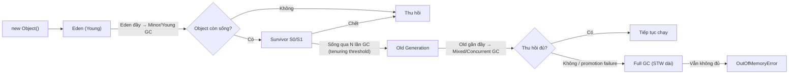

# JVM Performance Notes: G1, ZGC, GC Metrics

## 1. Khái niệm cơ bản

| Khái niệm | Giải thích |
| --- | --- |
| **Heap** | Vùng nhớ dùng chung cho mọi thread, nơi phần lớn object Java được cấp phát (`new`). Do GC quản lý. Chia thành Young (Eden + Survivor) và Old generation. |
| **Stack** | Mỗi thread có một stack riêng, chứa stack frame của từng method call: biến local, primitive, reference tới object trên heap. Tự giải phóng khi method return, GC không quản lý. Lỗi điển hình: `StackOverflowError`. |
| **Metaspace** | Lưu class metadata (native memory, ngoài heap). Leak thường do classloader (redeploy, dynamic proxy). |
| **Native memory** | Bộ nhớ ngoài heap: thread stack, direct `ByteBuffer`, JIT code cache, GC structures. |
| **GC pause (Stop-the-world)** | Khoảng thời gian JVM dừng một phần/toàn bộ application thread để GC đánh dấu/di chuyển/thu hồi object. Pause dài → request bị treo → latency (p99) tăng. |
| **Allocation rate** | Tốc độ application tạo object mới (MB/s). Allocation rate cao → Eden đầy nhanh → Young GC thường xuyên hơn, nhiều object bị promote lên Old sớm (premature promotion). |
| **Memory leak** | Object không còn cần nhưng vẫn bị reference (static map, cache không giới hạn, listener chưa remove, ThreadLocal) → GC không thu hồi được → **heap after GC tăng dần**. |

> Heap cao **không** đồng nghĩa với "GC chậm" hay leak. Chỉ số đáng tin là **heap after GC** (live set) theo thời gian.

## 2. Sơ đồ Heap / GC flow

Heap saw-tooth bình thường: tăng dần do allocation → giảm khi GC. **Đáy răng cưa tăng dần** mới là dấu hiệu leak/live set tăng.

## 3. So sánh G1 và ZGC

| Tiêu chí | G1 GC | ZGC |
| --- | --- | --- |
| **Mục tiêu** | Cân bằng throughput và pause-time goal (`-XX:MaxGCPauseMillis`, mặc định 200ms). Default từ Java 9. | Pause cực thấp (thường < 1ms, gần như không phụ thuộc kích thước heap). Generational từ Java 21. |
| **Cơ chế** | Heap chia region; Young GC STW, marking concurrent, Mixed GC dọn region nhiều rác trước. Compaction có STW. | Hầu hết công việc (mark, relocate, compact) chạy concurrent nhờ colored pointers + load barriers. |
| **Trade-off** | Throughput tốt, overhead thấp; pause vẫn tỷ lệ với live set/region cần evacuate; Full GC khi không kịp thu hồi. | Tốn thêm CPU cho GC thread & barriers, cần heap headroom lớn hơn; nếu allocation nhanh hơn GC → *allocation stall*. Throughput có thể thấp hơn. |
| **Phù hợp** | Đa số service, heap vừa–lớn, chấp nhận pause vài chục–trăm ms. | Latency-sensitive (p99/p999 chặt), heap rất lớn, còn dư CPU. |

### Khi nào cần benchmark thay vì đoán
- Khi có SLA latency chặt (p99/p999) và muốn đổi collector hoặc tuning flag.
- Khi workload đặc thù: allocation rate cao, live set lớn, nhiều object sống trung bình.
- Khi môi trường giới hạn: container ít CPU/RAM (ZGC cần CPU & headroom).
- Khi nâng version JDK (hành vi GC thay đổi giữa các bản).

→ Benchmark với **tải thực tế** (load test giống production), so sánh: p99 latency, throughput, CPU, pause time, allocation stall. Kết quả lý thuyết/blog không thay thế được dữ liệu từ chính workload của mình.

## 4. Phân tích tình huống

> Payroll API có p99 tăng từ 400ms lên 8 giây. Application CPU chỉ 45%. Heap usage saw-tooth liên tục. Full GC xuất hiện nhiều lần trong giờ cao điểm.

### Hypothesis ban đầu (chưa kết luận)
1. **Live set lớn / memory leak**: Old gen không được dọn sạch → Full GC lặp lại, mỗi lần STW vài giây → p99 tăng vọt.
2. **Allocation pressure giờ cao điểm**: tạo nhiều object lớn (load cả danh sách payroll, build report, JSON lớn) → premature promotion → Old đầy nhanh → Full GC.
3. **Heap quá nhỏ / cấu hình GC chưa phù hợp** so với tải peak (humongous object trong G1, thiếu headroom).
4. **Không phải GC (hoặc không chỉ GC)**: CPU 45% gợi ý request có thể đang *chờ* — thread pool exhaustion, DB connection pool cạn, lock contention, downstream chậm. Full GC có thể chỉ là triệu chứng đi kèm.

### Metric / log cần xem thêm
- **GC log** (`-Xlog:gc*`): pause time từng lần, nguyên nhân Full GC (Allocation Failure, Humongous, Metadata, `System.gc()`), tần suất.
- **Heap after GC** theo thời gian: đáy saw-tooth có tăng dần không → leak hay chỉ là peak tải.
- **Allocation rate & promotion rate** trong giờ cao điểm so với giờ thường.
- **Tương quan thời gian**: thời điểm Full GC có trùng với spike p99 không.
- **Heap dump / histogram** (`jcmd GC.heap_info`, `jmap -histo`, Eclipse MAT): object nào chiếm nhiều nhất, ai giữ reference.
- **Thread dump** (`jstack`, `jcmd Thread.print`): thread BLOCKED/WAITING, pool đã full chưa.
- **Thread pool & connection pool metrics**: active, queue size, wait time (Hikari).
- **Downstream latency**: DB query time, external API.
- **CPU breakdown**: GC thread vs application thread; container CPU throttling.
- **Metaspace / native memory** (`NMT`) nếu Full GC do Metadata.

### Nguyên tắc
- **Không kết luận chỉ từ một biểu đồ**: saw-tooth là bình thường; heap cao không có nghĩa GC chậm. Phải đối chiếu GC log + latency + thread metrics.
- Xác nhận hypothesis bằng evidence, sửa một thứ, đo lại.

## 5. Bảng Symptom → Possible cause → Evidence cần kiểm tra

| Symptom | Possible cause | Evidence cần kiểm tra |
| --- | --- | --- |
| p99 tăng đột biến, trùng thời điểm GC | GC pause dài (Full GC, evacuation lớn) | GC log: pause time, cause; tương quan timestamp pause ↔ latency |
| Heap after GC tăng dần theo thời gian | Memory leak | Đáy saw-tooth tăng; heap dump so sánh 2 thời điểm; dominator tree / GC roots |
| Young GC rất thường xuyên, Old đầy nhanh | Allocation pressure, premature promotion | Allocation rate, promotion rate, survivor overflow; allocation profiling (JFR, async-profiler) |
| Full GC lặp lại nhưng thu hồi được ít | Live set gần bằng heap / heap quá nhỏ | Heap after Full GC so với max heap; `OutOfMemoryError` sắp xảy ra |
| Latency cao, CPU thấp, GC bình thường | Thread pool / connection pool exhaustion, lock contention, downstream chậm | Thread dump (BLOCKED/WAITING), pool active/queue, DB/HTTP latency |
| CPU ~100%, latency tăng | CPU saturation (code nóng, GC thread chiếm CPU, throttling) | CPU profiler, % CPU của GC thread, container throttling metric |
| ZGC: latency spike dù pause thấp | Allocation stall (GC không theo kịp) | GC log "Allocation Stall", headroom heap, số GC thread |
| Full GC với cause "Metadata GC Threshold" | Metaspace leak (classloader) | Metaspace usage, số class loaded, `jcmd VM.classloader_stats` |
| RSS process > Xmx nhiều, bị OOMKilled | Native memory (direct buffer, thread stack) | Native Memory Tracking (`-XX:NativeMemoryTracking`), số thread |

## 6. Checklist

- [x] Phân biệt heap issue (GC log, heap after GC) và thread issue (thread dump, pool metrics).
- [x] Không kết luận "GC chậm" chỉ vì heap cao.
- [x] Cần đo: pause time, allocation rate, heap after GC.
- [x] Benchmark thực tế quan trọng khi chọn GC vì kết quả phụ thuộc workload, heap, CPU và môi trường.

