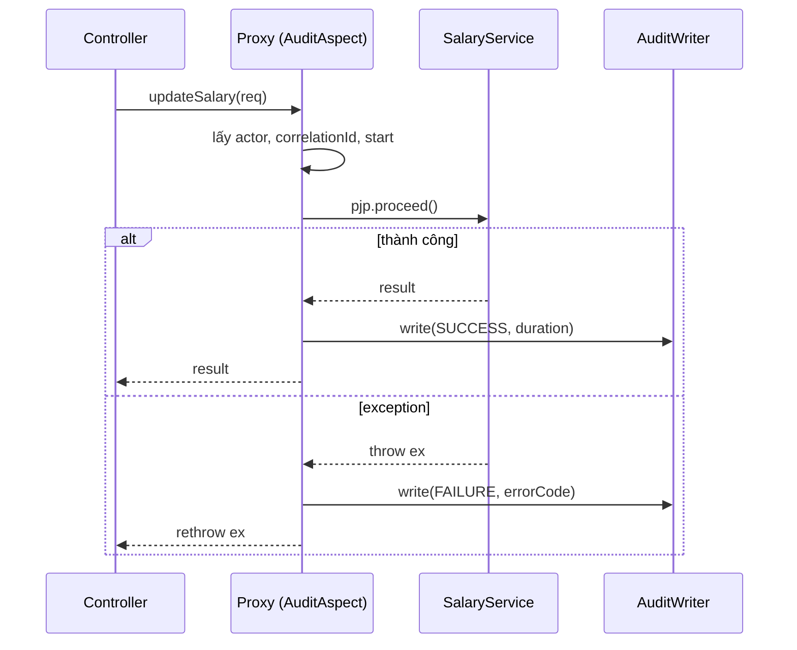
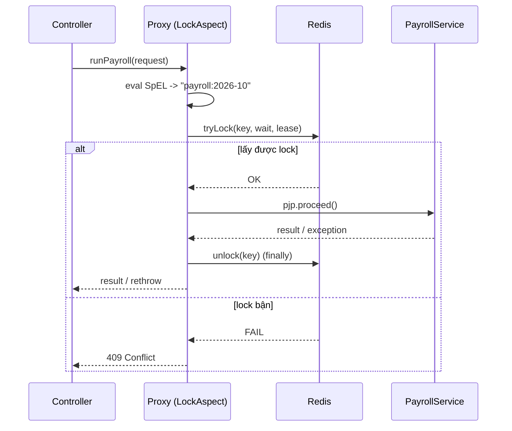

# 03 - Spring AOP Design: `@AuditAction` & `@DistributedLock`

## 1. Khái niệm
- **Aspect**: module chứa cross-cutting concern (vd `AuditAspect`, `LockAspect`).
- **Join point**: điểm chèn logic — trong Spring AOP chỉ là *method execution* (qua proxy).
- **Pointcut**: biểu thức chọn join point, vd `@annotation(auditAction)`.
- **Advice**: code chạy tại join point (`@Before`, `@AfterReturning`, `@AfterThrowing`, `@Around`).
- `@Around` **phải gọi `pjp.proceed()`** thì method gốc mới chạy; không gọi = method bị "nuốt".

## 2. `@AuditAction(action = "UPDATE_SALARY")`
- **Pointcut**: `@annotation(auditAction)` trên public method của Spring bean tầng service/use case.
- **`@Around` làm gì**: lấy actor (SecurityContext), correlationId (MDC), ghi `startTime` → `proceed()` → ghi audit SUCCESS / FAILURE kèm duration.
- **Field audit**: `action, actor, actorRole, correlationId, targetType, targetId, status (SUCCESS|FAILURE), errorCode, errorMessage (đã rút gọn), durationMs, timestamp, clientIp`. **Không** log password, token, full payload nhạy cảm.
- **Khi exception**: ghi `status=FAILURE`, `errorCode` = class exception, message đã mask → **rethrow** exception (không nuốt).
- Ghi audit bất đồng bộ hoặc `REQUIRES_NEW` để audit FAILURE không bị rollback cùng transaction nghiệp vụ.

## 3. `@DistributedLock(key = "'payroll:' + #request.month", waitTime=0, leaseTime=30s)`
- **Pointcut**: `@annotation(distributedLock)` trên method service cần chạy độc quyền (vd chạy payroll theo tháng).
- **Lock key**: parse SpEL với `MethodBasedEvaluationContext` (tham số method) → `lock:payroll:2026-10`. Prefix theo domain, tránh key chứa PII.
- **`@Around` làm gì**: `tryLock(waitTime, leaseTime)` (Redisson/Redis `SET NX PX`) → `proceed()` → `finally unlock()` (chỉ unlock nếu còn là owner).
- **Không lấy được lock**: ném `LockNotAcquiredException` → API trả **409 Conflict** (hoặc 423 Locked) + message "Payroll tháng X đang được xử lý, thử lại sau".
- **Thứ tự**: lock aspect phải bọc **ngoài** `@Transactional` (`@Order` nhỏ hơn) để unlock sau khi commit.
- **Timeout**: `leaseTime` > thời gian chạy dự kiến hoặc dùng watchdog; log + metric `lock.acquire.fail`, `lock.hold.duration`.

## 4. Rủi ro khi lạm dụng AOP
1. **Ẩn business rule** (lương/thuế) trong aspect → khó đọc, khó test, khó review.
2. **Self-invocation**: gọi `this.method()` bỏ qua proxy → annotation không chạy.
3. Chỉ áp dụng cho **public method của Spring bean**; `final`/`private` không bị proxy.
4. **Thứ tự aspect** sai (lock vs transaction vs audit) → race condition, audit sai.
5. `@Around` quên `proceed()` hoặc **nuốt exception** → lỗi im lặng.
6. Pointcut quá rộng (`execution(* *..*(..))`) → overhead, log rác, lộ dữ liệu nhạy cảm.
7. Debug/stack trace khó vì logic "vô hình"; cần observability (log, metric, trace).
8. Lock không có timeout → deadlock/treo tài nguyên.

> Nguyên tắc: dùng advice yếu nhất đủ dùng; aspect chỉ cho cross-cutting concern, business flow phải explicit trong use case.

