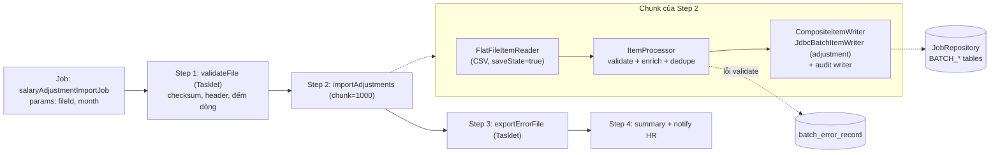
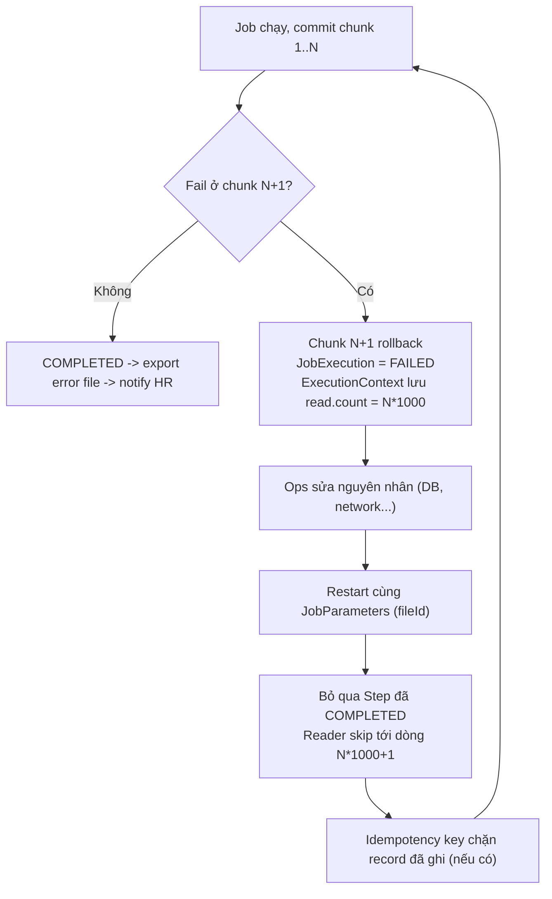

# 06 - Spring Batch Design: Import 3M Salary Adjustments

## 1. Online API vs Batch
| | Online API | Batch |
|---|---|---|
| Khối lượng | 1 / ít record mỗi request | Hàng triệu record |
| Latency | ms, user chờ | phút–giờ, chạy nền |
| Lỗi | Fail cả request | Skip record lỗi, tiếp tục |
| Phục hồi | Client retry | Restart từ checkpoint (JobRepository) |

## 2. Sơ đồ Job → Step → Reader → Processor → Writer

- **Reader**: `FlatFileItemReader` đọc streaming `employee_id, effective_date, adjustment_type, amount`; lưu `read.count` vào ExecutionContext để restart.
- **Processor**: validate (employee tồn tại & active, ngày hợp lệ, type ∈ enum, amount trong ngưỡng) → lỗi nghiệp vụ ném `ValidationException` (skippable); tính `idempotency_key`.
- **Writer**: `JdbcBatchItemWriter` insert `salary_adjustment` + insert audit (cùng transaction chunk).
- **Error file**: `SkipListener` ghi record lỗi (line_no, raw, error_code, message) vào `batch_error_record`; Step 3 xuất `errors_<fileId>.csv` cho HR.

## 3. Chunk size đề xuất: **1000**
- Mỗi chunk = 1 transaction: đọc 1000 → xử lý → write batch → commit + cập nhật JobRepository.
- Nhỏ quá (10–50): commit nhiều, overhead JobRepository → throughput thấp (3M/50 = 60k commit).
- Lớn quá (50k): transaction dài, lock/undo log lớn, tốn memory, 1 lỗi write → rollback & scan lại cả chunk lâu.
- 1000 → 3.000 commit, memory vài MB, rollback nhỏ. Tinh chỉnh 500–5000 qua load test; cấu hình JDBC `rewriteBatchedStatements`/batch size = chunk size.
- Lookup employee: cache/prefetch theo chunk (`IN (...)`) tránh N+1 query.

## 4. Skip / Retry policy
| Loại lỗi | Policy |
|---|---|
| `ValidationException`, `FlatFileParseException` (dữ liệu sai) | **Skip**, ghi error file |
| `DuplicateAdjustmentException` / `DuplicateKeyException` | **Skip** (đã apply), ghi error code `DUPLICATE` |
| `TransientDataAccessException`, deadlock, lock timeout | **Retry** 3 lần, backoff 1s→2s→4s |
| Lỗi hệ thống (DB down, OOM, file mất) | **Không skip** → fail job, restart sau |
- `skipLimit` = 1% (30.000) hoặc ngưỡng tuyệt đối; vượt → fail job để HR kiểm tra file thay vì import file rác.
- Khi skip trong writer, Spring Batch scan lại từng item của chunk để cô lập item lỗi.

## 5. Idempotency strategy
- `idempotency_key = hash(employee_id, effective_date, adjustment_type, amount)` (hoặc kèm `source_file_id` + `line_no` nếu nghiệp vụ cho phép dòng trùng nội dung).
- **Unique constraint** DB: `UNIQUE (employee_id, effective_date, adjustment_type)` hoặc `UNIQUE(idempotency_key)`.
- Writer dùng `INSERT ... ON CONFLICT DO NOTHING` (Postgres) / `INSERT IGNORE` → rerun/restart không apply trùng; đếm số dòng bị bỏ qua để báo cáo.
- Chống upload trùng file: `uploaded_file(checksum UNIQUE)`; JobParameters `fileId` (identifying) → cùng file không tạo JobInstance mới khi đã COMPLETED.
- Trùng trong cùng file: processor kiểm tra key ở chunk hiện tại; DB constraint là chốt chặn cuối.

## 6. Audit
- Mỗi adjustment ghi `salary_adjustment_audit(adjustment_id, employee_id, old_salary, new_salary, job_execution_id, file_id, line_no, actor=uploaded_by, created_at)`.
- Mức job: `job_execution_id`, người upload, tổng read/write/skip, thời gian → bảng summary.
- Không dùng Envers per-row cho 3M dòng nếu quá tốn; audit theo JDBC batch insert cùng chunk.

## 7. Restart / Recovery flow

- JobRepository (BATCH_JOB_EXECUTION, BATCH_STEP_EXECUTION, *_CONTEXT) lưu trạng thái & checkpoint mỗi commit.
- Reader `saveState=true`, không dùng multi-thread step cho reader không thread-safe (nếu cần song song → **partitioning** theo range dòng/employee_id, mỗi partition có state riêng).
- `allowStartIfComplete=false` cho step import; step export error có thể chạy lại.
- Job bị kill (STARTED treo) → đánh dấu FAILED thủ công rồi restart.

## 8. Checklist
- [x] Chunk size ảnh hưởng transaction/memory/throughput.
- [x] Unique constraint + idempotency key.
- [x] Error file cho HR.
- [x] Restart từ checkpoint sau failure.

