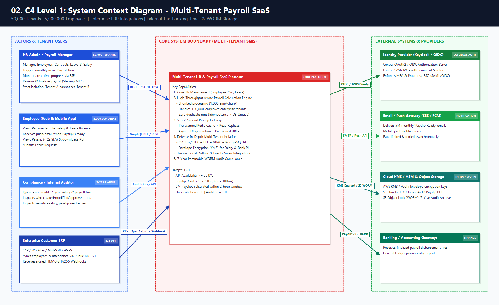
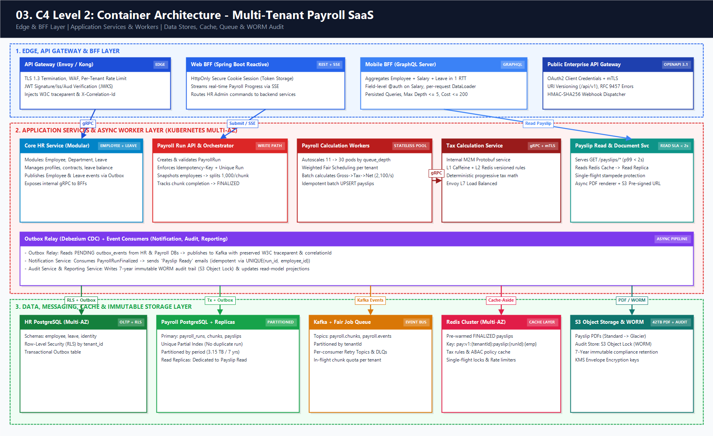
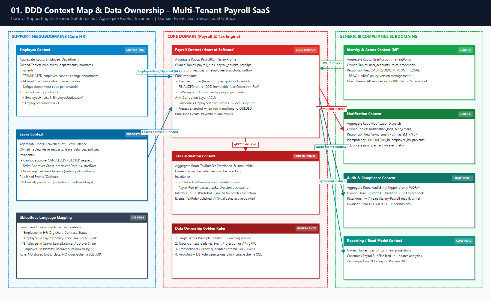
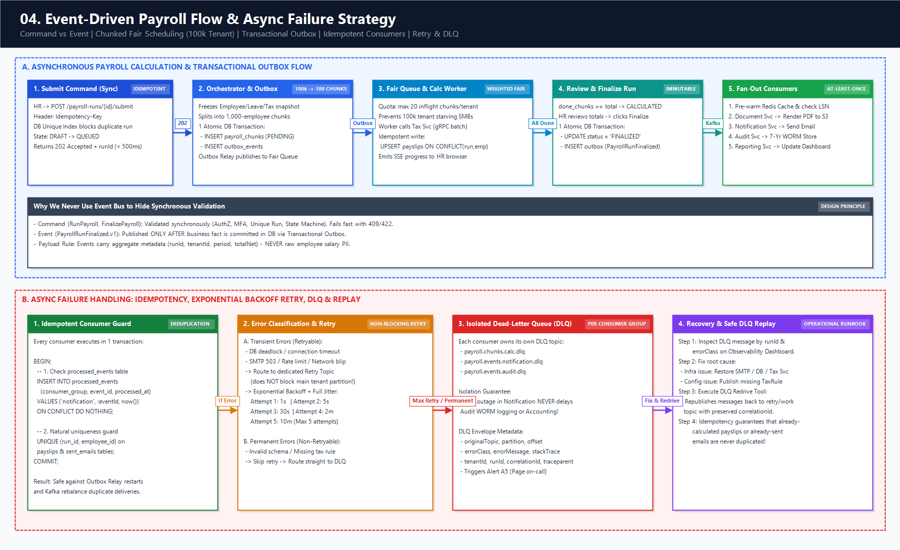
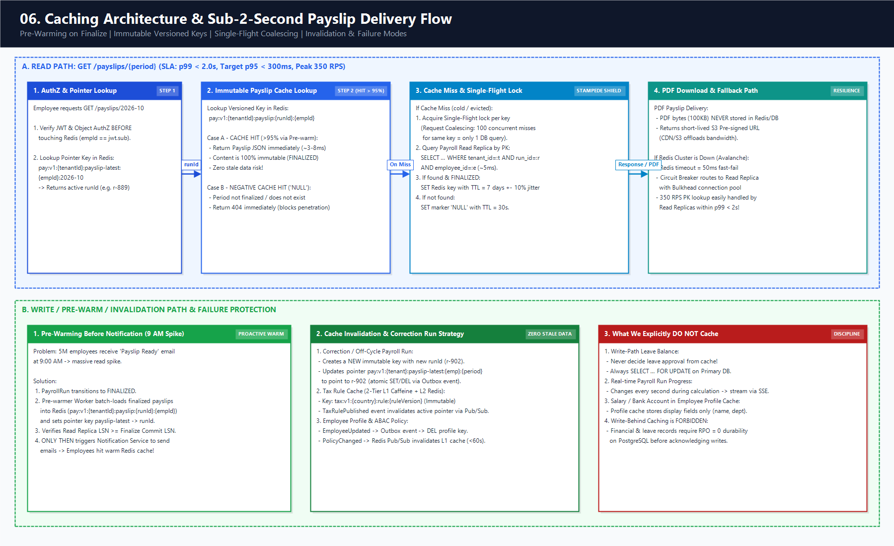
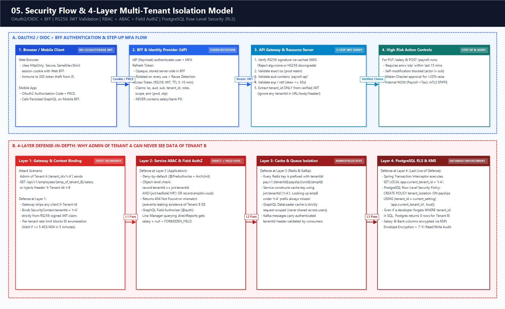
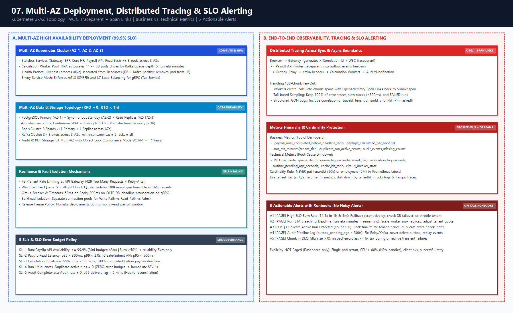
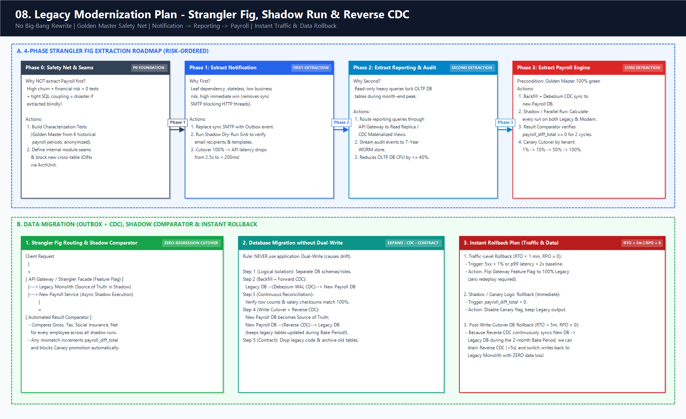

# Capstone Architecture — Multi-Tenant Payroll SaaS

> Tài liệu tổng hợp thiết kế kiến trúc đầu-cuối cho hệ thống **HR & Payroll SaaS đa tenant** (50,000 tenants · 5,000,000 employees), kết nối toàn bộ quyết định từ bài [01](01-architecture-tradeoff.md) đến [09](09-modernization-plan.md). Mọi lựa chọn công nghệ đều xuất phát từ **business requirement → NFR → ước lượng tải → failure mode → trade-off**.

---

## 1. Business Requirements, NFR & Capacity Estimation

### 1.1. Business Requirements (Functional)

| Mã | Yêu cầu nghiệp vụ | Thiết kế đáp ứng cốt lõi |
| --- | --- | --- |
| **BR-1** | Quy mô **50,000 tenants**, **5,000,000 employees** (Enterprise tới **100,000 employees/tenant**) | Multi-tenant shared infrastructure + **Fair-share chunk scheduling** (1,000 emp/chunk) chống noisy neighbor |
| **BR-2** | HR quản lý **Employee, Leave, Salary** | Tách Bounded Context độc lập (`Employee`, `Leave`, `Payroll`) với Data Ownership & DB schema riêng |
| **BR-3** | **Payroll chạy hàng tháng**, tính toán **bất đồng bộ (async)** | `POST /payroll-runs/{id}/submit` trả `202 Accepted`; Orchestrator chia chunk đẩy qua Job Queue + Worker pool; tiến độ phát qua **SSE** |
| **BR-4** | **Không được duplicate payroll run** | Chặn 2 lớp: `Idempotency-Key` tại API + **DB Unique Partial Index** `(tenant_id, pay_group_id, period) WHERE status <> 'CANCELLED'` |
| **BR-5** | **Payslip xem được trong < 2 giây** | Tách hẳn Read Path: **Redis Cache-aside (pre-warmed)** + **Read Replica** + Pre-signed URL cho PDF trên Object Storage |
| **BR-6** | **Notification** gửi sau khi payslip sẵn sàng | Phát sự kiện `PayrollRunFinalized` qua **Transactional Outbox** (chỉ sau khi run `FINALIZED` & replica bắt kịp) → Notification Service |
| **BR-7** | **Audit salary/payroll giữ 7 năm** | Outbox → Audit Service → **Append-only WORM Store** (PostgreSQL partitioned + S3 Object Lock Compliance mode) |
| **BR-8** | **Admin của tenant A không được xem data tenant B** | Cô lập 4 lớp: `tenant_id` từ JWT đã ký → ABAC/Object AuthZ ở Service → Cache key prefix `{tenantId}` → **PostgreSQL RLS (Row-Level Security)** |

### 1.2. Non-Functional Requirements (NFR) & SLOs

| Thuộc tính | Chỉ tiêu (SLO / Target) | Cơ chế bảo chứng |
| --- | --- | --- |
| **Payslip Read Latency** | **p99 < 2s** (mục tiêu nội bộ **p95 < 300ms**) | Đọc kết quả đã tính sẵn từ Redis (key bất biến theo `runId`) + Read Replica; single-flight chống stampede |
| **Payroll Throughput** | **10,000 runs (5M employees) hoàn tất < 2 giờ** cuối tháng (99% run < 30 phút) | Chia chunk 1,000 nhân viên; autoscale stateless Calculation Workers theo `queue_depth` (~2,100 payslips/s peak) |
| **Availability** | **≥ 99.9%** cho API (Error budget: 43 phút/30 ngày) | Stateless pods trải ≥ 3 AZ, PostgreSQL Multi-AZ auto-failover, Redis Cluster, Circuit Breaker & Bulkhead |
| **Financial Correctness** | **Duplicate run = 0**, mất/lặp payslip = **0** (RPO ≈ 0, RTO < 1h) | Unique constraint ở DB, `UPSERT` payslip theo `(run_id, employee_id)`, Outbox cùng transaction, không dùng Write-behind cache |
| **Audit Durability** | **Audit loss = 0**, retention **≥ 7 năm** bất biến | Transactional Outbox + đối soát hằng giờ + lưu trữ WORM (Write-Once-Read-Many) tách khỏi DB OLTP |
| **Tenant Isolation** | **0 cross-tenant leak**; 1 tenant 100k không làm nghẽn 49,999 tenant nhỏ | RLS bắt buộc ở DB + Weighted Fair Queue / In-flight chunk quota per tenant + Rate limit theo `tenant_id` tại Gateway |

### 1.3. Tóm tắt Capacity Estimation (Chi tiết tại [04-system-design-process.md](04-system-design-process.md))

- **Workload tính lương (Write Burst cuối tháng)**: 5M employees trong 2h (7,200s) → trung bình **~700 payslips/s**, peak 3× = **~2,100 payslips/s**. Với ~20ms/payslip (CPU + batch IO), cần ~42 threads thực tế → cấu hình **~84 worker threads (~11 pods × 8 cores)** với khả năng autoscale lên 30 pods. Batch `UPSERT` 500 dòng/lần → ~5 batch/s vào Primary DB.
- **Enterprise Tenant (100,000 employees)**: Chia thành **100 chunks** (1,000 emp/chunk). Mỗi chunk xử lý ~20s → nếu cấp quota tối đa 20 chunks chạy song song cho 1 tenant, toàn bộ 100k nhân viên hoàn tất trong **~1.5–2 phút** mà vẫn dành >75% năng lực worker cho các tenant khác.
- **Workload xem Payslip (Read Spike sau thông báo)**: 5M × 3 lượt xem, 60% dồn vào 3 ngày đầu (8h/ngày) → avg **~35 RPS**, peak 10× lúc 9h sáng sau khi bắn email = **~350 RPS**.
- **Dung lượng lưu trữ 7 năm**:
  - **Payslip JSON (DB)**: 5M × 5KB × 12 tháng × 7 năm (+50% index) ≈ **3.15 TB** (partition theo `period`, chuyển bảng > 24 tháng sang cold tablespace/archive).
  - **Payslip PDF (Object Storage)**: 5M × 100KB × 12 × 7 năm ≈ **42 TB** (S3 Standard 90 ngày đầu → lifecycle sang S3 Glacier Instant Retrieval).
  - **Audit Log (WORM)**: 5M × 10 events × 1KB × 12 × 7 năm ≈ **4.2 TB**.

---

## 2. Kiến trúc Tổng thể: System Context & Container (C4 Model)

### 2.1. Lựa chọn Kiến trúc: Modular Monolith tiến hóa sang Selective Microservices ([01-architecture-tradeoff.md](01-architecture-tradeoff.md))

Không tách vụn thành hàng chục microservices ngay từ đầu mà phân tách theo **nhu cầu scale, tần suất thay đổi và ranh giới dữ liệu**:
1. **Payroll Service (+ Calculation Workers & Tax Engine)**: Tách riêng vì là **Core Domain**, thay đổi luật thuế/công thức liên tục và chịu tải burst 2,100 payslips/s cuối tháng.
2. **Notification Service**: Tách riêng vì là **Generic Subdomain** thuần I/O bất đồng bộ, cần autoscale theo lượng email/push (5M thông báo sau kỳ lương) mà không giữ tài nguyên của hệ thống lõi.
3. **Audit Service & Reporting Service**: Tách riêng để cô lập yêu cầu lưu trữ WORM 7 năm và các truy vấn OLAP nặng khỏi OLTP DB.
4. **Core HR Service (`Employee` + `Leave` modules)**: Giữ trong một **Modular Monolith** (hoặc 2 service có schema tách biệt) vì gắn kết nghiệp vụ chặt, tần suất deploy thấp và tải ổn định.





---

## 3. Domain-Driven Design (DDD): Bounded Contexts & Data Ownership ([02-ddd-boundary.md](02-ddd-boundary.md))

### 3.1. Phân loại Subdomain & Context Map



| Bounded Context | Phân loại | Aggregate Roots | Invariant cốt lõi (Bảo vệ bởi Aggregate Root & DB) | Data Owner (Bảng độc quyền ghi) |
| --- | --- | --- | --- | --- |
| **Payroll** | **Core** | `PayrollRun`, `SalaryProfile` | • 1 run active / `(tenant, payGroup, period)`<br>• Run `FINALIZED` là bất biến (sửa qua Correction Run)<br>• `netSalary >= 0`; phụ cấp không chồng lấp hiệu lực | `payroll_runs`, `payroll_chunks`, `payslips`, `salary_profiles`, `employee_snapshots` |
| **Tax Engine** | **Core** (Internal) | `TaxRuleSet` | • Mỗi `ruleVersion` đã publish là bất biến<br>• Kỳ lương pin cố định `taxRuleVersion` lúc snapshot | `tax_rule_versions`, `tax_brackets` |
| **Employee** | **Supporting** | `Employee`, `Department` | • Nhân viên `TERMINATED` không được chuyển phòng ban<br>• Tại 1 thời điểm chỉ có 1 `Contract` active | `employees`, `departments`, `contracts` |
| **Leave** | **Supporting** | `LeaveRequest`, `LeaveBalance` | • Không duyệt đơn đã `CANCELLED`/`REJECTED`<br>• Duyệt đúng thứ tự approver chain; `balance >= 0` | `leave_requests`, `leave_balances`, `leave_policies` |
| **Identity** | **Generic** | `UserAccount`, `TenantPolicy` | • Email duy nhất trong tenant; user `LOCKED` không cấp token | `user_accounts`, `roles`, `abac_policies` |
| **Notification** | **Generic** | `NotificationDispatch` | • Không gửi trùng email payslip cho cùng `(runId, employeeId)` | `notification_logs`, `sent_emails` |
| **Audit** | **Supporting / Compliance** | `AuditEntry` | • **Append-only (WORM)**: không có API hay quyền DB cho `UPDATE`/`DELETE` | `audit_logs` (PostgreSQL + S3 Object Lock) |

### 3.2. Quy tắc Giao tiếp & Chống Shared Database

- **Tuyệt đối không join chéo DB/schema** giữa các context. Mỗi bảng chỉ có **duy nhất 1 service có quyền ghi**.
- **Anti-Corruption Layer (ACL) & Local Snapshot**: `Payroll Service` subscribe sự kiện `EmployeeHired`, `EmployeeUpdated`, `LeaveApproved (Unpaid)` để duy trì bảng chiếu cục bộ `payroll_employee_snapshots`. Khi HR bấm `Submit Run`, Payroll chụp (freeze) dữ liệu đầu vào của kỳ lương giúp quá trình tính toán **hoàn toàn tự chủ**, không gọi HTTP đồng bộ sang `Employee`/`Leave` cho từng nhân viên.

---

## 4. Event-Driven Architecture & Async Failure Strategy ([03-event-driven-design.md](03-event-driven-design.md), [04-system-design-process.md](04-system-design-process.md))



### 4.1. Luồng Chạy Bảng Lương Bất Đồng Bộ & Fair Scheduling cho Tenant 100k

1. **Khởi tạo & Chống Duplicate (`POST /api/v1/payroll-runs`)**:
   - Kiểm tra header `Idempotency-Key` trong bảng `idempotency_records(tenant_id, key) UNIQUE`.
   - Ghi bảng `payroll_runs` với ràng buộc `CREATE UNIQUE INDEX uq_active_run ON payroll_runs(tenant_id, pay_group_id, period) WHERE status <> 'CANCELLED'`. Nếu trùng → trả lại run hiện hữu (`200 OK`) hoặc `409 Conflict`.
2. **Submit & Chia Chunk (`POST /api/v1/payroll-runs/{id}/submit` → `202 Accepted`)**:
   - Chuyển trạng thái `DRAFT → QUEUED`, đóng băng `taxRuleVersion` và danh sách nhân viên.
   - **Run Orchestrator** cắt danh sách nhân viên thành các **Chunk 1,000 nhân viên** (ví dụ: tenant 100k nhân viên = 100 chunks; tenant 50 nhân viên = 1 chunk).
   - Trong cùng 1 DB transaction: `INSERT payroll_chunks` + `INSERT outbox_events (PayrollChunkQueued)`.
3. **Weighted Fair Scheduling (Chống Noisy Neighbor)**:
   - Outbox Relay đẩy chunk vào hệ thống **Multi-Tenant Fair Queue** (phân vùng/nhóm theo `tenant_tier` + giới hạn `max_inflight_chunks_per_tenant = 20`).
   - Nhờ vậy, khi một Enterprise tenant 100k nhân viên submit cùng lúc với 500 SMB tenants, Enterprise không thể chiếm độc quyền toàn bộ worker pool.
4. **Stateless Calculation Worker**:
   - Worker nhận `PayrollChunkQueued`, đọc dữ liệu snapshot theo batch, gọi **Tax Service qua gRPC streaming/batch** (với L1 Caffeine cache cho `TaxRuleSet`), tính Gross → BHXH → Thuế TNCN → Net.
   - Ghi kết quả bằng câu lệnh idempotent: `INSERT INTO payslips ... ON CONFLICT (run_id, employee_id) DO UPDATE ...` và đánh dấu `payroll_chunks.status = 'DONE'` trong cùng transaction.
   - Phát sự kiện tiến độ để **Web BFF đẩy qua SSE** (`processed: 42,000 / 100,000`) lên màn hình HR.
5. **Review, Finalize & Phát Sự Kiện**:
   - Khi `done_chunks == total_chunks`, trạng thái chuyển sang `CALCULATED`.
   - HR Admin kiểm tra bảng tổng hợp và bấm **Finalize** (`CALCULATED → APPROVED → FINALIZED`).
   - Trong **1 local transaction**: cập nhật `status = 'FINALIZED'` + ghi `outbox_events` (`PayrollRunFinalized.v1` và `AuditEvent`).
6. **Downstream Async Consumers (Sau khi Finalize)**:
   - **Cache Pre-warmer / Read Model**: Nạp sẵn payslips vào Redis, chỉ khi Read Replica đã đồng bộ tới LSN của run vừa finalize mới kích hoạt bước gửi thông báo.
   - **Document Service**: Render PDF bất đồng bộ, lưu vào S3 (`s3://payslips/{tenantId}/{period}/{runId}/{empId}.pdf`).
   - **Notification Service**: Nhận sự kiện → gửi email/push *"Phiếu lương tháng 10/2026 đã sẵn sàng"*.
   - **Audit Service**: Ghi nhận toàn bộ lịch sử phê duyệt và tổng kết lương vào kho WORM 7 năm.

### 4.2. Chiến lược Xử lý Lỗi Bất Đồng Bộ (Idempotency, Retry, DLQ, Replay)

| Tầng rủi ro | Cơ chế bảo vệ cụ thể |
| --- | --- |
| **Dual-write mất event khi DB commit xong nhưng Kafka lỗi** | Dùng **Transactional Outbox** (`outbox_events` chung transaction với bảng nghiệp vụ) + Relay (CDC Debezium / Poller) phát **at-least-once**. |
| **Consumer nhận trùng message (At-least-once delivery)** | Mọi consumer bắt buộc **Idempotent**: kiểm tra bảng `processed_events(consumer_group, event_id) PRIMARY KEY` trong cùng transaction xử lý, kèm khóa tự nhiên (`UNIQUE(run_id, employee_id)` cho payslip và email). |
| **Worker chết giữa chừng khi đang tính chunk** | Message không được ACK → hết visibility timeout sẽ giao cho worker khác. Do lệnh ghi dùng `UPSERT (run_id, employee_id)`, chạy lại chunk hoàn toàn an toàn, không nhân đôi dữ liệu. |
| **Lỗi tạm thời (Transient: DB deadlock, SMTP 503, mạng chập chờn)** | Retry với **Exponential Backoff + Full Jitter** (`1s → 5s → 30s → 2m → 10m`, tối đa 5 lần) thông qua **Retry Topic riêng** để không làm nghẽn (head-of-line blocking) partition chính. |
| **Lỗi vĩnh viễn (Permanent: sai schema, thiếu cấu hình thuế) hoặc hết lượt retry** | Chuyển ngay vào **Dead-Letter Queue (DLQ) riêng của từng consumer** (`payroll.events.notification.dlq`), đính kèm `errorClass`, `stackTrace`, `correlationId`. Bắn cảnh báo (Alert A5). |
| **Khôi phục từ DLQ (Replay)** | Sau khi vá lỗi cấu hình/code, chạy công cụ **DLQ Redrive** đẩy message về lại topic xử lý. Nhờ tính idempotent, các nhân viên đã xử lý thành công trước đó sẽ được bỏ qua an toàn. |

---

## 5. Thiết kế Caching & Đảm bảo SLA Xem Payslip < 2s ([05-caching-design.md](05-caching-design.md))



### 5.1. Ma trận Quyết định Cache & Key Design

Nguyên tắc: **Tenant ID luôn đứng đầu key** để cô lập dữ liệu và hỗ trợ xóa cache theo tenant; dữ liệu tài chính đã chốt dùng **versioned/immutable key**; tuyệt đối **cấm Write-behind cache** cho dữ liệu lương/phép.

| Dữ liệu | Cache? | Tầng & Chiến lược | Cấu trúc Key | TTL & Invalidation | Chấp nhận Stale? |
| --- | --- | --- | --- | --- | --- |
| **Payslip (Đã FINALIZED)** | **Có** | Redis Cache-aside + **Pre-warm** khi Finalize | `pay:v1:{tenantId}:payslip:{runId}:{empId}` *(bất biến)*<br>`pay:v1:{tenantId}:payslip-latest:{empId}:{period}` *(pointer)* | Data: **7 ngày ± 10% jitter**<br>Pointer: đổi ngay khi có Correction Run | Nội dung: bất biến.<br>Pointer: **Không** (invalidate tức thì) |
| **Tax Rule** | **Có** | **L1 Caffeine** (in-pod) + **L2 Redis** (Read-through) | `tax:v1:{country}:rule:{ruleVersion}` *(bất biến)*<br>`tax:v1:{country}:rule-active:{date}` | Rule version: **24h**<br>Pointer active: **5 phút** + Pub/Sub DEL | Version đã pin vào run: **0 stale** |
| **Employee Profile** *(chỉ tên, phòng ban)* | **Có** | Redis Cache-aside *(không cache lương/số TK)* | `hr:v1:{tenantId}:emp:{empId}:profile` | **30 phút ± 10% jitter**; sự kiện `EmployeeUpdated` → `DEL` | Có (≤ vài phút, chỉ dùng hiển thị) |
| **Permission Policy** | **Có** | L1 Local Cache + Redis Pub/Sub | `authz:v1:{tenantId}:policy:{policyVersion}` | **60s**; sự kiện `PolicyChanged` broadcast xóa ngay | Tối đa 60s; thao tác nhạy cảm đọc thẳng DB |
| **Leave Balance (Write) / Audit / Run Progress** | **KHÔNG** | Đọc/ghi trực tiếp DB (`SELECT FOR UPDATE` khi trừ phép) | — | — | **Không** — dùng để ra quyết định ghi hoặc đổi liên tục |

### 5.2. Chống Cache Stampede, Penetration & Avalanche lúc 9h sáng ngày trả lương

1. **Pre-warming có kiểm soát tốc độ**: Ngay khi `PayrollRunFinalized`, worker nạp sẵn JSON payslip vào Redis trước khi bắn thông báo email cho nhân viên → tỷ lệ Cache Hit đạt **> 95%** ngay phút đầu tiên nhân viên mở app.
2. **Single-Flight (Request Coalescing)**: Nếu cache miss, chỉ **1 request** giữ lock đọc Read Replica và nạp Redis; các request trùng key chờ kết quả chung, không để hàng nghìn request đâm xuyên xuống DB.
3. **Negative Caching**: Nếu nhân viên hỏi kỳ lương chưa tồn tại/chưa chốt → lưu marker `NULL` với TTL ngắn **30–60s** kèm Rate Limit theo `sub` để chặn Cache Penetration.
4. **Bảo vệ DB khi Redis sập (Avalanche)**: Timeout gọi Redis đặt cứng **50ms**. Nếu Redis lỗi, hệ thống fallback về **Read Replica** (với Bulkhead giới hạn connection pool & Circuit Breaker). Với peak 350 RPS đọc theo Primary Key (~5ms/query), cụm Read Replica hoàn toàn chịu tải được trong lúc chờ Redis phục hồi, vẫn giữ `p99 < 2s`.

---

## 6. Bảo mật Đa Tenant (Multi-Tenant Security) & Threat Model ([07-security-threat-model.md](07-security-threat-model.md))



### 6.1. Kiến trúc Xác thực (AuthN) & Phân quyền (AuthZ)

- **BFF Pattern (Backend-for-Frontend)**: Trình duyệt không lưu JWT trong `localStorage`. `Refresh Token` (opaque, xoay vòng + reuse detection) và phiên đăng nhập giữ tại BFF thông qua cookie `HttpOnly; Secure; SameSite=Strict`.
- **Access Token (JWT RS256/ES256, TTL 5–10 phút)**: Chỉ chứa định danh và quyền thô (`iss`, `aud`, `sub`, `tenant_id`, `roles`, `scope`, `amr`). **Cấm tuyệt đối** đưa lương, số tài khoản, CCCD vào JWT payload.
- **Step-up MFA & Maker-Checker**: Các hành động rủi ro cao (`POST /payroll-runs`, `PUT /employees/{id}/salary`, duyệt bảng lương) bắt buộc kiểm tra claim `amr` có MFA trong vòng 15 phút, cấm tự sửa lương chính mình (`actor != subject`), và yêu cầu phê duyệt 2 bước (Maker-Checker) nếu tăng lương > 20%.

### 6.2. Cô lập Dữ liệu Đa Tenant 4 Lớp (Defense-in-Depth: Admin Tenant A không thể xem Tenant B)

1. **Lớp 1 — API Gateway & Token Validation**: Xác thực chữ ký JWKS, `iss`, `aud`, `exp`. Trích xuất `tenant_id` **duy nhất từ JWT đã xác thực** (bỏ qua hoặc từ chối mọi `tenantId` truyền từ query/body/header chưa ký).
2. **Lớp 2 — Application Service & ABAC Policy**: Kiểm tra `resource.tenantId == jwt.tenantId` kết hợp Object-level (`payslip.employeeId == jwt.sub` cho nhân viên, hoặc cùng đơn vị quản lý cho HR) và Field-level AuthZ (ẩn trường `salary` trên GraphQL nếu chỉ là Line Manager). Trả `404 Not Found` thay vì `403` khi truy cập chéo tenant để chống dò ID.
3. **Lớp 3 — Cache & Messaging Namespace**: Mọi Redis key đều bắt đầu bằng `{service}:v1:{tenantId}:...`; Kafka message gắn header `tenantId` được kiểm chứng trước khi xử lý.
4. **Lớp 4 — Database Row-Level Security (PostgreSQL RLS — Chốt chặn cuối cùng)**:
   ```sql
   ALTER TABLE payslips ENABLE ROW LEVEL SECURITY;
   ALTER TABLE payslips FORCE ROW LEVEL SECURITY;
   CREATE POLICY tenant_isolation_policy ON payslips
       USING (tenant_id = current_setting('app.current_tenant_id', true));
   ```
   Mọi transaction từ connection pool đều thực thi `SET LOCAL app.current_tenant_id = :jwtTenantId` qua Spring Transaction Interceptor. Kể cả khi lập trình viên viết thiếu `WHERE tenant_id = ?` trong câu SQL, PostgreSQL vẫn tự động chặn đứng truy vấn chéo tenant.

### 6.3. Bảng Tóm tắt Threat Model (STRIDE / OWASP)

| Mã | Mối đe dọa | Kịch bản tấn công | Biện pháp giảm thiểu (Mitigation) | Phát hiện (Detection & Alert) |
| --- | --- | --- | --- | --- |
| **T1** | **IDOR / Cross-Tenant Access** (OWASP A01) | Admin Tenant A đổi UUID sang `employeeId`/`payslipId` của Tenant B; nhân viên đoán ID đồng nghiệp | UUIDv7 + lấy `tenant_id` từ JWT + Object-level check + **PostgreSQL RLS** bắt buộc | Alert khi 1 `sub` nhận ≥ 5 lỗi `403/404` trên `/salary` hoặc `/payslips` trong 5 phút; CI test tự động chéo tenant |
| **T2** | **Leo thang đặc quyền & Gian lận lương** (A01) | HR tự nâng lương cho mình hoặc sửa số TK nhận lương ngay trước giờ chạy payroll | Chặn `actor == subject`; DTO allowlist chống mass-assignment; Step-up MFA; **Maker-Checker** | Audit log `SalaryChanged{before, after}`; Alert khi đổi cả lương + số TK trong 24h |
| **T3** | **Đánh cắp / Phát lại Token** (A07) | XSS đọc token; lộ Refresh Token | Lưu token ở BFF (`HttpOnly` cookie); Access TTL 5–10m; **Refresh Token Rotation + Reuse Detection** (thu hồi cả họ token) | Alert khi phát hiện reuse Refresh Token đã dùng hoặc 1 `jti` gọi từ 2 quốc gia/ASN |
| **T4** | **Lộ dữ liệu nhạy cảm** (A04) | Lộ lương/số TK trong log, cache, DB dump | **Envelope Encryption (AES-256-GCM + KMS)** cho cột lương & số TK; mask `****1234`; log masking filter; `Cache-Control: no-store` | Quét PII tự động trên luồng log; kiểm tra OpenAPI diff trong CI |
| **T5** | **Chối bỏ hành vi / Sửa xóa dấu vết** (A09) | Admin sửa lương hoặc xem trộm payslip rồi xóa log | Ghi audit cho **cả thao tác ghi lẫn đọc nhạy cảm** (`SalaryViewed`, `PayslipViewed`); lưu vào **WORM S3 Object Lock 7 năm** | Alert A4 khi `outbox_pending_age > 5m` hoặc lệch số lượng đối soát audit |

---

## 7. Quyết định API Style theo Ngữ cảnh ([08-api-style-decision.md](08-api-style-decision.md))

| Ngữ cảnh giao tiếp | API Style chọn | Lý do cốt lõi | Bảo mật, Versioning & Vận hành |
| --- | --- | --- | --- |
| **A. Mobile App** xem Profile + Salary + Leave Balance | **GraphQL tại Mobile BFF** | Ghép dữ liệu 3 service trong **1 round-trip** trên mạng 4G/5G; lấy đúng field cần; trả **partial data** nếu `leave-svc` chậm | • **Object + Field-level AuthZ** (`@auth` trên field `salary`)<br>• **DataLoader** per-request chống N+1<br>• **Persisted Queries**, Max Depth ≤ 5, Cost ≤ 200<br>• Tiến hóa additive + `@deprecated` |
| **B. Payroll Service ↔ Tax Calculation Service** | **gRPC (HTTP/2 + Protobuf)** | M2M nội bộ tốc độ cao khi tính 5M payslips; **typed contract** cho số tiền/thuế; hỗ trợ streaming & deadline propagation | • **mTLS với SPIFFE ID**<br>• Kiểm tra tương thích ngược bằng **`buf breaking` trong CI**, `reserved` field tags<br>• **L7 Load Balancing (Envoy/Headless)** tránh bẫy dính kết nối HTTP/2 ở L4 |
| **C. HR Dashboard** xem tiến độ chạy Payroll thời gian thực | **REST + Server-Sent Events (`SSE`)** | Luồng dữ liệu **1 chiều (Server → Browser)**; chạy chuẩn HTTP/2, đi xuyên firewall dễ dàng, tự động reconnect qua `Last-Event-ID` | • Xác thực bằng Cookie `HttpOnly` qua Web BFF (không gắn JWT lên URL)<br>• Không phát PII qua stream; heartbeat `: ping` mỗi 15s<br>• Tự động **fallback về REST polling 5s** nếu mạng chặn stream |
| **D. Public Integration API** cho khách hàng Enterprise ERP | **REST (OpenAPI 3.1) + HMAC Webhooks** | Tương thích 100% với SAP, Workday, MuleSoft; hỗ trợ chuẩn Cursor Pagination, `ETag`, `Idempotency-Key`, lỗi **RFC 9457** | • **OAuth2 Client Credentials + mTLS / `private_key_jwt`**<br>• URI Versioning `/api/v1/...`, kiểm tra bằng `oasdiff`, chính sách `Sunset` 6–12 tháng |

---

## 8. Khả năng Quan sát (Observability), SLI/SLO & Vận hành ([06-nfr-observability.md](06-nfr-observability.md))



### 8.1. Năm SLI & SLO Trọng yếu

| # | SLI (Định nghĩa đo lường) | Mục tiêu SLO | Error Budget & Chính sách |
| --- | --- | --- | --- |
| **1** | **Run & Payslip API Availability**: Tỷ lệ request hợp lệ không trả `5xx` tại Gateway | **≥ 99.9%** (rolling 30d) | 43 phút/tháng; đốt > 50% budget → ưu tiên sửa độ tin cậy; đốt 100% → đóng băng tính năng mới |
| **2** | **Payslip Read Latency**: Tỷ lệ request `GET /payslips/*` hoàn tất nhanh | **p95 < 300ms**, **p99 < 2s** | 1% request được phép > 2s; tự động cảnh báo khi cache hit ratio tụt < 90% |
| **3** | **Payroll Calculation Timeliness**: Tỷ lệ run chuyển từ `QUEUED → CALCULATED` đúng hạn | **99% < 30 phút**, **100% < 2 giờ** | Autoscale worker theo `queue_depth` và `run_eta_minutes` |
| **4** | **Payroll Run Uniqueness**: Số cặp `(tenant, payGroup, period)` có > 1 run active | **Tuyệt đối = 0** | **Không có error budget** — vi phạm kích hoạt SEV-1 tức thì |
| **5** | **Audit Completeness & Lag**: Tỷ lệ sự kiện nhạy cảm có mặt trong kho WORM | **Loss = 0**, **p99 lag < 5 phút** | **Không có budget cho mất dữ liệu**; đối soát tự động mỗi giờ |

### 8.2. Distributed Tracing & Kiểm soát Cardinality

- **Truyền ngữ cảnh xuyên suốt (Sync → Outbox → Queue → Worker → Event)**: Mọi request được gắn `X-Correlation-Id` và W3C `traceparent` tại API Gateway, lưu vào cột header của `outbox_events`, truyền qua Kafka message header xuống Worker và Audit log.
- **Span Links cho Batch/Fan-out**: Một kỳ lương 100k nhân viên sinh ra 100 chunks chạy bất đồng bộ → dùng **OpenTelemetry Span Links** nối span của từng chunk về root span `SubmitPayrollRun` và đánh chỉ mục theo `runId` (tránh tạo 1 trace khổng lồ bị đứt gãy).
- **Chống nổ Cardinality trên Prometheus**: **Cấm** gắn `tenantId` (50,000 giá trị) hoặc `employeeId` (5M giá trị) làm label trên Prometheus metric. Chỉ dùng label `tenant_tier` (`smb`, `mid`, `enterprise`) trên metric; việc tra cứu chi tiết theo `tenantId`/`runId` thực hiện trên **Structured JSON Logs (Loki/ELK)** và **Traces (Tempo/Jaeger)**.

### 8.3. Năm Cảnh báo Hành động (Actionable Alerts)

1. **A1 — Multi-Window SLO Burn Rate Cao** (14.4× trong 1h & 5m): Kiểm tra vừa deploy (rollback ngay), DB failover hoặc 1 tenant gửi đột biến (siết rate limit).
2. **A2 — Nguy cơ Trễ Hạn Kỳ Lương (`run_eta_minutes > remaining_window`)**: Kiểm tra HPA worker đã chạm trần chưa → nâng max replicas, điều chỉnh quota chunk và thông báo chủ động cho CS.
3. **A3 — Phát hiện Duplicate Active Run (`duplicate_run_active_count > 0` — SEV1)**: Khóa ngay quyền `Finalize` của tenant liên quan, hủy bản chạy trùng chưa chốt, kiểm tra unique index.
4. **A4 — Tắc nghẽn Đường ống Audit (`outbox_pending_age_seconds{type="audit"} > 300`)**: Kiểm tra Outbox Relay/Kafka; tuyệt đối không xóa bảng outbox; chạy lại relay để bảo toàn cam kết `Audit loss = 0`.
5. **A5 — Chunk Rơi vào DLQ (`dlq_size > 0`)**: Phân loại theo `errorClass` — nếu lỗi dữ liệu/cấu hình thuế thì báo HR sửa và tính lại chunk; nếu lỗi hạ tầng tạm thời thì redrive DLQ sau khi dịch vụ ổn định.

---

## 9. Kế hoạch Hiện đại hóa từ Legacy Monolith ([09-modernization-plan.md](09-modernization-plan.md))



Nếu xuất phát từ hệ thống Monolith cũ, lộ trình chuyển đổi tuân thủ nghiêm ngặt mẫu **Strangler Fig** (tuyệt đối **không Big-Bang Rewrite**, **không Dual-Write**):

| Giai đoạn | Hạng mục thực hiện | Lưới an toàn (Safety Net) & Chiến lược Rollback |
| --- | --- | --- |
| **Phase 0: Safety Net & Modularization** | • Xây dựng bộ **Characterization Tests (Golden Master)** từ dữ liệu 6 kỳ lương thực tế đã ẩn danh.<br>• Cô lập ranh giới module (`Payroll`, `Employee`, `Leave`, `Notification`) và tách schema ngay trong Monolith, chặn `JOIN` chéo bằng ArchUnit. | Mọi refactor phải cho kết quả tính lương khớp **100% (`diff = 0`)** với Golden Master. |
| **Phase 1: Tách Notification Service (Đầu tiên)** | • Thay lệnh gọi SMTP đồng bộ bằng **Transactional Outbox**.<br>• Dựng Notification Service tiêu thụ event; chạy **Shadow Dry-run** đối chiếu nội dung email trước khi bật gửi thật. | Rủi ro nghiệp vụ thấp nhất, giải phóng thread HTTP ngay (latency giảm từ `2.5s → < 200ms`). Rollback bằng feature flag trong < 1 phút. |
| **Phase 2: Tách Reporting & Audit Store** | • Đưa toàn bộ truy vấn báo cáo nặng sang **Read Replica / CDC Read Model**.<br>• Dựng đường ống Outbox → **WORM Audit Store 7 năm**. | Giảm ≥ 40% CPU và 0 lock wait trên OLTP DB chính vào cuối tháng mà không chạm vào luồng ghi. |
| **Phase 3: Tách Payroll Engine & Tax Service** | • Backfill dữ liệu lịch sử + đồng bộ **CDC (Debezium)** sang Payroll DB mới.<br>• Chạy **Parallel / Shadow Run** qua **Result Comparator** đối chiếu từng dòng lương giữa Monolith và Payroll Service mới qua 2 kỳ lương liên tiếp.<br>• **Canary Cutover** theo tenant (`1% → 10% → 50% → 100%`) trên API Gateway/Facade. | • Chỉ cắt sang hệ thống mới khi `payroll_diff_total == 0`.<br>• Duy trì **Reverse CDC** từ DB mới về DB cũ trong suốt thời gian Bake Period → cho phép **Rollback cả Traffic lẫn Data trong < 5 phút với RPO = 0**. |

---

## 10. Tổng hợp Quyết định Kiến trúc & Phân tích Đánh đổi (ADR & Trade-offs)

*Mỗi quyết định trong hệ thống đều có cái giá phải trả (trade-off) được cân nhắc rõ ràng:*

| ADR | Quyết định lựa chọn | Phương án bị từ chối | Lợi ích đạt được (Pros) | Cái giá phải trả / Đánh đổi (Trade-offs & Mitigations) |
| --- | --- | --- | --- | --- |
| **ADR-01** | **Modular Monolith + Tách chọn lọc** (`Payroll`, `Notification`, `Audit/Reporting`) | Tách 10+ microservices ngay từ đầu hoặc giữ nguyên 1 Monolith duy nhất | Tối ưu cho quy mô đội ngũ; cô lập đúng phần cần scale đột biến (Payroll, Notification) và phần cần lưu trữ đặc thù (Audit) | Phải kỷ luật giữ ranh giới module bằng ArchUnit và duy trì song song 1 Modular Monolith + vài service chuyên biệt |
| **ADR-02** | **Tính lương Async theo Chunk (1,000 emp) + Weighted Fair Queue** | Tính lương đồng bộ trong HTTP request hoặc 1 job nguyên khối cho cả công ty | Xử lý mượt 100k nhân viên/tenant và burst 5M nhân viên cuối tháng; tenant lớn không làm nghẽn tenant nhỏ; retry theo từng chunk nhỏ | Phức tạp hơn ở tầng Orchestrator (quản lý trạng thái chunk, tổng hợp tiến độ qua SSE) và cần thiết kế idempotent `UPSERT` |
| **ADR-03** | **Chống Duplicate Run bằng DB Unique Partial Index + `Idempotency-Key`** | Chỉ dùng Distributed Lock trên Redis hoặc kiểm tra `if exists` ở code | Đảm bảo **100% không thể sinh 2 run active** ngay cả khi Redis chết, network retry hay race condition giữa nhiều pod | Ràng buộc chặt vào thiết kế schema PostgreSQL; cần xử lý ngoại lệ `UniqueViolation` để trả về kết quả thân thiện |
| **ADR-04** | **Transactional Outbox + At-Least-Once Consumer Idempotency** | Dual-write (`db.save()` rồi `kafka.send()`) hoặc Distributed Transaction (2PC/XA) | Không bao giờ mất sự kiện `PayrollRunFinalized` hay `AuditEvent` mà không cần khóa 2PC làm giảm throughput | Độ trễ phát sự kiện tăng thêm vài chục ms (do Outbox Relay) và mọi consumer bắt buộc phải lưu bảng `processed_events` để khử trùng |
| **ADR-05** | **Cache-aside + Pre-warming + Immutable Versioned Key (`runId`)** | Write-through / Write-behind cache hoặc tính lại payslip khi đọc | Đạt SLA xem payslip **p99 < 2s** ngay lúc 9h sáng ngày trả lương; tránh hoàn toàn lỗi stale nội dung phiếu lương | Tốn bộ nhớ Redis cho các kỳ lương vừa chốt (giải quyết bằng TTL 7 ngày vì lưu lượng xem tập trung 90% vào 3 ngày đầu) |
| **ADR-06** | **Shared DB với PostgreSQL RLS + `tenant_id` từ JWT (và Dedicated Pool tùy chọn cho Enterprise)** | Tạo 50,000 Database / 50,000 Schema vật lý riêng biệt | Vận hành và migrate schema cho 50,000 tenants khả thi; chi phí hạ tầng tối ưu; vẫn chặn đứng lỗi đọc chéo tenant ở tận tầng DB | Cần kiểm soát nghiêm ngặt biến session `app.current_tenant_id` trong connection pool và kết hợp Fair Queue để chống noisy neighbor |
| **ADR-07** | **Đa dạng hóa API Style**: GraphQL (Mobile BFF), gRPC (Payroll↔Tax), REST+SSE (Progress), REST OpenAPI (Enterprise) | Ép toàn bộ hệ thống dùng chung 1 kiểu API duy nhất (chỉ REST hoặc chỉ GraphQL) | Tối ưu đúng theo từng consumer (1 round-trip cho Mobile, tốc độ nhị phân cho tính thuế, chuẩn mực cho ERP khách hàng) | Tăng chi phí công cụ (OpenAPI, GraphQL Persisted Queries/DataLoader, Protobuf/Buf, Envoy L7 LB cho gRPC) |
| **ADR-08** | **Tách kho Audit WORM 7 năm (PostgreSQL Partition + S3 Object Lock)** | Lưu chung bảng `audit_logs` trong DB nghiệp vụ OLTP chính | Đáp ứng chuẩn pháp lý lưu trữ bất biến 7 năm; không làm phình bảng OLTP và không ai (kể cả DBA app) xóa sửa được lịch sử lương | Dữ liệu audit sang kho lưu trữ theo mô hình eventual consistency (độ trễ vài giây qua Outbox, giám sát bằng Alert A4) |
| **ADR-09** | **Hiện đại hóa theo Strangler Fig + Shadow Run Comparator + Reverse CDC** | Big-Bang Rewrite viết lại toàn bộ hệ thống từ đầu | Không đóng băng tính năng kinh doanh; chứng minh tính lương khớp 100% trước khi cắt traffic; rollback trong < 5 phút không mất dữ liệu | Tốn công xây dựng Facade, đường ống CDC hai chiều và chạy song song 2 hệ thống trong giai đoạn chuyển tiếp |

---

## 11. Kiểm tra Definition of Done (DoD)

- [x] **Có business requirement và NFR rõ**: Đầy đủ 8 BR (50k tenants, 5M employees, 100k enterprise, async payroll, payslip < 2s, notification, 7-year audit, no duplicate, tenant isolation) + bảng NFR/SLO + ước lượng tải chi tiết (Mục 1 & [Bài 04](04-system-design-process.md)).
- [x] **Có bounded contexts và ownership**: Phân định rõ Core/Supporting/Generic subdomains, Aggregate Roots, Invariants và bảng độc quyền ghi cho từng service (Mục 3 & [Bài 02](02-ddd-boundary.md)).
- [x] **Có event flow và async failure strategy**: Phân biệt Command vs Event, Transactional Outbox, Chunked Fair Scheduling, Idempotent Consumer, Exponential Backoff Retry, DLQ riêng và cơ chế Replay (Mục 4 & [Bài 03](03-event-driven-design.md)).
- [x] **Có cache strategy**: Ma trận cache 5 loại dữ liệu, cấu trúc key có `tenantId` + version bất biến, Pre-warming + Single-flight chống stampede, Negative cache và DB fallback đảm bảo p99 < 2s (Mục 5 & [Bài 05](05-caching-design.md)).
- [x] **Có security/threat model**: OAuth2/OIDC + BFF, quy tắc xác thực JWT, RBAC/ABAC + Field-level AuthZ, cô lập tenant 4 lớp tới tận PostgreSQL RLS, mã hóa KMS và bảng Threat Model STRIDE/OWASP (Mục 6 & [Bài 07](07-security-threat-model.md)).
- [x] **Có API style decision**: Giải thích rõ lý do, bảo mật, versioning và trade-off cho 4 trường hợp REST, GraphQL, gRPC, SSE (Mục 7 & [Bài 08](08-api-style-decision.md)).
- [x] **Có observability plan**: 5 SLIs/SLOs kèm Error Budget, truyền `correlationId`/`traceparent` + Span Links qua luồng async, tách Business/Technical metrics không nổ cardinality, 5 Alerts có Runbook (Mục 8 & [Bài 06](06-nfr-observability.md)).
- [x] **Có scale/failure/migration reasoning**: Xử lý tenant 100k nhân viên, kịch bản sập Redis/DB/Worker, và lộ trình Strangler Fig (Notification → Reporting → Payroll Shadow Run + Reverse CDC) (Mục 4, 8, 9 & [Bài 09](09-modernization-plan.md)).
- [x] **Mỗi quyết định có trade-off**: Bảng tổng hợp 9 ADR nêu rõ phương án chọn, phương án bác bỏ, lợi ích và đánh đổi (Mục 10).

