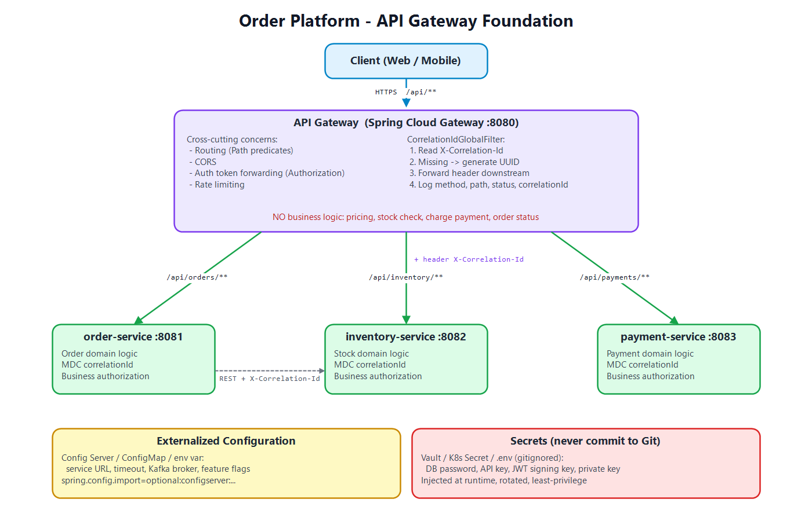

# Week 7 – Day 1: API Gateway, Externalized Configuration & Service Communication Foundation

## Mục tiêu

Hiểu cách một hệ thống microservices nhận request từ bên ngoài và quản lý cấu hình / service endpoint theo môi trường.

## Nội dung thư mục

| File | Nội dung |
|---|---|
| [gateway-routing.md](gateway-routing.md) | Vai trò Gateway, route config, global filter Correlation ID, docker-compose, Gateway vs Load Balancer |
| [config-classification.md](config-classification.md) | Vì sao không hard-code, phân loại config/secret/feature flag, Spring Cloud Config, quản lý secret |
| [gateway-diagram.png](gateway-diagram.png) | Sơ đồ kiến trúc Client → Gateway → Services |
| README.md | Tổng quan, trả lời câu hỏi, checklist hoàn thành |



---

## 1. Tóm tắt kiến thức

### API Gateway
- Single entry point: routing, CORS, auth token forwarding, request logging, correlation ID, rate limiting, policy chung.
- **Không** chứa business logic (tính giá, kiểm tra tồn kho, charge payment, quyết định trạng thái order).
- Spring Cloud Gateway = **Route** (id + uri + predicates + filters) + **GlobalFilter** áp dụng cho mọi route.

### Externalized Configuration
- Build một lần, chạy mọi môi trường; config đến từ env var / Config Server / ConfigMap / Secret store.
- 4 loại: Application config, Environment config, Secret, Feature flag (chi tiết ở [config-classification.md](config-classification.md)).

### Service Discovery & Load Balancing
- Không hard-code `http://inventory-service-01:8080` vì instance có thể chết, đổi IP, scale lên/xuống.
- **Server-side LB**: client gọi 1 địa chỉ ảo (LB / K8s Service), LB chọn instance.
- **Client-side LB**: client lấy danh sách instance từ registry (Eureka/Consul) rồi tự chọn (Spring Cloud LoadBalancer: round-robin, random), dùng `lb://inventory-service`.
- **Eureka/Consul** phù hợp khi chạy VM/bare-metal/Docker không có orchestrator, hoặc hệ thống lai nhiều môi trường.
- **Kubernetes Service + DNS** đã đủ khi toàn bộ chạy trong K8s: `http://inventory-service.default.svc.cluster.local`.

```text
Không có discovery:   order-service ──► http://10.0.1.15:8082   (chết là hỏng)

Client-side LB:       order-service ──(hỏi)──► Eureka: [10.0.1.15, 10.0.1.16, 10.0.1.17]
                      order-service ──(tự chọn round-robin)──► 10.0.1.16

Kubernetes:           order-service ──► http://inventory-service:8082 (ClusterIP)
                                         └─ kube-proxy ──► pod-1 | pod-2 | pod-3
```

---

## 2. Trả lời câu hỏi

### Q1. Gateway khác Load Balancer ở điểm nào?

| | Load Balancer | API Gateway |
|---|---|---|
| Bài toán | Chia tải giữa **nhiều instance của cùng một service** | Định tuyến tới **nhiều service khác nhau** qua một điểm vào |
| Mức hiểu request | L4 (IP/port) hoặc L7 cơ bản (host/path) | L7 sâu: path, header, JWT claims, version, query |
| Chức năng | Health check, phân phối traffic, TLS termination | Auth/token forwarding, rate limit, CORS, correlation ID, transform, circuit breaker, aggregation |
| Ví dụ | AWS NLB/ALB, Nginx, HAProxy, kube-proxy | Spring Cloud Gateway, Kong, AWS API Gateway, Apigee |

Gateway **có thể** làm load balancing (`lb://`), nhưng LB không làm được các policy API. Thực tế dùng cả hai: `Cloud LB → nhiều instance Gateway → Services`.

### Q2. Gateway có thay thế authorization trong service không?

**Không.** Gateway chỉ làm **authentication** và **coarse-grained authorization**:
- Kiểm tra token có hợp lệ, còn hạn, đúng issuer/audience không.
- Chặn sớm theo rule thô: "`/api/admin/**` cần role ADMIN".

Service vẫn phải làm **business / fine-grained authorization** vì chỉ service mới có dữ liệu nghiệp vụ:
- "User A chỉ được xem order **của chính mình**" → cần biết `order.customerId`.
- "Chỉ được huỷ order khi trạng thái là PENDING".
- "Refund > 10 triệu cần role FINANCE_MANAGER".

Lý do thêm (Zero Trust / defense in depth):
- Request có thể đến service **không qua gateway** (gọi nội bộ service-to-service, job, message consumer, cấu hình network sai).
- Gateway bị cấu hình sai một route → mở toàn bộ service nếu service không tự kiểm tra.
- Service nên tự validate JWT (Spring Security Resource Server) + `@PreAuthorize` / kiểm tra ownership trong domain.

### Q3. Config nào là secret?

Những giá trị mà **nếu lộ sẽ cho phép truy cập dữ liệu hoặc mạo danh hệ thống**:
- Database password / connection string chứa credential.
- API key của bên thứ 3 (payment provider, SMS, email).
- Private key, JWT signing key, TLS private key, keystore password.
- OAuth2 client secret.
- Kafka SASL password, Redis password, cloud access key (AWS_SECRET_ACCESS_KEY).
- Encryption key (mã hoá dữ liệu PII).

Không phải secret: timeout, page size, route config, service URL, Kafka broker address, feature flag.

### Q4. Nếu chạy Kubernetes, có bắt buộc cần Eureka không?

**Không bắt buộc.** Kubernetes đã có sẵn:
- **Service discovery**: K8s Service + CoreDNS (`inventory-service` → ClusterIP).
- **Load balancing**: kube-proxy (iptables/IPVS) phân phối đến các pod Ready.
- **Health**: readiness/liveness probe tự loại pod hỏng khỏi Endpoints.

Dùng Eureka trên K8s sẽ trùng lặp chức năng, thêm một thành phần phải vận hành. Chỉ cân nhắc Eureka/Consul (hoặc Spring Cloud Kubernetes discovery) khi:
- Hệ thống lai: một phần chạy K8s, một phần chạy VM/on-prem.
- Cần client-side LB nâng cao (zone-aware, weighted, sticky) mà không dùng service mesh.
- Đang migrate dần từ hệ thống cũ đã dùng Eureka.

Nhu cầu nâng cao trên K8s (mTLS, retry, canary, traffic split) thường giải quyết bằng **service mesh** (Istio, Linkerd) thay vì Eureka.

### Q5. Nếu một service scale từ 1 lên 5 instances, client route request thế nào?

Client **không cần biết** có 5 instance; nó vẫn gọi một **tên logic**:

1. **Kubernetes**: Client gọi `http://inventory-service:8082`. K8s cập nhật Endpoints thành 5 pod IP; kube-proxy phân phối request (random/round-robin). Pod mới chỉ nhận traffic khi readiness probe pass.
2. **Eureka/Consul + Spring Cloud LoadBalancer**: 5 instance tự đăng ký vào registry kèm heartbeat. Gateway/service dùng `lb://inventory-service`; LoadBalancer lấy danh sách (có cache) và chọn instance theo **round-robin** (mặc định) hoặc random. Instance chết → hết heartbeat → bị loại khỏi registry.
3. **LB truyền thống (Nginx/ALB)**: thêm 5 instance vào target group/upstream; LB health check và chia tải.

Lưu ý khi scale:
- Service phải **stateless** (session/cache để ở Redis, không giữ trong memory) để request nào đến instance nào cũng đúng.
- Kết hợp **timeout + retry (idempotent) + circuit breaker** để chịu được 1 instance lỗi.
- Graceful shutdown để không mất request khi scale down.

---

## 3. Checklist hoàn thành

- [x] **Gateway route được tối thiểu 3 services** – `/api/orders/**`, `/api/inventory/**`, `/api/payments/**` ([gateway-routing.md §3](gateway-routing.md#3-route-configuration-không-hard-code-url)).
- [x] **Không hard-code URL service trong business code** – URL lấy từ `${ORDER_SERVICE_URL}`, `@ConfigurationProperties`, Docker/K8s DNS, hoặc `lb://` ([gateway-routing.md §5](gateway-routing.md#5-gọi-service-to-service-không-hard-code-url)).
- [x] **Có correlation ID đi từ Gateway xuống service** – `CorrelationIdGlobalFilter` + `CorrelationIdFilter` đưa vào MDC ([gateway-routing.md §4](gateway-routing.md#4-global-filter-correlation-id--request-logging)).
- [x] **Phân biệt được config thường và secret** – [config-classification.md](config-classification.md).
- [x] **Giải thích được Gateway không thay thế business authorization** – xem Q2 ở trên.

## Tham khảo

- Spring Cloud Gateway: https://docs.spring.io/spring-cloud-gateway/reference/
- Spring Cloud Config: https://docs.spring.io/spring-cloud-config/reference/
- Spring Cloud LoadBalancer: https://docs.spring.io/spring-cloud-commons/reference/spring-cloud-commons/loadbalancer.html
- The Twelve-Factor App – Config: https://12factor.net/config

