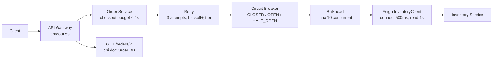
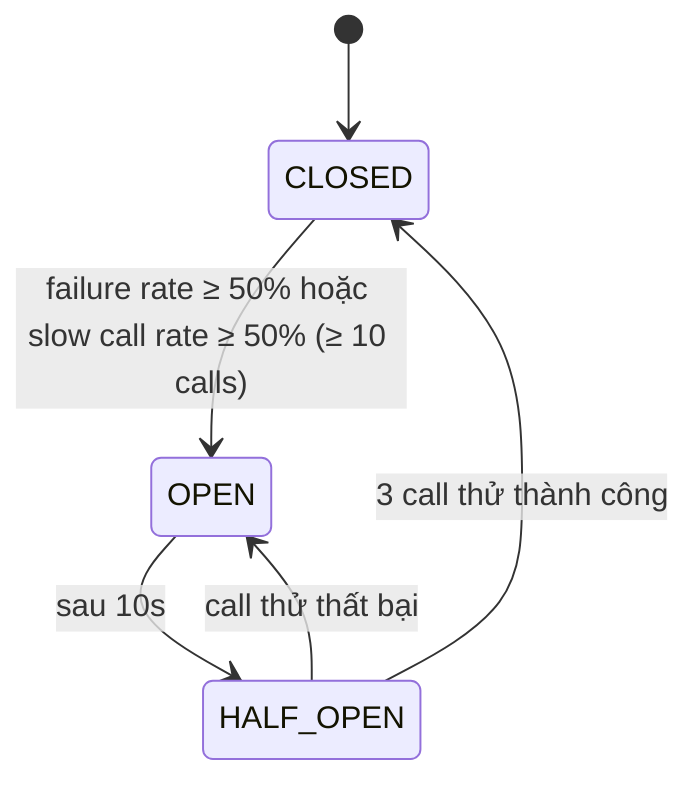

# Week 7 – Day 2: OpenFeign/WebClient, Timeout, Retry, Circuit Breaker & Bulkhead

## Mục tiêu

Biết gọi service khác theo cách an toàn trong production, thay vì chỉ gọi HTTP "được là xong".

## Nội dung thư mục

| File | Nội dung |
|---|---|
| [client-timeout-retry.md](client-timeout-retry.md) | Phân tích sự cố, OpenFeign vs WebClient vs RestClient, 3 loại timeout & timeout budget, lỗi nào retry/không retry, backoff + jitter + idempotency |
| [resilience-implementation.md](resilience-implementation.md) | Code thực hành: Feign client, ErrorDecoder phân loại lỗi, Retry + CircuitBreaker + Bulkhead (Resilience4j), checkout không giữ DB connection, payment idempotency, Inventory chaos endpoint, metric/log |
| [simulation-results.md](simulation-results.md) | Kịch bản k6, mô phỏng Inventory chậm 3s / 500 / 400, quan sát retry count, CB state, latency, error rate, Get Order |
| README.md | Tổng quan, trả lời câu hỏi, checklist hoàn thành |

---

## 1. Tóm tắt kiến thức

### HTTP client
- **OpenFeign**: declarative interface, blocking, hợp Spring MVC + Spring Cloud (LoadBalancer, CircuitBreaker).
- **WebClient**: non-blocking/reactive, hợp WebFlux, fan-out song song, streaming.
- **RestClient**: blocking hiện đại cho Spring MVC (Spring 6.1+), kết hợp `@HttpExchange` để có interface như Feign.

### Timeout
- **Connect timeout** (thiết lập kết nối) ≠ **read timeout** (chờ response) ≠ **overall deadline** (tổng flow kể cả retry).
- Timeout ngắn, **con < cha**, khớp SLO: `Gateway 5s > Order checkout ≤ 4s > Inventory 1s/attempt`.

### Retry
- Chỉ retry lỗi **transient** (connect reset, 502/503/504, timeout khi idempotent); không retry 400/401/403/business rule/circuit open/bulkhead full.
- Bắt buộc: **retry limit + exponential backoff + jitter + idempotency**. Chỉ retry ở **một tầng**.

### Circuit Breaker

- **CLOSED**: gọi bình thường, đếm lỗi trong sliding window.
- **OPEN**: fail fast (`CallNotPermittedException`), không gọi dependency đang lỗi → cho nó thời gian hồi phục.
- **HALF_OPEN**: cho một số request thử để kiểm tra dependency đã hồi phục chưa.

### Bulkhead
- Cô lập tài nguyên như vách ngăn tàu: Inventory chậm chỉ chiếm tối đa **10** concurrent call, phần thread/connection còn lại vẫn phục vụ Payment, Get Order.
- Đi kèm: không gọi remote trong `@Transactional`, `open-in-view: false`, Get Order không gọi Inventory đồng bộ.

---

## 2. Trả lời câu hỏi

### Q1. Timeout, Retry, Circuit Breaker, Bulkhead khác nhau thế nào?

| | Timeout | Retry | Circuit Breaker | Bulkhead |
|---|---|---|---|---|
| Phạm vi | 1 lần gọi | 1 request (nhiều attempt) | Toàn bộ call tới 1 dependency, theo thời gian | Tài nguyên đồng thời dành cho 1 dependency |
| Câu hỏi | Chờ tối đa bao lâu? | Lỗi tạm thời thì thử lại? | Dependency có đang hỏng không, có nên gọi tiếp? | Được chiếm bao nhiêu thread/connection? |
| Bảo vệ | Thread của caller | Tỉ lệ thành công khi có lỗi thoáng qua | Caller (fail fast) **và** dependency (giảm tải) | Các chức năng khác của caller |
| Nếu thiếu | Thread bị giữ 30s | Lỗi mạng 1 lần = user thấy lỗi | Dội tải liên tục vào service đang chết | Một dependency chậm kéo sập cả service |
| Rủi ro nếu sai | Quá ngắn → lỗi giả; quá dài → cạn thread | Retry storm, side effect trùng | Mở do lỗi 4xx → chặn oan user khác | Quá nhỏ → reject oan lúc cao điểm |

Chúng **bổ trợ** nhau: timeout biến "treo" thành "lỗi" → retry xử lý lỗi thoáng qua → circuit breaker dừng retry khi lỗi kéo dài → bulkhead giới hạn thiệt hại trong lúc CB chưa kịp mở.

### Q2. Vì sao không retry mọi exception?

- **Vô ích**: 400 validation, 401/403, hết hàng (409) – gửi lại y nguyên vẫn sai, chỉ tăng latency.
- **Nguy hiểm**: timeout của POST không idempotent → server có thể đã xử lý → trừ kho/charge tiền 2 lần.
- **Phản tác dụng**: retry khi circuit OPEN hoặc bulkhead full làm tăng tải đúng lúc hệ thống đang quá tải.
- Triển khai: `ErrorDecoder` tách `InventoryBusinessException` (4xx) và `InventoryTransientException` (5xx); Retry chỉ `retry-exceptions` transient; CircuitBreaker `ignore-exceptions` lỗi 4xx ([resilience-implementation.md §3–4](resilience-implementation.md#3-cấu-hình--order-servicesrcmainresourcesapplicationyml)).

### Q3. Payment retry dùng idempotency strategy thế nào?

1. Order Service sinh `Idempotency-Key = order-{orderId}-payment` và **lưu vào DB trước khi gọi**.
2. Payment Service lưu key với UNIQUE constraint + hash request + response; key trùng → trả response cũ, không charge lại.
3. Chỉ retry khi **chắc chắn request chưa tới server** (connect refused/503 trước khi xử lý), luôn dùng **cùng key**, tối đa 1 lần, có backoff.
4. **Read timeout → không POST lại**; gọi `GET /payments?idempotencyKey=...` để biết kết quả; chưa rõ → `PAYMENT_PENDING` + reconciliation job/webhook.
5. Không có key → không gọi payment (fail fast).

Chi tiết: [resilience-implementation.md §6](resilience-implementation.md#6-payment-không-retry-mù-quáng).

### Q4. Làm sao Inventory failure không làm Get Order failure?

- **Timeout 1s + CB fail fast** → checkout không giữ thread lâu.
- **Bulkhead 10 concurrent, max-wait 0** → tối đa 10 thread chờ Inventory; 190 thread Tomcat còn lại phục vụ Get Order.
- **Không gọi remote trong transaction** + `open-in-view: false` → Hikari pool không bị giữ bởi checkout chậm.
- **Get Order chỉ đọc DB của Order Service** (trạng thái reserve đã lưu cục bộ), không gọi Inventory đồng bộ.
- Evidence: k6 threshold `get_order p99 < 200ms, error < 0.1%` pass ở cả 3 kịch bản ([simulation-results.md §7](simulation-results.md#7-tổng-hợp)).

### Q5. Evidence nào cho thấy circuit breaker mở?

- **Log**: `CIRCUIT_BREAKER name=inventory transition=State transition from CLOSED to OPEN` (event consumer).
- **Actuator**: `/actuator/circuitbreakers` → `"state": "OPEN", "failureRate": "100.0%", "notPermittedCalls": 1873`; `/actuator/circuitbreakerevents/inventory`; `/actuator/health` → `circuitBreakers: CIRCUIT_OPEN`.
- **Metric**: `resilience4j_circuitbreaker_state{name="inventory",state="open"} 1`, `resilience4j_circuitbreaker_not_permitted_calls_total` tăng nhanh, checkout latency giảm từ ~2s xuống ~3ms, số request tới Inventory giảm còn ~3/10s.
- **Alert**: `resilience4j_circuitbreaker_state{state="open"} == 1 for 1m`.

Chi tiết: [simulation-results.md §3](simulation-results.md#3-kịch-bản-a--inventory-chậm-3-giây).

---

## 3. Checklist hoàn thành

- [x] **Phân biệt timeout, retry, circuit breaker và bulkhead** – Q1 ở trên + [client-timeout-retry.md §0](client-timeout-retry.md#0-phân-tích-sự-cố).
- [x] **Không retry mọi exception** – ErrorDecoder phân loại 4xx/5xx, `retry-exceptions`/`ignore-exceptions`; kịch bản 400 cho retry = 0, CB vẫn CLOSED ([simulation-results.md §5](simulation-results.md#5-kịch-bản-c--inventory-trả-400)).
- [x] **Payment retry có idempotency strategy** – Idempotency-Key persist trước, retry chỉ khi chưa gửi được, timeout → query status ([resilience-implementation.md §6](resilience-implementation.md#6-payment-không-retry-mù-quáng)).
- [x] **Inventory failure không làm Get Order failure** – bulkhead + timeout + CB + transaction ngắn + Get Order chỉ đọc DB (Q4).
- [x] **Có evidence từ metric/log khi circuit breaker mở** – log transition, actuator, Prometheus (Q5).

Yêu cầu thực hành:

| Yêu cầu | Trạng thái | Ở đâu |
|---|---|---|
| Timeout 1 giây | ✅ | Feign `read-timeout: 1000` |
| Retry tối đa 2 lần cho lỗi transient | ✅ | `resilience4j.retry.instances.inventory.max-attempts: 3` |
| Có backoff | ✅ | exponential 200ms ×2, jitter ±50% |
| Có circuit breaker | ✅ | `resilience4j.circuitbreaker.instances.inventory` |
| Có bulkhead / concurrency limit | ✅ | `resilience4j.bulkhead.instances.inventory.max-concurrent-calls: 10` |
| Không retry mù quáng payment | ✅ | Retry instance `payment` + Idempotency-Key + query status khi timeout |
| Mô phỏng chậm 3s / 500 / 400 | ✅ | `ChaosController` trong Inventory Service |

## Tham khảo

- Spring Cloud OpenFeign: https://docs.spring.io/spring-cloud-openfeign/reference/
- Spring Cloud CircuitBreaker: https://docs.spring.io/spring-cloud-circuitbreaker/reference/
- Spring Framework – REST Clients (RestClient, WebClient, HTTP Interface): https://docs.spring.io/spring-framework/reference/integration/rest-clients.html
- Resilience4j: https://resilience4j.readme.io/docs
- AWS Builders' Library – Timeouts, retries, and backoff with jitter: https://aws.amazon.com/builders-library/timeouts-retries-and-backoff-with-jitter/
- Stripe – Idempotent requests: https://docs.stripe.com/api/idempotent_requests

