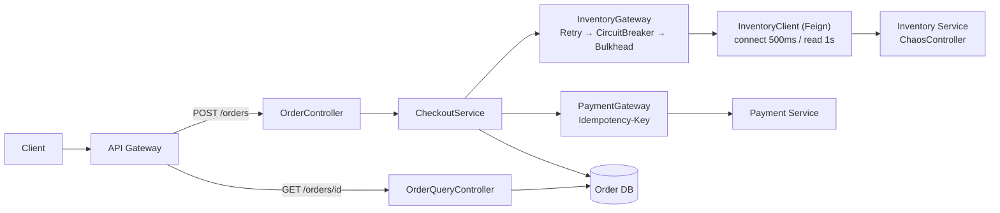

# Resilience Implementation – Order Service ↓ Inventory Client ↓ Inventory Service

## 1. Kiến trúc



Thứ tự decorator mặc định của Resilience4j (annotation):

```text
Retry ( CircuitBreaker ( RateLimiter ( TimeLimiter ( Bulkhead ( Feign call ) ) ) ) )
```

- **Retry ở ngoài cùng** → mỗi attempt đều đi qua CircuitBreaker; khi circuit OPEN, attempt tiếp theo nhận `CallNotPermittedException` (không retry) → dừng ngay.
- **Bulkhead ở trong cùng** → permit được trả lại trong lúc backoff giữa các attempt.

| Yêu cầu | Cách đáp ứng |
|---|---|
| Timeout 1 giây | Feign `read-timeout: 1000`, `connect-timeout: 500` |
| Retry tối đa 2 lần cho lỗi transient | Resilience4j Retry `max-attempts: 3`, `retry-exceptions` chỉ gồm lỗi transient |
| Có backoff | Exponential backoff 200ms ×2 + jitter 50% |
| Có circuit breaker | Resilience4j CircuitBreaker `inventory` (failure rate + slow call rate) |
| Có bulkhead | Semaphore Bulkhead `max-concurrent-calls: 10`, `max-wait-duration: 0` |
| Không retry mù payment | Retry instance `payment` riêng, bắt buộc idempotency key, timeout ⇒ query status |

---

## 2. Dependencies – `order-service/build.gradle`

```groovy
plugins {
    id 'java'
    id 'org.springframework.boot' version '3.3.5'
    id 'io.spring.dependency-management' version '1.1.6'
}

ext { set('springCloudVersion', '2023.0.3') }

dependencies {
    implementation 'org.springframework.boot:spring-boot-starter-web'
    implementation 'org.springframework.boot:spring-boot-starter-data-jpa'
    implementation 'org.springframework.boot:spring-boot-starter-actuator'
    implementation 'org.springframework.boot:spring-boot-starter-aop'          // cần cho annotation Resilience4j
    implementation 'org.springframework.cloud:spring-cloud-starter-openfeign'
    implementation 'io.github.resilience4j:resilience4j-spring-boot3:2.2.0'   // Retry, CB, Bulkhead + metrics
    implementation 'io.micrometer:micrometer-registry-prometheus'
    runtimeOnly 'org.postgresql:postgresql'
}

dependencyManagement {
    imports { mavenBom "org.springframework.cloud:spring-cloud-dependencies:${springCloudVersion}" }
}
```

> Không bật `spring.cloud.openfeign.circuitbreaker.enabled` ở đây vì ta muốn tự kiểm soát thứ tự Retry → CB → Bulkhead và phân loại exception. Cách bật CB qua Spring Cloud xem [§9](#9-cách-khác-spring-cloud-circuitbreaker-cho-openfeign).

---

## 3. Cấu hình – `order-service/src/main/resources/application.yml`

```yaml
spring:
  application:
    name: order-service
  jpa:
    open-in-view: false        # không giữ DB connection suốt request (quan trọng cho bulkhead)
  datasource:
    hikari:
      maximum-pool-size: 20
  cloud:
    openfeign:
      client:
        config:
          inventory-service:
            connect-timeout: 500
            read-timeout: 1000          # ← Timeout 1 giây
            logger-level: basic
          payment-service:
            connect-timeout: 500
            read-timeout: 2000

clients:
  inventory:
    base-url: ${INVENTORY_SERVICE_URL:http://localhost:8082}
  payment:
    base-url: ${PAYMENT_SERVICE_URL:http://localhost:8083}

server:
  tomcat:
    threads:
      max: 200

resilience4j:
  retry:
    instances:
      inventory:
        max-attempts: 3                       # 1 lần đầu + 2 retry
        wait-duration: 200ms
        enable-exponential-backoff: true
        exponential-backoff-multiplier: 2     # 200ms → 400ms
        enable-randomized-wait: true          # jitter
        randomized-wait-factor: 0.5           # ±50%
        retry-exceptions:                     # CHỈ retry lỗi transient
          - com.example.order.client.InventoryTransientException
          - feign.RetryableException          # IOException: connect refused/reset, read timeout
        ignore-exceptions:
          - com.example.order.client.InventoryBusinessException   # 4xx
          - io.github.resilience4j.circuitbreaker.CallNotPermittedException
          - io.github.resilience4j.bulkhead.BulkheadFullException
      payment:
        max-attempts: 2                       # chỉ 1 retry, chỉ khi request chắc chắn chưa tới server
        wait-duration: 300ms
        enable-exponential-backoff: true
        exponential-backoff-multiplier: 2
        enable-randomized-wait: true
        randomized-wait-factor: 0.5
        retry-exceptions:
          - com.example.order.client.PaymentNotSentException      # connect refused / 503 trước khi xử lý
        # read timeout KHÔNG nằm trong danh sách → không retry mù

  circuitbreaker:
    instances:
      inventory:
        register-health-indicator: true
        sliding-window-type: COUNT_BASED
        sliding-window-size: 20
        minimum-number-of-calls: 10
        failure-rate-threshold: 50            # ≥50% lỗi → OPEN
        slow-call-duration-threshold: 800ms   # call > 800ms coi là chậm
        slow-call-rate-threshold: 50          # ≥50% chậm → OPEN
        wait-duration-in-open-state: 10s
        automatic-transition-from-open-to-half-open-enabled: true
        permitted-number-of-calls-in-half-open-state: 3
        record-exceptions:
          - com.example.order.client.InventoryTransientException
          - feign.RetryableException
        ignore-exceptions:
          - com.example.order.client.InventoryBusinessException   # 400/409 không phải dependency hỏng
          - io.github.resilience4j.bulkhead.BulkheadFullException

  bulkhead:
    instances:
      inventory:
        max-concurrent-calls: 10              # tối đa 10 thread được chờ Inventory cùng lúc
        max-wait-duration: 0                  # hết slot → reject ngay, không xếp hàng giữ thread

management:
  endpoints:
    web:
      exposure:
        include: health,metrics,prometheus,circuitbreakers,circuitbreakerevents,retries,retryevents,bulkheads
  endpoint:
    health:
      show-details: always
  health:
    circuitbreakers:
      enabled: true
  metrics:
    distribution:
      percentiles-histogram:
        http.server.requests: true
    tags:
      application: ${spring.application.name}
```

> Ngân sách thời gian worst-case của 1 checkout: `3 × 1s + ~0.2s + ~0.4s ≈ 3.6s` (jitter tối đa ≈ 3.9s) < Gateway 5s ✅.

---

## 4. Inventory Client – Feign + phân loại lỗi

### 4.1. Feign interface

```java
package com.example.order.client;

@FeignClient(name = "inventory-service",
             url = "${clients.inventory.base-url}",
             configuration = InventoryFeignConfig.class)
public interface InventoryClient {

    @PostMapping("/api/inventory/reservations")
    ReservationResponse reserve(@RequestHeader("Idempotency-Key") String idempotencyKey,
                                @RequestBody ReserveRequest request);
}

public record ReserveRequest(String orderId, List<Item> items) {
    public record Item(String sku, int quantity) {}
}
public record ReservationResponse(String reservationId, String status) {}
```

### 4.2. Exception phân loại – chìa khoá để "không retry mọi exception"

```java
/** 5xx (trừ 501) – lỗi hạ tầng tạm thời: được retry, được tính vào circuit breaker. */
public class InventoryTransientException extends RuntimeException {
    private final int status;
    public InventoryTransientException(int status, String msg) { super(msg); this.status = status; }
    public int status() { return status; }
}

/** 4xx – lỗi nghiệp vụ / validation: KHÔNG retry, KHÔNG tính vào circuit breaker. */
public class InventoryBusinessException extends RuntimeException {
    private final int status;
    public InventoryBusinessException(int status, String msg) { super(msg); this.status = status; }
    public int status() { return status; }
}
```

### 4.3. ErrorDecoder + correlation ID propagation

```java
public class InventoryFeignConfig {

    @Bean
    ErrorDecoder inventoryErrorDecoder() {
        return (methodKey, response) -> {
            int status = response.status();
            String body = readBody(response);
            if (status >= 400 && status < 500) {
                return new InventoryBusinessException(status, body);   // 400, 401, 403, 404, 409, 422...
            }
            if (status >= 500 && status != 501) {
                return new InventoryTransientException(status, body);  // 500, 502, 503, 504
            }
            return new ErrorDecoder.Default().decode(methodKey, response);
        };
    }

    /** Feign mặc định Retryer.NEVER_RETRY trong Spring Cloud – khai báo rõ để không bị retry 2 tầng. */
    @Bean
    Retryer feignRetryer() {
        return Retryer.NEVER_RETRY;
    }

    @Bean
    RequestInterceptor correlationIdInterceptor() {
        return template -> {
            String cid = MDC.get("correlationId");
            if (cid != null) template.header("X-Correlation-Id", cid);
        };
    }

    private static String readBody(Response response) {
        try (var in = response.body() == null ? null : response.body().asInputStream()) {
            return in == null ? "" : new String(in.readAllBytes(), StandardCharsets.UTF_8);
        } catch (IOException e) {
            return "";
        }
    }
}
```

> Read timeout / connect refused → Feign ném `feign.RetryableException` (bọc `SocketTimeoutException`/`ConnectException`). Ta retry nó **vì reserve có Idempotency-Key**, Inventory xử lý trùng sẽ trả kết quả cũ.

### 4.4. InventoryGateway – nơi gắn Retry / CircuitBreaker / Bulkhead

```java
package com.example.order.client;

@Slf4j
@Component
@RequiredArgsConstructor
public class InventoryGateway {

    private final InventoryClient client;

    @Retry(name = "inventory")
    @CircuitBreaker(name = "inventory")
    @Bulkhead(name = "inventory")          // semaphore bulkhead
    public ReservationResponse reserve(String orderId, List<ReserveRequest.Item> items) {
        String key = "order-" + orderId + "-reserve";           // cùng key cho mọi attempt
        log.info("Calling inventory reserve orderId={} key={}", orderId, key);
        return client.reserve(key, new ReserveRequest(orderId, items));
    }
}
```

Không dùng `fallbackMethod` trên `@CircuitBreaker`: nếu fallback ở lớp trong biến exception thành kết quả, `@Retry` ở ngoài sẽ không thấy lỗi nữa. Việc dịch exception được làm ở `CheckoutService`.

---

## 5. Checkout flow – không giữ DB connection khi gọi remote

```java
@Slf4j
@Service
@RequiredArgsConstructor
public class CheckoutService {

    private final OrderRepository orderRepository;
    private final InventoryGateway inventoryGateway;
    private final PaymentGateway paymentGateway;
    private final TransactionTemplate tx;

    // ❌ KHÔNG đặt @Transactional ở đây: nếu gọi Inventory bên trong transaction,
    //    mỗi checkout chậm sẽ giữ 1 connection Hikari tới 3.6s → hết pool → Get Order cũng lỗi.
    public OrderResponse checkout(CreateOrderRequest req) {
        Order order = tx.execute(s -> orderRepository.save(Order.pending(req)));      // TX ngắn #1

        try {
            ReservationResponse r = inventoryGateway.reserve(order.getId(), req.items());
            tx.executeWithoutResult(s -> order.markReserved(r.reservationId()));       // TX ngắn #2
        } catch (InventoryBusinessException e) {                    // 400/409 – lỗi nghiệp vụ
            tx.executeWithoutResult(s -> order.reject(e.getMessage()));
            throw new OrderRejectedException(e.status(), e.getMessage());
        } catch (CallNotPermittedException e) {                     // circuit OPEN
            log.warn("Inventory circuit OPEN, fail fast orderId={}", order.getId());
            tx.executeWithoutResult(s -> order.markFailed("INVENTORY_UNAVAILABLE"));
            throw new DependencyUnavailableException("inventory", "CIRCUIT_OPEN");
        } catch (BulkheadFullException e) {                         // quá nhiều call đồng thời
            log.warn("Inventory bulkhead full, reject orderId={}", order.getId());
            tx.executeWithoutResult(s -> order.markFailed("INVENTORY_BUSY"));
            throw new DependencyUnavailableException("inventory", "BULKHEAD_FULL");
        } catch (InventoryTransientException | RetryableException e) {   // hết 3 attempts
            log.error("Inventory failed after retries orderId={}", order.getId(), e);
            tx.executeWithoutResult(s -> order.markFailed("INVENTORY_ERROR"));
            throw new DependencyUnavailableException("inventory", "RETRIES_EXHAUSTED");
        }

        return paymentGateway.charge(order);   // xem §6
    }
}
```

```java
@RestControllerAdvice
class ResilienceExceptionHandler {

    @ExceptionHandler(DependencyUnavailableException.class)
    ResponseEntity<ProblemDetail> unavailable(DependencyUnavailableException e) {
        ProblemDetail pd = ProblemDetail.forStatusAndDetail(HttpStatus.SERVICE_UNAVAILABLE,
                "Inventory tạm thời không khả dụng, vui lòng thử lại sau");
        pd.setProperty("reason", e.reason());
        return ResponseEntity.status(503).header(HttpHeaders.RETRY_AFTER, "10").body(pd);
    }

    @ExceptionHandler(OrderRejectedException.class)
    ResponseEntity<ProblemDetail> rejected(OrderRejectedException e) {
        return ResponseEntity.status(e.status())
                .body(ProblemDetail.forStatusAndDetail(HttpStatusCode.valueOf(e.status()), e.getMessage()));
    }
}
```

### Get Order – không phụ thuộc Inventory

```java
@RestController
@RequiredArgsConstructor
class OrderQueryController {
    private final OrderRepository orderRepository;

    @GetMapping("/orders/{id}")
    OrderResponse get(@PathVariable String id) {
        // Chỉ đọc DB của Order Service. Trạng thái reserve đã được lưu cục bộ (RESERVED/FAILED),
        // KHÔNG gọi Inventory đồng bộ để "làm giàu" dữ liệu.
        return orderRepository.findById(id).map(OrderResponse::from)
                .orElseThrow(() -> new ResponseStatusException(HttpStatus.NOT_FOUND));
    }
}
```

Các lớp cô lập giúp Get Order không bị ảnh hưởng:

| Tài nguyên dùng chung | Nguy cơ | Biện pháp |
|---|---|---|
| Tomcat threads (200) | Checkout chờ Inventory chiếm hết thread | Bulkhead 10 + timeout 1s + CB fail fast ⇒ tối đa ~10 thread bị chờ Inventory |
| Hikari connections (20) | Gọi remote trong `@Transactional` giữ connection | Transaction ngắn, gọi remote **ngoài** transaction, `open-in-view: false` |
| HTTP connection pool của Feign | Dùng chung pool cho Inventory và Payment | Mỗi dependency một Feign client / pool riêng |
| Data | Get Order gọi Inventory để hiển thị | Lưu trạng thái cục bộ, đọc từ DB của chính mình |

> Mức cô lập mạnh hơn: tách Get Order sang **instance/deployment riêng** (read service, CQRS) hoặc dùng `ThreadPoolBulkhead`. Với Java 21 virtual threads, thread không còn khan hiếm nhưng **bulkhead vẫn cần** để bảo vệ Inventory và connection pool.

---

## 6. Payment: không retry mù quáng

Nguy cơ: Order gửi `POST /payments` → Payment đã charge thẻ thành công → response bị timeout → Order retry → **charge 2 lần**.

### Chiến lược idempotency

```text
Idempotency-Key = "order-{orderId}-payment"   (sinh 1 lần, lưu vào bảng orders trước khi gọi)

Payment Service:
  INSERT INTO idempotency_keys(key, request_hash, status, response) ...  -- UNIQUE(key)
  - key mới                → xử lý, lưu response
  - key đã có, DONE        → trả lại response cũ (không charge lại)
  - key đã có, IN_PROGRESS → 409 "đang xử lý"
  - key giống nhưng body khác (hash khác) → 422 (dùng sai key)
```

```java
@Slf4j
@Component
@RequiredArgsConstructor
public class PaymentGateway {

    private final PaymentClient client;

    @Retry(name = "payment")                       // chỉ retry PaymentNotSentException
    public PaymentResponse charge(Order order) {
        String key = order.getPaymentIdempotencyKey();  // đã persist trước khi gọi
        if (key == null) {
            throw new IllegalStateException("Payment request bắt buộc có Idempotency-Key");
        }
        try {
            return client.charge(key, new ChargeRequest(order.getId(), order.getTotal()));
        } catch (RetryableException e) {
            if (e.getCause() instanceof ConnectException) {
                // TCP chưa kết nối được → chắc chắn server chưa nhận request → retry an toàn
                throw new PaymentNotSentException(e);
            }
            // Read timeout: KHÔNG biết server đã charge hay chưa → KHÔNG retry POST,
            // hỏi lại trạng thái bằng chính idempotency key.
            log.warn("Payment timeout orderId={} key={}, querying status", order.getId(), key);
            return client.findByIdempotencyKey(key)
                    .orElseGet(() -> PaymentResponse.pending(key));   // để reconciliation job xử lý
        }
    }
}
```

| Tình huống | Hành động |
|---|---|
| Connect refused / 503 trước khi xử lý | Retry 1 lần, **cùng key**, có backoff |
| Read timeout | Không POST lại; `GET /payments?idempotencyKey=...`; chưa rõ → order `PAYMENT_PENDING`, reconciliation job/webhook chốt sau |
| 4xx (thẻ bị từ chối, sai số tiền) | Không retry, trả lỗi cho user |
| Không có idempotency key | Không gọi payment (fail fast) – không bao giờ retry |

---

## 7. Inventory Service – mô phỏng sự cố (Chaos endpoint)

```java
package com.example.inventory.chaos;

@RestController
@RequestMapping("/chaos")
class ChaosController {

    enum Mode { NORMAL, SLOW, ERROR_500, ERROR_400 }

    static final AtomicReference<Mode> MODE = new AtomicReference<>(Mode.NORMAL);
    static final AtomicLong DELAY_MS = new AtomicLong(3000);

    @PostMapping
    Map<String, Object> set(@RequestParam Mode mode, @RequestParam(defaultValue = "3000") long delayMs) {
        MODE.set(mode);
        DELAY_MS.set(delayMs);
        return Map.of("mode", mode, "delayMs", delayMs);
    }
}

@Slf4j
@RestController
@RequestMapping("/api/inventory")
class ReservationController {

    private final AtomicLong received = new AtomicLong();
    private final Map<String, ReservationResponse> idempotencyStore = new ConcurrentHashMap<>();

    @PostMapping("/reservations")
    ResponseEntity<?> reserve(@RequestHeader("Idempotency-Key") String key,
                              @RequestBody ReserveRequest req) throws InterruptedException {
        log.info("reserve received#{} key={} mode={}", received.incrementAndGet(), key, ChaosController.MODE.get());

        switch (ChaosController.MODE.get()) {
            case SLOW      -> Thread.sleep(ChaosController.DELAY_MS.get());           // chậm 3s
            case ERROR_500 -> { return ResponseEntity.status(500).body("simulated failure"); }
            case ERROR_400 -> { return ResponseEntity.badRequest().body("INVALID_SKU"); }
            default        -> { }
        }
        // Idempotent: cùng key → cùng kết quả, không trừ kho lần 2
        return ResponseEntity.ok(idempotencyStore.computeIfAbsent(key,
                k -> new ReservationResponse(UUID.randomUUID().toString(), "RESERVED")));
    }
}
```

```bash
curl -X POST "http://localhost:8082/chaos?mode=SLOW&delayMs=3000"
curl -X POST "http://localhost:8082/chaos?mode=ERROR_500"
curl -X POST "http://localhost:8082/chaos?mode=ERROR_400"
curl -X POST "http://localhost:8082/chaos?mode=NORMAL"
```

---

## 8. Observability – log state transition & retry

```java
@Slf4j
@Configuration
class ResilienceEventLogging {

    @Bean
    RegistryEventConsumer<io.github.resilience4j.circuitbreaker.CircuitBreaker> cbEventLogger() {
        return new RegistryEventConsumer<>() {
            @Override
            public void onEntryAddedEvent(EntryAddedEvent<io.github.resilience4j.circuitbreaker.CircuitBreaker> e) {
                e.getAddedEntry().getEventPublisher()
                    .onStateTransition(ev -> log.warn("CIRCUIT_BREAKER name={} transition={}",
                            ev.getCircuitBreakerName(), ev.getStateTransition()))
                    .onCallNotPermitted(ev -> log.debug("CIRCUIT_BREAKER name={} call not permitted",
                            ev.getCircuitBreakerName()));
            }
            @Override public void onEntryRemovedEvent(EntryRemovedEvent<io.github.resilience4j.circuitbreaker.CircuitBreaker> e) {}
            @Override public void onEntryReplacedEvent(EntryReplacedEvent<io.github.resilience4j.circuitbreaker.CircuitBreaker> e) {}
        };
    }

    @Bean
    RegistryEventConsumer<io.github.resilience4j.retry.Retry> retryEventLogger() {
        return new RegistryEventConsumer<>() {
            @Override
            public void onEntryAddedEvent(EntryAddedEvent<io.github.resilience4j.retry.Retry> e) {
                e.getAddedEntry().getEventPublisher()
                    .onRetry(ev -> log.warn("RETRY name={} attempt={} wait={}ms error={}",
                            ev.getName(), ev.getNumberOfRetryAttempts(),
                            ev.getWaitInterval().toMillis(), ev.getLastThrowable().toString()))
                    .onIgnoredError(ev -> log.info("RETRY name={} ignored (not retryable) error={}",
                            ev.getName(), ev.getLastThrowable().getClass().getSimpleName()));
            }
            @Override public void onEntryRemovedEvent(EntryRemovedEvent<io.github.resilience4j.retry.Retry> e) {}
            @Override public void onEntryReplacedEvent(EntryReplacedEvent<io.github.resilience4j.retry.Retry> e) {}
        };
    }
}
```

Metric quan trọng (Prometheus, do `resilience4j-spring-boot3` + Micrometer tự export):

| Quan sát | Metric / endpoint |
|---|---|
| Retry count | `resilience4j_retry_calls_total{name="inventory", kind="successful_with_retry\|failed_with_retry\|failed_without_retry\|successful_without_retry"}` |
| Circuit breaker state | `resilience4j_circuitbreaker_state{name="inventory", state="closed\|open\|half_open"}` (=1 ở state hiện tại), `/actuator/circuitbreakers`, `/actuator/circuitbreakerevents/inventory` |
| Failure / slow rate | `resilience4j_circuitbreaker_failure_rate`, `resilience4j_circuitbreaker_slow_call_rate` |
| Fail fast | `resilience4j_circuitbreaker_not_permitted_calls_total{name="inventory"}` |
| Bulkhead | `resilience4j_bulkhead_available_concurrent_calls{name="inventory"}`, `/actuator/bulkheads` |
| Checkout latency | `histogram_quantile(0.99, sum by (le) (rate(http_server_requests_seconds_bucket{uri="/orders", method="POST"}[1m])))` |
| Error rate | `sum(rate(http_server_requests_seconds_count{uri="/orders", status=~"5.."}[1m])) / sum(rate(http_server_requests_seconds_count{uri="/orders"}[1m]))` |
| Get Order bị ảnh hưởng? | Như trên với `uri="/orders/{id}", method="GET"` |
| Tomcat thread | `tomcat_threads_busy_threads`, `hikaricp_connections_active` |

Alert gợi ý: `resilience4j_circuitbreaker_state{state="open"} == 1 for 1m` → page on-call team Inventory.

---

## 9. Cách khác: Spring Cloud CircuitBreaker cho OpenFeign

```groovy
implementation 'org.springframework.cloud:spring-cloud-starter-circuitbreaker-resilience4j'
```

```yaml
spring:
  cloud:
    openfeign:
      circuitbreaker:
        enabled: true
        alphanumeric-ids:
          enabled: true      # tên instance = InventoryClientreserveStringReserveRequest
```

```java
@FeignClient(name = "inventory-service", url = "${clients.inventory.base-url}",
             fallbackFactory = InventoryFallbackFactory.class)
interface InventoryClient { ... }
```

- Ưu: mọi method Feign tự được bọc circuit breaker (+ TimeLimiter), chỉ cần config.
- Nhược: không có Retry/Bulkhead sẵn trong chuỗi, tên instance theo method khó đọc, fallback dễ "nuốt" lỗi 4xx nếu không phân loại cẩn thận. Vì vậy bài thực hành chọn annotation Resilience4j trên `InventoryGateway`.
