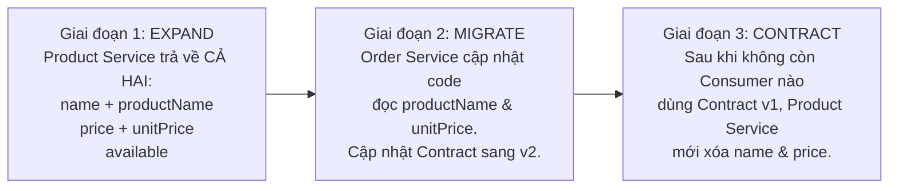

# Phân Tích Breaking Change & Chiến Lược Tiến Hóa API An Toàn

## 1. Giải phẫu sự cố Production trong Câu chuyện

### 1.1. So sánh Payload trước và sau khi Product Team deploy

| Thuộc tính | Order Service kỳ vọng (Cũ) | Product Service trả về (Mới) | Bản chất thay đổi | Hậu quả tại Order Service (Production) |
| :--- | :--- | :--- | :--- | :--- |
| `id` | `"P-100"` | `"P-100"` | Không đổi | Parse thành công. |
| Tên sản phẩm | `"name": "Keyboard"` | `"productName": "Keyboard"` | **Rename field** (`name` $\rightarrow$ `productName`) | Jackson map `product.getName() == null` $\rightarrow$ Lỗi lưu DB (`NOT NULL constraint`) hoặc hiển thị đơn hàng trống tên. |
| Giá bán | `"price": 120.50` | `"unitPrice": 120.50` | **Rename field** (`price` $\rightarrow$ `unitPrice`) | `product.getPrice() == null` $\rightarrow$ Khi tính `price.multiply(quantity)` gây **`NullPointerException`**, sập luồng Checkout (`500 Internal Server Error`). |
| Trạng thái tồn kho | `"available": true` | *(Bị xóa)* | **Xóa field bắt buộc** (`available`) | Nếu dùng kiểu primitive `boolean available`, Jackson gán mặc định `false` $\rightarrow$ **Mọi sản phẩm đều bị báo "Hết hàng"**, chặn 100% đơn hàng! Nếu dùng `Boolean`, gây `NullPointerException`. |

### 1.2. Tại sao hệ thống giám sát và Unit Test truyền thống hoàn toàn "mù" trước lỗi này?

1. **Product Service Health Check vẫn xanh (`/actuator/health`)**:
   - Health check chỉ kiểm tra Database connection, Disk space, Redis/Kafka ping. Nó không kiểm tra tính tương thích schema JSON với các downstream/upstream services.
2. **Product Service Unit Test vẫn pass**:
   - Khi Product Team đổi DTO từ `name, price` sang `productName, unitPrice` và bỏ `available`, họ **cập nhật luôn cả Unit Test nội bộ của Product Service** theo DTO mới. Do đó test của Product Service pass 100%.
3. **Order Service Unit Test vẫn pass (Cái bẫy của Mock tĩnh)**:
   - Trong Order Service, lập trình viên viết `@MockBean ProductClient` hoặc cấu hình WireMock thủ công bằng chuỗi JSON tĩnh viết từ 6 tháng trước (`{ "id": "P-100", "name": "Keyboard", "price": 120.50, "available": true }`).
   - **Mock không phản ánh sự thay đổi của thực tế** (Mock Drift).

---

## 2. Phân loại Breaking Change vs Non-Breaking Change

### 2.1. Bảng phân loại chuẩn cho HTTP REST API & Event Messaging

| Thay đổi API / Event | Breaking? | Lý do kỹ thuật & Điều kiện an toàn |
| :--- | :---: | :--- |
| **1. Thêm optional field mới vào Response / Event**<br>*(VD: Thêm `"category": "Peripherals"` vào Product response)* | **Không**<br>*(Không thường xuyên là breaking)* | **Consumer cũ có thể bỏ qua**. Tuy nhiên, chỉ thực sự an toàn khi Consumer tuân thủ **Tolerant Reader Pattern** (cấu hình Jackson `@JsonIgnoreProperties(ignoreUnknown = true)` hoặc `FAIL_ON_UNKNOWN_PROPERTIES = false`). |
| **2. Xóa field bắt buộc trong Response / Event**<br>*(VD: Xóa `"available": true`)* | **Có** | **Consumer cần field đó** để xử lý logic nghiệp vụ (kiểm tra còn hàng). Khi mất field, Consumer nhận `null` hoặc giá trị mặc định sai (`false`), dẫn đến lỗi runtime hoặc sai lệch nghiệp vụ nghiêm trọng. |
| **3. Rename field**<br>*(VD: Đổi `name` $\rightarrow$ `productName`, `price` $\rightarrow$ `unitPrice`)* | **Có** | Về mặt JSON serialization, **Rename = Xóa field cũ + Thêm field mới**. Consumer đang parse theo tên field cũ (`$.name`, `$.price`) sẽ nhận giá trị `null` và lỗi. |
| **4. Đổi kiểu dữ liệu (Data Type)**<br>*(VD: Đổi `price` từ `number` `120.50` $\rightarrow$ `string` `"120.50 USD"` hoặc `object` `{ "amount": 120.50, "currency": "USD" }`)* | **Có** | **Thay đổi type** làm bộ deserializer (Jackson/Gson) của Consumer ném lỗi `JsonParseException` / `InvalidFormatException` ngay khi đọc payload. |
| **5. Đổi cấu trúc Error Response hoặc HTTP Status Code**<br>*(VD: Đổi từ `{ "errorCode": "PRODUCT_NOT_FOUND" }` sang `{ "errors": ["Not found"] }` hoặc đổi `404` $\rightarrow$ `400`)* | **Có thể (Rất cao)** | **Consumer có thể phụ thuộc vào Error Contract** (ví dụ: dùng `FeignErrorDecoder` đọc `$.errorCode` để phân biệt lỗi hết hàng với lỗi hệ thống nhằm quyết định có retry hay không). |
| **6. Thêm field bắt buộc (Required) vào Request Body / Query Param** | **Có** | Consumer cũ không gửi field mới này lên sẽ bị Producer trả về `400 Bad Request`. |
| **7. Nới lỏng điều kiện Request (Chuyển Required field thành Optional)** | **Không** | Consumer cũ vẫn gửi đầy đủ field như trước nên vẫn hoạt động bình thường. |
| **8. Đổi tên Topic / Exchange hoặc Header định danh Event (`eventType`)** | **Có** | Consumer trong Messaging lắng nghe theo Topic và filter theo Header; đổi các thông số này khiến Consumer không nhận được message nữa. |
| **9. Thêm giá trị mới vào `enum` trong Response**<br>*(VD: `status` có thêm `"PRE_ORDER"` ngoài `"AVAILABLE"`, `"OUT_OF_STOCK"`)* | **Có thể** | Nếu Consumer deserialize `status` trực tiếp vào Java `enum` mà không có `@JsonEnumDefaultValue`, Jackson sẽ ném `InvalidFormatException` khi gặp giá trị enum lạ. |

---

## 3. Cách phòng chống & Giải pháp chuyển đổi không gây downtime

### 3.1. Nguyên tắc 1: Tolerant Reader ở phía Consumer (Order Service)
Consumer chỉ nên đọc những field mình thực sự cần và **không bao giờ fail khi gặp field lạ**:

```java
import com.fasterxml.jackson.annotation.JsonIgnoreProperties;
import java.math.BigDecimal;

@JsonIgnoreProperties(ignoreUnknown = true)
public record ProductDto(
    String id,
    String name,
    BigDecimal price,
    boolean available
) {}
```

### 3.2. Nguyên tắc 2: Expand-and-Contract (Parallel Change) ở phía Producer
Nếu Product Team thực sự muốn đổi quy chuẩn đặt tên từ `name` $\rightarrow$ `productName` và `price` $\rightarrow$ `unitPrice` mà không làm sập Order Service:



**Ví dụ Payload ở Giai đoạn 1 (Expand - Tương thích ngược 100%)**:
```json
{
  "id": "P-100",
  "name": "Keyboard",
  "productName": "Keyboard",
  "price": 120.50,
  "unitPrice": 120.50,
  "available": true
}
```
Khi giữ lại `name`, `price`, `available` và chỉ **thêm** `productName`, `unitPrice`, đây trở thành **Non-breaking change**! Provider Verification cho Contract cũ vẫn PASS, và Order Service trên Production vẫn chạy an toàn.

### 3.3. Nguyên tắc 3: Quản lý phiên bản Contract (Semantic Versioning)
- **`PATCH` (`1.0.0` $\rightarrow$ `1.0.1`)**: Sửa regex matcher hoặc mô tả mà không đổi cấu trúc.
- **`MINOR` (`1.0.0` $\rightarrow$ `1.1.0`)**: Thêm optional field mới vào response hoặc thêm endpoint mới (Tương thích ngược).
- **`MAJOR` (`1.1.0` $\rightarrow$ `2.0.0`)**: Xóa/đổi tên field bắt buộc hoặc tách sang API version mới (`/v2/products/{id}`).

