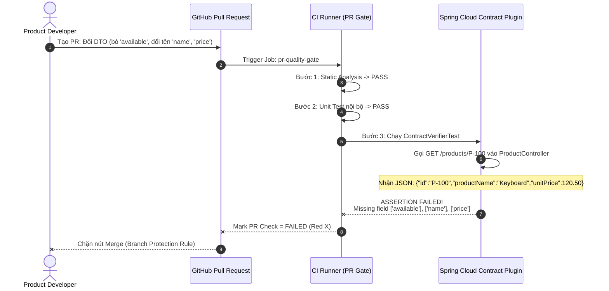

# Chiến Lược Testing Trong CI/CD & Quality Gate Với Spring Cloud Contract

## 1. Chiến lược phân bổ Test theo từng Stage của CI/CD Pipeline

Để vừa đảm bảo tốc độ phát triển (Fast Feedback) vừa chặn đứng lỗi trước khi lên Production, mỗi loại test phải được đặt đúng **Stage** (tầng kiểm duyệt):

```mermaid
flowchart LR
    subgraph PR["1. Pull Request (Phản hồi < 5 phút)"]
        U["Unit Test"]
        SA["Static Analysis (Sonar/Spotless)"]
        CV["Contract Verification<br/>(Quality Gate)"]
    end

    subgraph MAIN["2. Merge Main (Phản hồi < 15 phút)"]
        IT["Integration Test (Testcontainers)"]
        CT["Component Test"]
        CONT["Container Image Scan & Test"]
        PUB["Publish Contract Stubs JAR"]
    end

    subgraph STG["3. Staging (Pre-Production)"]
        E2E["E2E Test (Critical Flows)"]
        LOAD["Load / Performance Test"]
        SEC["Security / DAST Test"]
        RES["Resilience Smoke Test"]
    end

    subgraph PROD["4. Production (Live)"]
        SMK["Smoke Test"]
        SYN["Synthetic Check"]
        CAN["Canary Monitoring & Auto-Rollback"]
    end

    PR -->|"Pass Gate"| MAIN -->|"Pass Gate"| STG -->|"Pass Gate"| PROD
```



### Chi tiết mục tiêu từng Stage

| Stage | Các loại Test thực thi | Mục tiêu & Tiêu chí chặn (Quality Gate) |
| :--- | :--- | :--- |
| **1. Pull Request** | - **Unit Test**<br>- **Static Analysis** (Checkstyle, SonarQube)<br>- **Contract Verification** (Provider Verification & Consumer Stub Test) | Chạy cực nhanh (in-memory, không cần môi trường thật). **Chặn merge PR ngay lập tức** nếu logic sai, code bẩn hoặc **vi phạm hợp đồng API/Event** với các service khác. |
| **2. Merge Main** | - **Integration Test** (DB, Redis, Kafka qua Testcontainers)<br>- **Component Test**<br>- **Container Test** (Build Docker image, Trivy scan, test container boot) | Kiểm chứng service hoạt động đúng với hạ tầng lưu trữ/messaging thật và đóng gói container an toàn. Sau khi pass, **publish `*-stubs.jar` mới lên Artifact Repo**. |
| **3. Staging** | - **E2E Test cho Critical Flow** (Login $\rightarrow$ Cart $\rightarrow$ Checkout $\rightarrow$ Payment)<br>- **Load Test** (k6 / Gatling)<br>- **Security Test** (OWASP ZAP DAST)<br>- **Resilience Smoke Test** (Timeout, Circuit Breaker, Retry) | Kiểm chứng các luồng nghiệp vụ trọng yếu xuyên suốt toàn hệ thống, khả năng chịu tải và khả năng tự phục hồi trên môi trường giống Production. |
| **4. Production** | - **Smoke Test** (Kiểm tra nhanh sau deploy)<br>- **Synthetic Check** (Bot giả lập giao dịch định kỳ 24/7)<br>- **Canary Monitoring** (So sánh Error Rate, Latency p99 của bản mới vs bản cũ) | Phát hiện sớm bất thường khi tiếp xúc traffic thật; tự động rollback bản Canary nếu tỷ lệ lỗi vượt ngưỡng (SLO/Error Budget). |

---

## 2. Tại sao KHÔNG dùng E2E Test để thay thế Contract Test?

Nhiều đội ngũ mắc sai lầm khi bỏ qua Contract Test và nghĩ rằng *"Chỉ cần chạy E2E Test trên Staging là bắt được lỗi lệch API"*. Thực tế chứng minh cách làm này thất bại vì 5 lý do cốt lõi:

| Tiêu chí so sánh | Contract Test (Tại Pull Request) | E2E Test (Tại Staging) |
| :--- | :--- | :--- |
| **1. Thời điểm phát hiện lỗi (Shift-Left)** | **Ngay khi mở PR** (chưa merge vào `main`, chưa build Docker, chưa deploy). | **Quá muộn**: Code lỗi đã merge vào `main`, đã đóng gói image và deploy lên Staging làm hỏng môi trường dùng chung. |
| **2. Tốc độ phản hồi** | **Vài giây** (Chạy bằng `MockMvc` / In-memory StubRunner). | **15 – 60 phút** (Phải dựng đầy đủ 10–20 microservices, DB, Kafka, API Gateway). |
| **3. Độ ổn định (Flakiness)** | **Định tất (Deterministic) 100%** – Không phụ thuộc mạng hay môi trường ngoài. | **Rất dễ Flaky** – Một service thứ 3 (VD: Auth hoặc Payment Sandbox) chập chờn cũng làm cả bộ E2E fail giả. |
| **4. Khả năng định vị lỗi (Root Cause Isolation)** | Chỉ rõ ngay lập tức: **`ProductController` thiếu field `$.available` ở dòng nào**. | Chỉ báo chung chung: `Checkout failed with HTTP 500`. Mất hàng giờ đọc log phân tán (Distributed Tracing) để tìm thủ phạm. |
| **5. Độ phủ các trường hợp biên (Edge Cases)** | Dễ dàng test mọi kịch bản: `200 OK`, `404 Not Found`, `409 Conflict`, event schema. | Chỉ đủ tài nguyên và thời gian chạy vài **Critical Happy Paths** (theo mô hình Kim tự tháp kiểm thử). |

> **Nguyên tắc vàng**:
> - Dùng **Contract Test** ở tầng **Pull Request** để đảm bảo 100% tương thích giao tiếp (API/Event schema) giữa các cặp Producer – Consumer.
> - Chỉ dùng **E2E Test** ở tầng **Staging** cho một số ít luồng nghiệp vụ cốt lõi (Critical Business Journeys) để kiểm tra sự phối hợp tổng thể (configuration, routing, IAM, network).

---

## 3. CI Plan Thực Tế: Biến Provider Verification thành Quality Gate

### 3.1. Cấu hình GitHub Actions cho Product Service (`.github/workflows/product-service-ci.yml`)

```yaml
name: Product Service CI Pipeline

on:
  pull_request:
    branches: [ "main" ]
  push:
    branches: [ "main" ]

jobs:
  # =========================================================================
  # STAGE 1: PULL REQUEST QUALITY GATE (Unit + Static Analysis + Contract)
  # =========================================================================
  pr-quality-gate:
    name: "PR Gate: Unit, Static Analysis & Contract Verification"
    runs-on: ubuntu-latest
    steps:
      - name: Checkout Source Code
        uses: actions/checkout@v4

      - name: Set up JDK 21
        uses: actions/setup-java@v4
        with:
          java-version: '21'
          distribution: 'temurin'
          cache: 'maven'

      - name: 1. Run Static Analysis (Checkstyle & SpotBugs)
        run: ./mvnw checkstyle:check spotbugs:check -B

      - name: 2. Run Unit Tests
        run: ./mvnw test -Dtest="*UnitTest" -B

      - name: 3. QUALITY GATE - Spring Cloud Contract Provider Verification
        # Lệnh này tự động generate ContractVerifierTest từ thư mục contracts/
        # và chạy kiểm chứng trực tiếp lên ProductController.
        # Nếu thiếu bất kỳ field nào (như 'available'), bước này trả về exit code != 0 và chặn PR!
        run: ./mvnw spring-cloud-contract:convert spring-cloud-contract:generateTests test -Dtest="*ContractVerifierTest" -B

  # =========================================================================
  # STAGE 2: MERGE MAIN (Integration, Container Test & Publish Stubs)
  # =========================================================================
  merge-main-pipeline:
    name: "Main: Integration, Container & Publish Stubs"
    needs: pr-quality-gate
    if: github.event_name == 'push' && github.ref == 'refs/heads/main'
    runs-on: ubuntu-latest
    steps:
      - name: Checkout Source Code
        uses: actions/checkout@v4

      - name: Set up JDK 21
        uses: actions/setup-java@v4
        with:
          java-version: '21'
          distribution: 'temurin'
          cache: 'maven'

      - name: 1. Run Integration & Component Tests (Testcontainers)
        run: ./mvnw verify -DskipUnitTests=true -B

      - name: 2. Publish Verified Contract Stubs JAR to Artifact Repository
        run: ./mvnw deploy -DskipTests=true -B
        env:
          NEXUS_USERNAME: ${{ secrets.NEXUS_USERNAME }}
          NEXUS_PASSWORD: ${{ secrets.NEXUS_PASSWORD }}
```

---

## 4. Mô phỏng kịch bản: Khi Product Service đổi Response thiếu `available`

Giả sử một lập trình viên trong team Product mở Pull Request sửa `ProductResponse.java` thành:

```java
// Code mới gây Breaking Change trong PR của Product Service:
public record ProductResponse(
    String id,
    String productName, // Đổi từ 'name' -> 'productName'
    BigDecimal unitPrice // Đổi từ 'price' -> 'unitPrice'
    // Đã xóa trường 'boolean available'
) {}
```

### 4.1. Luồng chặn lỗi tự động trên CI (Pull Request Stage)



### 4.2. Log lỗi thực tế tại bước `Contract Verification` trên CI

Ngay tại bước `3. QUALITY GATE - Spring Cloud Contract Provider Verification`, Maven dừng lại với lỗi chi tiết:

```text
[INFO] -------------------------------------------------------
[INFO]  T E S T S
[INFO] -------------------------------------------------------
[INFO] Running org.springframework.cloud.contract.verifier.tests.order_consumer.ContractVerifierTest
[ERROR] Tests run: 2, Failures: 1, Errors: 0, Skipped: 0, Time elapsed: 0.842 s <<< FAILURE!
[ERROR] validate_should_return_product_when_id_exists  Time elapsed: 0.415 s  <<< FAILURE!
java.lang.IllegalStateException: Parsed JSON [{"id":"P-100","productName":"Keyboard","unitPrice":120.50}] doesn't match the JSON path [$[?(@.['available'] =~ /^(true|false)$/)]]
    at com.toomuchcoding.jsonassert.JsonAsserter.checkBufferedJsonPathString(JsonAsserter.java:265)
    at org.springframework.cloud.contract.verifier.tests.order_consumer.ContractVerifierTest.validate_should_return_product_when_id_exists(ContractVerifierTest.java:42)

[INFO] Results:
[INFO]
[ERROR] Failures:
[ERROR]   ContractVerifierTest.validate_should_return_product_when_id_exists:42
          Parsed JSON [{"id":"P-100","productName":"Keyboard","unitPrice":120.50}]
          doesn't match the JSON path [$[?(@.['available'] =~ /^(true|false)$/)]]
[INFO]
[ERROR] Tests run: 2, Failures: 1, Errors: 0, Skipped: 0
[INFO] ------------------------------------------------------------------------
[INFO] BUILD FAILURE
[INFO] ------------------------------------------------------------------------
Error: Process completed with exit code 1.
```

### 4.3. Kết quả đạt được
1. **Chặn đứng sự cố từ trong trứng nước**: PR bị đánh dấu đỏ (`❌ pr-quality-gate failed`), Branch Protection khóa nút **Merge**.
2. **Developer nhận phản hồi tức thì**: Nhìn vào log CI, developer của Product Service biết ngay **Order Service** đang phụ thuộc vào các trường `name`, `price`, và `available` thông qua contract `order_consumer/shouldReturnProductWhenIdExists.yml`.
3. **Hướng xử lý bắt buộc**:
   - Giữ nguyên các trường `name`, `price`, `available` (áp dụng **Expand-and-Contract** bằng cách chỉ thêm mới `productName`, `unitPrice`), **HOẶC**
   - Phối hợp với team Order Service để nâng cấp sang endpoint `/v2/products/{id}` với Contract mới.

