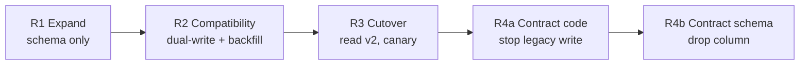

# Migration Plan — Order Status Model (Expand / Contract)

## 0. Bối cảnh & vì sao KHÔNG làm "drop cột → deploy → rollback image"

| Hiện tại (v1.3) | Mục tiêu (v1.4+) |
|---|---|
| `PENDING`, `CONFIRMED`, `CANCELLED` (+ `SHIPPED` đang có trong code) | `PENDING_PAYMENT`, `PAYMENT_PROCESSING`, `CONFIRMED`, `PAYMENT_FAILED`, `CANCELLED` (+ `SHIPPED`) |

Kế hoạch ban đầu (drop `status` → tạo schema mới → rolling deploy → rollback image nếu lỗi) sai vì:

1. **Rolling deployment = old + new cùng chạy** (vài phút, lâu hơn nếu rollout bị pause/canary). Pod v1.3 vẫn `SELECT status` → cột đã drop → 500 toàn bộ request vào pod cũ.
2. Nếu v1.4 ghi giá trị mới vào chính cột `status`, v1.3 gọi `OrderStatus.valueOf("PAYMENT_PROCESSING")` → `IllegalArgumentException` → `GET /orders/{id}` lỗi, consumer v1.3 crash/đẩy DLQ.
3. **Rollback image không rollback schema/data**: cột đã drop + dữ liệu đã mất → image cũ không chạy được → rollback thất bại đúng lúc cần nhất.
4. Event `OrderStatusChanged` mang giá trị mới → consumer cũ (Inventory, Notification) không hiểu.

**Nguyên tắc:** mọi bước migration phải tương thích với **version đang chạy (N)** và **version rollback (N-1)**. Mỗi thay đổi schema tách khỏi thay đổi code, và không bao giờ có bước "phá huỷ" trong cùng release với code mới.

---

## 1. Thiết kế schema

Không tái sử dụng cột `status` cho giá trị mới. Thêm cột mới `status_v2`, giữ `status` (legacy) cho tới khi contract.

### Mapping 2 chiều

| `status_v2` (mới) | → `status` legacy (dual-write cho v1.3 đọc) | Lý do |
|---|---|---|
| `PENDING_PAYMENT` | `PENDING` | |
| `PAYMENT_PROCESSING` | `PENDING` | v1.3 chỉ cần biết "chưa confirm" |
| `PAYMENT_FAILED` | `PENDING` | Có thể retry payment; KHÔNG map `CANCELLED` để v1.3 không release inventory/hoàn tiền nhầm (hành động không đảo ngược) |
| `CONFIRMED` | `CONFIRMED` | |
| `CANCELLED` | `CANCELLED` | |
| `SHIPPED` | `SHIPPED` | |

| `status` legacy | → `status_v2` (backfill / đọc fallback) |
|---|---|
| `PENDING` | `PENDING_PAYMENT` |
| `CONFIRMED` | `CONFIRMED` |
| `CANCELLED` | `CANCELLED` |
| `SHIPPED` | `SHIPPED` |

---

## 2. Các release



### Release 1 — Expand (migration `V14__add_status_v2.sql`, app v1.3 không đổi)

```sql
-- Chỉ thêm, nullable, không default → metadata-only trên PostgreSQL, không lock bảng lâu
ALTER TABLE orders ADD COLUMN IF NOT EXISTS status_v2 VARCHAR(32);

-- Constraint NOT VALID: áp cho row mới, không scan bảng ngay
ALTER TABLE orders
  ADD CONSTRAINT chk_orders_status_v2
  CHECK (status_v2 IN ('PENDING_PAYMENT','PAYMENT_PROCESSING','CONFIRMED',
                       'PAYMENT_FAILED','CANCELLED','SHIPPED')) NOT VALID;

-- Index cho query vận hành (stuck order); CONCURRENTLY để không block write
-- (Flyway: chạy trong migration riêng với executeInTransaction=false)
CREATE INDEX CONCURRENTLY IF NOT EXISTS idx_orders_status_v2_updated
  ON orders (status_v2, updated_at);
```

- Chạy migration bằng **Job riêng / Flyway trước deploy**, KHÔNG để `ddl-auto=update`.
- `SET lock_timeout = '3s'` cho migration để không treo bảng `orders` giờ cao điểm.
- v1.3 không biết `status_v2` → không ảnh hưởng (JPA chỉ map cột đã khai báo).
- **Rollback:** không cần; cột nullable vô hại. (Nếu bắt buộc: `DROP COLUMN status_v2` — an toàn vì chưa có dữ liệu.)

### Release 2 — Compatibility (app v1.4, `FEATURE_STATUS_V2_WRITE=true`, `READ=false`)

Code:
- Domain có enum mới `OrderStatusV2`; enum legacy giữ nguyên.
- **Dual-write** trong cùng transaction: ghi `status_v2` + `status` (theo bảng mapping).
- **Đọc** vẫn theo `status` legacy (`READ=false`), nhưng **tolerant reader**: parse được cả giá trị mới, giá trị lạ → log + metric `order_status_unknown_total` thay vì throw.
- Event: thêm field **additive** `statusV2`, giữ `status` legacy. Consumer cũ bỏ qua field lạ (đã kiểm tra bằng contract test ở day-4).
- Outbox ghi event theo cùng transaction.

Backfill (job chạy sau khi 100% pod là v1.4 — để không còn writer v1.3 ghi row thiếu `status_v2`):

```sql
-- Batch 5.000 row, lặp đến khi 0 row; chạy ngoài giờ flash sale, có throttle (sleep 200ms/batch)
WITH batch AS (
  SELECT id FROM orders
  WHERE status_v2 IS NULL
  ORDER BY id
  LIMIT 5000
  FOR UPDATE SKIP LOCKED
)
UPDATE orders o
SET status_v2 = CASE o.status
                  WHEN 'PENDING'   THEN 'PENDING_PAYMENT'
                  WHEN 'CONFIRMED' THEN 'CONFIRMED'
                  WHEN 'CANCELLED' THEN 'CANCELLED'
                  WHEN 'SHIPPED'   THEN 'SHIPPED'
                END
FROM batch WHERE o.id = batch.id;
```

Verify:

```sql
-- 1. Không còn row thiếu
SELECT count(*) FROM orders WHERE status_v2 IS NULL;                      -- expect 0
-- 2. Không lệch mapping
SELECT status, status_v2, count(*) FROM orders GROUP BY 1,2 ORDER BY 1,2; -- chỉ các cặp hợp lệ
-- 3. Validate constraint (scan, nhưng chỉ SHARE UPDATE EXCLUSIVE lock)
ALTER TABLE orders VALIDATE CONSTRAINT chk_orders_status_v2;
```

- **Rollback app → v1.3:** an toàn. Cột `status` vẫn đúng (dual-write), v1.3 bỏ qua `status_v2`. Row ghi bởi v1.3 trong thời gian rollback có `status_v2 = NULL` → backfill chạy lại (idempotent).

### Release 3 — Cutover (cùng image v1.4 hoặc v1.5, bật `FEATURE_STATUS_V2_READ=true` qua canary)

- Đọc `status_v2`; fallback từ `status` nếu NULL (phòng row ghi bởi pod cũ).
- Logic payment mới chạy: `PENDING_PAYMENT → PAYMENT_PROCESSING → CONFIRMED | PAYMENT_FAILED`.
- **Vẫn dual-write** cột legacy → rollback về R2/v1.3 vẫn được.
- Canary 10% → 25% → 50% → 100% (xem `deployment-strategy.md`).
- Theo dõi: `status mismatch` (job so sánh `status` vs mapping(`status_v2`)), số order `PAYMENT_PROCESSING` > 10 phút, payment mismatch giữa Order và Payment Service.
- Sau khi backfill = 0 row NULL và 100% pod dual-write, đặt NOT NULL không full-scan dưới ACCESS EXCLUSIVE lock (PG12+):
  ```sql
  ALTER TABLE orders ADD CONSTRAINT chk_status_v2_nn CHECK (status_v2 IS NOT NULL) NOT VALID;
  ALTER TABLE orders VALIDATE CONSTRAINT chk_status_v2_nn;   -- lock nhẹ
  ALTER TABLE orders ALTER COLUMN status_v2 SET NOT NULL;    -- dùng constraint đã validate, bỏ qua scan
  ALTER TABLE orders DROP CONSTRAINT chk_status_v2_nn;
  ```

### Release 4 — Contract (sau rollback window ≥ 2 tuần + data verification)

Chia 2 bước, mỗi bước 1 release:

**4a — Contract code (v1.6):** ngừng đọc cột `status`, xoá fallback, xoá feature flag; vẫn **ghi** legacy thêm 1 release (để rollback về v1.5 an toàn). Event bỏ field `status` chỉ khi mọi consumer đã chuyển sang `statusV2` (xác nhận qua contract test + consumer registry).

**4b — Contract schema (v1.7 + migration `V18__drop_legacy_status.sql`):**

```sql
-- Chỉ chạy khi: không pod nào (kể cả version rollback N-1) còn đọc/ghi `status`
ALTER TABLE orders DROP COLUMN status;
-- (Tuỳ chọn) đổi tên status_v2 → status cần thêm 1 vòng expand/contract nữa → thường giữ nguyên tên
```

- Trước khi drop: snapshot/backup bảng hoặc `CREATE TABLE orders_status_legacy_backup AS SELECT id, status FROM orders` (giữ 30 ngày).
- Từ đây rollback app chỉ được về v1.6 (không về v1.5 trở xuống) → ghi rõ trong release note.

---

## 3. Ma trận tương thích

| Schema \ App | v1.3 (old) | v1.4 R2 (dual-write, read legacy) | v1.4/1.5 R3 (read v2) | v1.6 R4a | v1.7 R4b |
|---|---|---|---|---|---|
| Sau R1 (có `status`, `status_v2`) | ✅ | ✅ | ✅ (fallback) | ✅ | ✅ |
| Sau R4b (drop `status`) | ❌ | ❌ | ❌ | ✅ | ✅ |

→ Bước phá huỷ duy nhất (R4b) chỉ xảy ra khi mọi version trong rollback window đều ✅.

## 4. Checklist cho mỗi migration

- [ ] Additive/backward compatible với version N-1?
- [ ] Có `lock_timeout`, không full table rewrite (không `ADD COLUMN ... DEFAULT volatile`, không đổi type)?
- [ ] Index tạo `CONCURRENTLY`?
- [ ] Backfill batch, idempotent, có throttle, có metric tiến độ?
- [ ] Đã chạy trên staging với bản sao dữ liệu cỡ production?
- [ ] Có câu lệnh verify + kế hoạch rollback/data repair?
