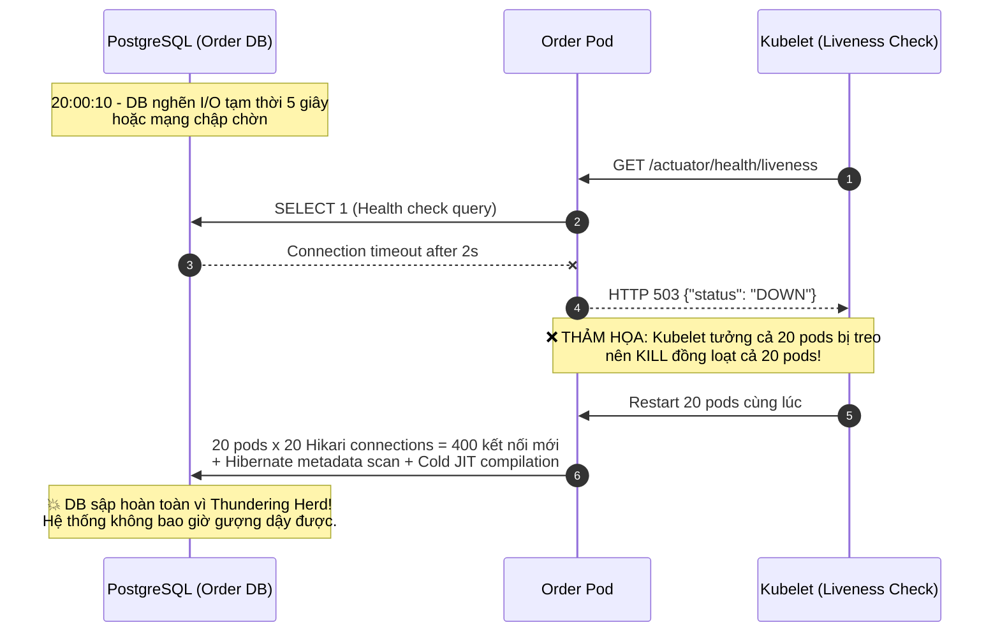
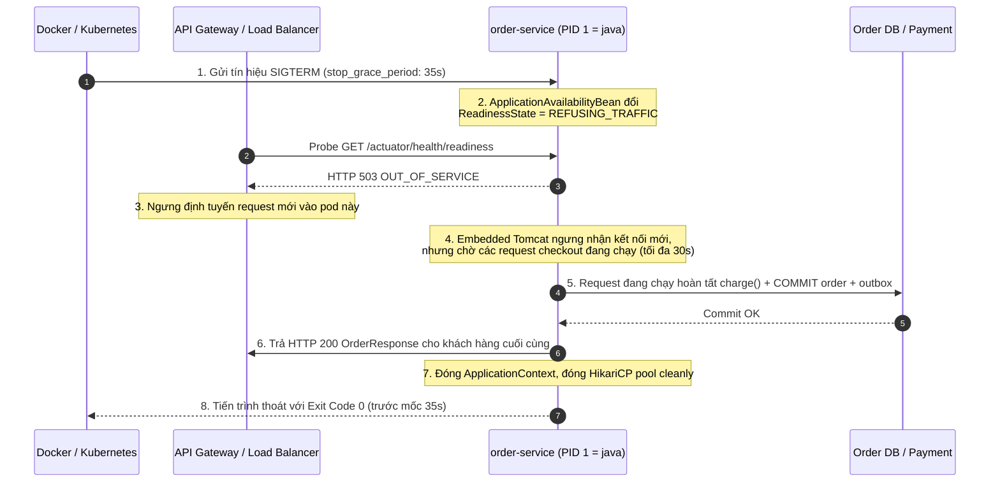

# Thiết Kế Containerization, Spring Boot Actuator, Health Probes & Graceful Shutdown

> Tài liệu này giải quyết bài toán đưa `order-service` vào môi trường vận hành thực tế (Docker / Kubernetes): đóng gói container chuẩn bảo mật, quản lý bộ nhớ JVM trong cgroup, thiết kế Liveness/Readiness Probe chống hiệu ứng domino (Cascading Failure), và đảm bảo không rơi rớt giao dịch khi deploy/scale bằng Graceful Shutdown.

---

## 1. Dockerize Spring Boot Service Chuẩn Production

### 1.1. Multi-stage Build & Spring Boot Layered JAR

Trong [Dockerfile](Dockerfile), quá trình đóng gói được tách thành 2 giai đoạn độc lập:

```mermaid
flowchart LR
    subgraph S1["Stage 1: Builder (gradle:8.7-jdk17-alpine)"]
        B1["Copy build.gradle & settings.gradle<br/>gradle dependencies (Cached Layer)"]
        B2["Copy src/<br/>gradle bootJar -x test"]
        B3["java -Djarmode=layertools extract<br/>Tách 4 layers"]
        B1 --> B2 --> B3
    end

    subgraph S2["Stage 2: Runtime (eclipse-temurin:17-jre-alpine)"]
        R1["Layer 1: dependencies/ (~40MB - hiếm khi đổi)"]
        R2["Layer 2: spring-boot-loader/"]
        R3["Layer 3: snapshot-dependencies/"]
        R4["Layer 4: application/ (~100KB - đổi mỗi lần sửa code)"]
        R5["Run as Non-Root UID 10001:10001<br/>exec java JarLauncher (PID 1)"]
        R1 --> R2 --> R3 --> R4 --> R5
    end

    B3 -->|"COPY --from=builder --chown=10001:10001"| R1
```



- **Tại sao không đẩy JDK và Gradle vào image chạy thật?**
  - Image `jdk` + `gradle` + `.gradle/` cache nặng **700MB – 1.2GB** và chứa trình biên dịch (`javac`), công cụ shell thừa làm tăng bề mặt tấn công (Attack Surface).
  - Sang Stage 2 (`eclipse-temurin:17-jre-alpine`), chỉ giữ lại JRE tối giản + 4 thư mục đã giải nén từ `layertools`, giảm dung lượng image xuống **~170MB**.
- **Tại sao dùng `layertools extract` thay vì `COPY app.jar`?**
  - Nếu copy nguyên khối `app.jar` (45MB), mỗi lần sửa 1 dòng code trong `CreateOrderService`, Docker phải build và push lại toàn bộ layer 45MB.
  - Khi tách thành 4 layers (`dependencies`, `spring-boot-loader`, `snapshot-dependencies`, `application`), layer `dependencies` (99% dung lượng) được cache hoàn toàn; mỗi lần deploy mới chỉ push layer `application/` nặng vài chục KB.

### 1.2. Vai trò của `.dockerignore`

File [order-service/.dockerignore](../../order-service/.dockerignore) chặn các file không cần thiết hoặc nhạy cảm trước khi Docker CLI gửi Build Context sang Docker Daemon:
1. **Bảo mật (Chặn lộ Secret)**: Loại bỏ `.env`, `.env.*`, `*.pem`, `*.key`, `*.p12`, `application-local.yml`. Dù developer vô tình tạo file `.env` trên máy cá nhân khi debug, file đó cũng không bao giờ lọt vào image layer.
2. **Tốc độ & tính nhất quán**: Loại bỏ `.git/`, `.gradle/`, `build/`, `bin/`, `.idea/`, `.vscode/` giúp giảm kích thước context từ hàng trăm MB xuống vài chục KB và tránh làm mất hiệu lực cache (cache invalidation) khi chỉ sửa tài liệu `*.md`.

### 1.3. Non-root User & Container Hardening

Mặc định container chạy với quyền `root` (`UID 0`). Nếu kẻ tấn công khai thác được lỗ hổng RCE (ví dụ lỗ hổng deserialization hoặc thư viện bên thứ 3) và thoát khỏi container (container escape), họ sẽ có quyền `root` trên máy chủ Host.

Cách phòng vệ trong [Dockerfile](Dockerfile) và [docker-compose.yml](docker-compose.yml):
- Tạo system user/group không có login shell:
  ```dockerfile
  RUN addgroup -S appgroup -g 10001 && \
      adduser -S appuser -u 10001 -G appgroup -h /app -s /sbin/nologin
  USER 10001:10001
  ```
- Dùng UID số nguyên (`10001:10001` > `10000`) để tránh trùng với UID của user hệ thống trên Host và giúp Kubernetes kiểm chứng `runAsNonRoot: true` mà không cần tra cứu `/etc/passwd`.
- Bật `read_only: true` cho root filesystem và `security_opt: ["no-new-privileges:true"]`, chỉ cấp `tmpfs` cho `/tmp` và `/tmp/heapdumps`.

### 1.4. Quản lý Environment Variables & Nguyên tắc Không Commit Secret

Trong [order-service/src/main/resources/application.yml](../../order-service/src/main/resources/application.yml):

```yaml
spring:
  datasource:
    url: ${DB_URL:jdbc:postgresql://localhost:5432/orderdb}
    username: ${DB_USERNAME:postgres}
    password: ${DB_PASSWORD:}   # TUYỆT ĐỐI KHÔNG hard-code password trong Git
```

Và trong [docker-compose.yml](docker-compose.yml):

```yaml
DB_PASSWORD: ${DB_PASSWORD:?ERROR_DB_PASSWORD_MUST_BE_PROVIDED_VIA_ENV}
```

- Cú pháp `${VAR:?error_message}` trong Docker Compose sẽ **chặn container khởi chạy ngay lập tức** với thông báo lỗi rõ ràng nếu biến môi trường `DB_PASSWORD` chưa được truyền vào từ shell hoặc file `.env` (vốn đã nằm trong `.gitignore`), thay vì âm thầm chạy với mật khẩu mặc định yếu (`postgres` / `password`).

### 1.5. Quản lý Bộ nhớ JVM trong Container (Tại sao bị `OOMKilled - Exit Code 137`?)

Một tiến trình Java không chỉ tiêu thụ bộ nhớ **Heap** mà còn dùng nhiều vùng bộ nhớ **Off-Heap / Native**:

$$\text{Total JVM Memory} = \text{Heap} + \text{Metaspace} + (\text{Threads} \times \text{Thread Stack}) + \text{Direct Buffers (NIO/Netty)} + \text{GC \& JIT Code Cache} + \text{OS Native Libs}$$

| Sai lầm phổ biến | Hậu quả trên Production (Flash Sale) |
| :--- | :--- |
| Không giới hạn RAM container hoặc để JVM tự đoán trên bản cũ | JVM đọc RAM của máy Host (ví dụ 64GB) và đặt Max Heap = 16GB trong khi container bị giới hạn 512MB $\rightarrow$ Linux Kernel OOM Killer bắn tín hiệu `SIGKILL (9)` làm container chết tức tưởi với **Exit Code 137** mà không kịp ghi log. |
| Đặt `-Xmx512m` bằng đúng giới hạn `memory: 512M` của container | Khi Flash Sale tải cao, Heap tăng lên 420MB + 200 Tomcat threads ($\approx$ 200MB stack) + Metaspace (80MB) > 512MB $\rightarrow$ **OOMKilled (Exit 137)** dù Heap chưa đầy! |

**Cấu hình chuẩn áp dụng cho `order-service` (Container limit = `512MB`)**:
```text
-XX:+UseContainerSupport
-XX:InitialRAMPercentage=50.0
-XX:MaxRAMPercentage=75.0
-XX:+UseG1GC
-XX:MaxGCPauseMillis=200
-XX:+HeapDumpOnOutOfMemoryError
-XX:HeapDumpPath=/tmp/heapdumps/heapdump.hprof
-XX:+ExitOnOutOfMemoryError
```
- **`-XX:+UseContainerSupport`**: Bắt buộc JVM đọc giới hạn RAM/CPU từ Linux `cgroups v1/v2` của container.
- **`-XX:MaxRAMPercentage=75.0`**: Giới hạn Heap tối đa chiếm **75% RAM container** ($\approx 384\text{MB}$ trên container $512\text{MB}$), chừa lại **25% ($\approx 128\text{MB}$)** cho Metaspace, Thread Stacks, Direct Memory và GC overhead.
- **`-XX:+HeapDumpOnOutOfMemoryError` + `-XX:+ExitOnOutOfMemoryError`**: Nếu có memory leak thật sự trong Java Heap, JVM tự xuất file `.hprof` ra volume `/tmp/heapdumps` để đội ngũ kỹ thuật phân tích bằng Eclipse MAT rồi thoát dứt khoát để orchestrator khởi tạo lại pod sạch.

---

## 2. Spring Boot Actuator: Liveness Probe vs Readiness Probe

### 2.1. Phân biệt bản chất Liveness và Readiness

| Tiêu chí | Liveness Probe (`/actuator/health/liveness`) | Readiness Probe (`/actuator/health/readiness`) |
| :--- | :--- | :--- |
| **Câu hỏi cốt lõi** | *"Tiến trình ứng dụng còn sống khỏe hay đã rơi vào trạng thái treo/hỏng nội bộ không thể tự hồi phục (cần giết đi bật lại)?"* | *"Instance này hiện tại có sẵn sàng nhận và xử lý HTTP request mới từ người dùng hay không?"* |
| **Hành động của Orchestrator (K8s) khi `DOWN`** | **Kill & Restart container** (`SIGTERM` $\rightarrow$ `SIGKILL` $\rightarrow$ tạo container mới). | **Rút pod khỏi Service EndpointSlice / Load Balancer** (ngưng gửi traffic mới tới pod, **KHÔNG** restart pod). |
| **Thành phần được phép kiểm tra** | **Chỉ trạng thái nội tại của JVM/Spring**: `livenessState` (`CORRECT` vs `BROKEN`), `ping`. | `readinessState` (`ACCEPTING_TRAFFIC` vs `REFUSING_TRAFFIC`), kết nối DB pool (`db`), ngưỡng tồn đọng nghiêm trọng (`outboxBacklog`). |
| **Có phụ thuộc External Systems (DB, Kafka, Inventory, Payment)?** | ❌ **TUYỆT ĐỐI KHÔNG** | ✅ **Có thể** (có cân nhắc ngưỡng và cơ chế graceful degradation) |

### 2.2. Tại sao Liveness Probe TUYỆT ĐỐI KHÔNG được phụ thuộc External Systems?

> [!CAUTION]
> Theo tài liệu chính thức của [Spring Boot Actuator](https://docs.spring.io/spring-boot/reference/actuator/endpoints.html#actuator.endpoints.kubernetes-probes), việc đưa kiểm tra Database, Kafka hoặc Downstream Microservice (`inventory-service`, `payment-service`) vào **Liveness Probe** là nguyên nhân hàng đầu gây ra **Restart Storm (Bão khởi động lại)** và **Cascading Failure (Sập dây chuyền)** trong các đợt Flash Sale.

Hãy xem điều gì xảy ra nếu ta cấu hình sai (gắn `db` hoặc `paymentService` vào Liveness) lúc 20:00 Flash Sale:



**Thiết kế đúng trong [application.yml](../../order-service/src/main/resources/application.yml)**:
```yaml
management:
  endpoint:
    health:
      show-details: when-authorized
      probes:
        enabled: true
      group:
        # 1. LIVENESS: Chỉ kiểm tra nội tại JVM/ApplicationContext
        liveness:
          include: livenessState,ping
        # 2. READINESS: Kiểm tra khả năng phục vụ traffic
        readiness:
          include: readinessState,db,outboxBacklog
```
- Khi `order-db` chập chờn 5 giây:
  - `/actuator/health/liveness` vẫn trả về **`200 OK {"status":"UP"}`** $\rightarrow$ **Không một pod nào bị restart**, JVM vẫn giữ nguyên JIT cache đã warm-up và trạng thái nội bộ.
  - `/actuator/health/readiness` trả về **`503 SERVICE_UNAVAILABLE {"status":"OUT_OF_SERVICE"}`** trên các pod mất kết nối DB $\rightarrow$ Load Balancer tạm ngưng đẩy request mới vào pod đó; ngay khi DB hồi phục sau 5 giây, Readiness tự chuyển lại về `UP` và nhận traffic bình thường.
- Đối với `inventory-service` và `payment-service`: **Không đưa cả vào Readiness của `order-service`!** Vì nếu `payment-service` chậm hoặc mở Circuit Breaker, `order-service` vẫn phải nhận traffic để phục vụ API `GET /api/orders/{id}` (xem lịch sử đơn hàng) và xử lý fallback `PENDING_PAYMENT`. Trạng thái của `paymentService` Circuit Breaker chỉ hiển thị trong `/actuator/health` tổng quát và xuất ra Prometheus metric `resilience4j_circuitbreaker_state` để cảnh báo.

---

## 3. Custom Health Indicator: `OutboxBacklogHealthIndicator`

Trong kiến trúc Transactional Outbox của `order-service`, nếu bảng `outbox_events` có quá nhiều bản ghi `status = 'NEW'` bị kẹt không đẩy được sang Kafka, hoặc bản ghi cũ nhất đã nằm chờ quá 120 giây, hệ thống đang bị nghẽn đường ống bất đồng bộ.

Chúng ta triển khai [`OutboxBacklogHealthIndicator`](../../order-service/src/main/java/com/example/orderservice/adapter/out/persistence/OutboxBacklogHealthIndicator.java) vừa cung cấp chi tiết cho `/actuator/health/readiness`, vừa xuất 2 Micrometer Gauges (`outbox_unpublished_count` và `outbox_oldest_pending_age_seconds`) cho Prometheus:

```java
@Component("outboxBacklog")
public class OutboxBacklogHealthIndicator implements HealthIndicator {

    private static final int WARNING_BACKLOG_THRESHOLD = 1000;
    private static final int CRITICAL_BACKLOG_THRESHOLD = 5000;
    private static final long MAX_OLDEST_EVENT_AGE_SECONDS = 120L;

    @Override
    public Health health() {
        int pending = unpublishedCount.get();
        long oldestAge = oldestPendingAgeSeconds.get();

        if (pending >= CRITICAL_BACKLOG_THRESHOLD || oldestAge > MAX_OLDEST_EVENT_AGE_SECONDS) {
            return Health.outOfService()
                    .withDetail("unpublishedCount", pending)
                    .withDetail("oldestPendingAgeSeconds", oldestAge)
                    .withDetail("threshold", CRITICAL_BACKLOG_THRESHOLD)
                    .withDetail("reason", "Outbox backlog exceeded critical threshold or publisher stalled")
                    .build();
        }
        return Health.up()
                .withDetail("unpublishedCount", pending)
                .withDetail("oldestPendingAgeSeconds", oldestAge)
                .build();
    }
}
```

### Kết quả JSON trên các Actuator Endpoints

1. **Liveness Probe (`GET /actuator/health/liveness`)** — Nhẹ, phản hồi $< 2\text{ms}$:
   ```json
   {
     "status": "UP",
     "components": {
       "livenessState": { "status": "UP" },
       "ping": { "status": "UP" }
     }
   }
   ```
2. **Readiness Probe (`GET /actuator/health/readiness`)**:
   ```json
   {
     "status": "UP",
     "components": {
       "db": {
         "status": "UP",
         "details": { "database": "PostgreSQL", "validationQuery": "isValid()" }
       },
       "outboxBacklog": {
         "status": "UP",
         "details": { "unpublishedCount": 14, "oldestPendingAgeSeconds": 1 }
       },
       "readinessState": { "status": "UP" }
     }
   }
   ```

---

## 4. Chiến Lược Graceful Shutdown (Không Rơi Rớt Giao Dịch Khi Deploy/Scale-In)

Khi deploy bản mới hoặc scale-in sau Flash Sale, nếu container bị tắt đột ngột trong lúc một thread đang xử lý dở bước `paymentServicePort.charge()` và chuẩn bị `orderRepository.save(order)`, khách hàng sẽ **bị trừ tiền trên cổng thanh toán nhưng DB chưa kịp commit đơn hàng**!

### 4.1. Luồng phối hợp Graceful Shutdown từ Docker/K8s tới Spring Boot



### 4.2. Ba điều kiện bắt buộc để Graceful Shutdown hoạt động thật sự

1. **Cấu hình Spring Boot ([application.yml](../../order-service/src/main/resources/application.yml))**:
   ```yaml
   server:
     shutdown: graceful
   spring:
     lifecycle:
       timeout-per-shutdown-phase: 30s
   ```
2. **Tiến trình `java` phải là `PID 1` trong Container ([Dockerfile](Dockerfile))**:
   - Nếu viết `ENTRYPOINT java -jar app.jar` (shell form không có `exec`), Docker sẽ chạy `/bin/sh -c "java ..."` với `/bin/sh` là `PID 1`. Khi Docker gửi `SIGTERM`, `/bin/sh` không chuyển tiếp tín hiệu `SIGTERM` cho tiến trình con `java` $\rightarrow$ Sau 10 giây chờ vô ích, Docker bắn `SIGKILL` giết chết ứng dụng!
   - Do đó, trong [Dockerfile](Dockerfile) bắt buộc dùng `exec`:
     ```dockerfile
     STOPSIGNAL SIGTERM
     ENTRYPOINT ["sh", "-c", "exec java $JAVA_OPTS org.springframework.boot.loader.launch.JarLauncher"]
     ```
3. **Đồng bộ thời gian chờ của Container Orchestrator ([docker-compose.yml](docker-compose.yml))**:
   - Mặc định Docker chỉ chờ `10s` sau khi gửi `SIGTERM` rồi bắn `SIGKILL`, trong khi Spring Boot cần `30s` (`timeout-per-shutdown-phase: 30s`) để hoàn tất các giao dịch đang dở.
   - Vì vậy phải cấu hình `stop_grace_period: 35s` trong Docker Compose (hoặc `terminationGracePeriodSeconds: 45` trên Kubernetes) để lớn hơn thời gian chờ của Spring Boot ít nhất `5s`.

