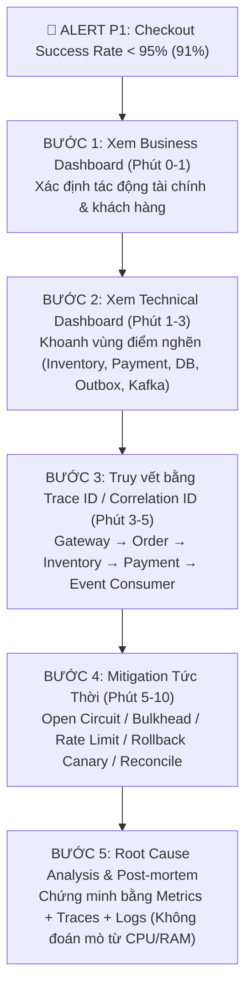
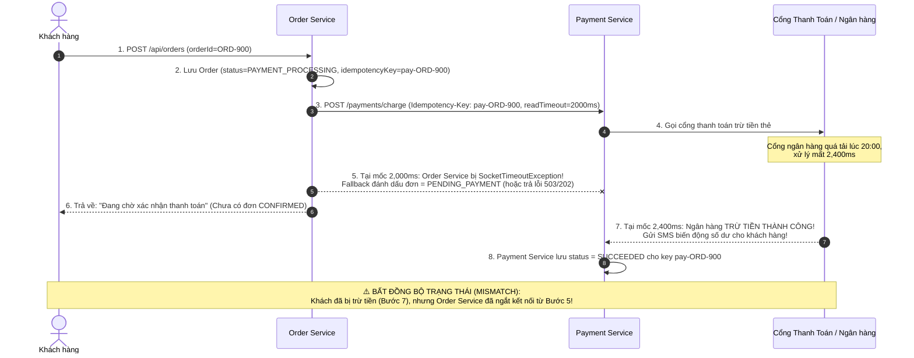

# Incident Runbook & Flash Sale Drill (20:00 Incident Response)

> **Tài liệu vận hành khẩn cấp (SOP/Runbook)** cho đội ngũ On-call khi xảy ra sự cố suy giảm tỷ lệ đặt hàng (Checkout Success Rate) và lệch trạng thái thanh toán trong đợt Flash Sale.

---

## 1. Bối Cảnh Sự Cố Flash Sale 20:00

- **Thời điểm bùng phát**: `20:00:00` (Flash Sale mở bán).
- **Cảnh báo P1 nổ lúc `20:01:15`**:
  1. `CheckoutSuccessRateLow`: Tỷ lệ đặt hàng thành công tụt từ **`99.8%` xuống `91.0%`**.
  2. `InventoryLatencyHigh`: Độ trễ `inventory-service` p99 vọt từ `45ms` lên **`5,020ms`**.
  3. `OutboxBacklogGrowing`: `outbox_unpublished_count` tăng lên **`3,400` events**, `oldest_pending_age` = `85s`.
  4. `KafkaConsumerLagHigh`: Lag của `notification-service` và `audit-service` tăng lên **`18,500` messages**.
  5. `PaymentOrderMismatchDetected`: CSKH báo nhiều khách hàng khiếu nại: ***"Đã nhận SMS trừ tiền ngân hàng nhưng trong app không có đơn hàng (hoặc đơn báo lỗi/đang chờ)!"***

---

## 2. Quy Trình Ứng Phó Chuẩn 5 Bước (Incident Triage Workflow)



### Bước 1: Kiểm tra Business Dashboard (Phút 0 – 1)
Kỹ sư On-call mở vùng **Row 1 & Row 2** trên [Observability Dashboard](observability-dashboard.md):
- `Checkout Success Rate`: Đang ở mức **`91.0%`** (mất `8.8%` đơn hàng trong giờ cao điểm).
- `Checkout Outcomes Breakdown`:
  - `6.5%` đơn rơi vào `FAILED_INVENTORY` (do timeout khi giữ kho).
  - `2.3%` đơn rơi vào `PAYMENT_PENDING` / `PAYMENT_PROCESSING` (khách đã bị trừ tiền nhưng đơn chưa `CONFIRMED`).
- `Payment Charged vs Order Confirmed Delta`: Dương **`+142` giao dịch** trong 5 phút qua $\rightarrow$ Xác nhận ngay phản ánh *"Đã bị trừ tiền nhưng chưa có order"* là **sự thật 100%**, không cần chờ CSKH gửi từng ảnh chụp màn hình.

### Bước 2: Kiểm tra Technical Dashboard (Phút 1 – 3)
Kỹ sư On-call đối chiếu **Row 3, Row 4, Row 5, Row 6**:
- **CPU & Memory của `order-service`**: CPU chỉ **`12%`**, Heap Memory **`48%`** $\rightarrow$ *Bẫy kinh điển: Nếu chỉ nhìn CPU/Memory sẽ tưởng `order-service` đang rất rảnh!*
- **Inventory Client Latency (Row 3)**: p95 = `4.8s`, p99 = `5.0s`.
- **Payment Client Latency (Row 3)**: p99 vọt lên `5.0s` (`TimeoutException` sau 5000ms).
- **HikariCP Connection Pool (Row 6)**: `hikaricp_connections_active = 20/20` (100% bão hòa!), `hikaricp_connections_pending = 85` threads đang xếp hàng chờ lấy DB connection.
- **Outbox Backlog (Row 5)**: Vì `HikariPool-1` bị các luồng Checkout giữ chặt (`20/20`), thread của `OutboxPublisher` không mượn được DB connection để chạy `SELECT ... FOR UPDATE SKIP LOCKED` $\rightarrow$ `outbox_unpublished_count` tăng vọt lên `3,400`.
- **Kafka Consumer Lag (Row 4)**: Khi một số đợt Outbox giật cục xả hàng nghìn event dồn nén sang Kafka cùng lúc (burst), cộng thêm downstream DB bị lock, consumer lag tăng vọt.

### Bước 3: Truy vết bằng Trace ID / Correlation ID (Phút 3 – 5)
Lấy 1 `traceId` từ Exemplar của các request chậm trên Grafana (ví dụ `traceId = 7a9c11e8f02b441099c3d11223344556`, `orderId = ORD-88219`):

```text
Trace ID: 7a9c11e8f02b441099c3d11223344556 | Correlation ID: corr-flash-88219 | Total Duration: 6,420ms
├─ [api-gateway]     POST /api/orders                        [0ms ─────────────────────────────── 6420ms] (200 OK - Fallback)
   └─ [order-service] OrderController.createOrder            [8ms ─────────────────────────────── 6412ms]
      ├─ [order-service] InventoryGateway.reserve            [15ms ────── 1380ms]
      │  ├─ Attempt 1: POST /api/inventory/reservations      [15ms ── 1015ms] ❌ SocketTimeoutException (1000ms)
      │  └─ Attempt 2: POST /api/inventory/reservations      [1215ms ─ 1380ms] ✅ 200 OK (reservationId=RES-771)
      ├─ [order-service] PaymentServiceClient.charge         [1385ms ──────────────────── 6395ms]
      │  └─ POST /api/payments/charge (Idempotency-Key)      [1385ms ──────────────────── 6390ms] ❌ PaymentTransientException (Timeout 5000ms)
      │  └─ Fallback: chargeWithFallback()                   [6391ms ─ 6395ms] ⚠️ Return PENDING_PAYMENT
      └─ [order-service] PostgresOrderRepository.save        [6396ms ─ 6410ms] (Wait Hikari connection: 12ms)
```

---

## 3. Incident Drill Chi Tiết

Dưới đây là quy trình xử lý chi tiết cho **Kịch bản A** và **Kịch bản B** (hai kịch bản cốt lõi trong câu chuyện Flash Sale 20:00), tiếp nối bởi bảng hành động cho **Kịch bản C** và **Kịch bản D**.

---

### KỊCH BẢN A: Inventory Service chậm 5 giây (Gây hiệu ứng Domino lên Order Service & Outbox)

#### A.1. Cơ chế gây lỗi dây chuyền (Anatomy of Failure)
1. Khi Flash Sale bắt đầu lúc 20:00, bảng `inventory_stock` bên `inventory-service` bị **Row Lock Contention** trên các mã SKU hot (hàng nghìn request cùng `UPDATE inventory_stock SET available = available - 1 WHERE sku = 'IPHONE-16'`), khiến thời gian phản hồi của `inventory-service` tăng từ `20ms` lên **`5,000ms`**.
2. Nếu `order-service` để timeout dài (5s) hoặc retry mù quáng ($3 \times 5\text{s} = 15\text{s}$) **bên trong `@Transactional`**:
   - Chỉ cần **20 request đồng thời** gọi sang `inventory-service` là toàn bộ **20 kết nối của HikariCP (`maximum-pool-size: 20`) bị chiếm giữ suốt 5–15 giây** trong trạng thái idle-in-transaction!
   - Hệ quả Domino:
     - API `GET /api/orders/{id}` (xem đơn hàng) bị chết theo vì không mượn được DB connection.
     - `OutboxPublisher` không mượn được DB connection để poll bảng `outbox_events` $\rightarrow$ **Outbox backlog tăng vọt**.

#### A.2. Dấu hiệu nhận biết (Evidence trên Dashboard)
- `http_client_requests_seconds{clientName="inventory-service", quantile="0.99"}` $\ge 1.0\text{s}$ (chạm ngưỡng read-timeout) hoặc $5.0\text{s}$.
- `resilience4j_circuitbreaker_slow_call_rate{name="inventory"}` $> 50\%$.
- `resilience4j_retry_calls_total{name="inventory", kind="failed_with_retry"}` tăng dựng đứng.

#### A.3. Hành động Mitigation Tức Thời (Trong 5 phút)

| Thứ tự | Hành động giảm thiểu (Mitigation) | Lệnh / Cấu hình thực thi | Mục đích |
| :--- | :--- | :--- | :--- |
| **1** | **Cắt máu chảy (Fail-fast) bằng Circuit Breaker & Timeout ngắn** | Đảm bảo `INVENTORY_TIMEOUT_MS=1000` (1s) và `slow-call-duration-threshold=800ms`. Nếu CB chưa mở, cưỡng bức chuyển sang `FORCED_OPEN` hoặc bật Rate Limit cho SKU đang kẹt. | Giải phóng ngay lập tức các Tomcat threads và DB connections trên `order-service`. |
| **2** | **Giới hạn đồng thời bằng Bulkhead** | `resilience4j.bulkhead.instances.inventory.max-concurrent-calls=10`, `max-wait-duration=0` | Dù Inventory có chậm, tối đa chỉ 10 threads của `order-service` được phép chờ Inventory; 190 threads còn lại vẫn phục vụ `GET /api/orders` và các luồng khác bình thường. |
| **3** | **Tách tuyệt đối Remote RPC ra khỏi DB Transaction** | Dùng `TransactionTemplate` chỉ mở TX ngắn vài ms khi `save(order)`, **không giữ `@Transactional`** khi gọi `inventoryGateway.reserve()`. | Giữ `hikaricp_connections_active` luôn $< 5/20$, giúp `OutboxPublisher` đẩy sạch backlog về $0$. |
| **4** | **Giảm tải cho Inventory (Tại nguồn)** | Bật Cache kiểm tra tồn kho hết hàng nhanh (Redis stock pre-check tại Gateway/Order) hoặc xếp hàng Flash Sale. | Ngăn chặn các request khi SKU đã `stock == 0` đập tiếp vào DB của Inventory. |

---

### KỊCH BẢN B: Payment Timeout sau khi Gateway đã Charge (*"Đã bị trừ tiền nhưng không có order"*)

#### B.1. Giải mã nguyên nhân: Tại sao khách bị trừ tiền nhưng không có Order hoàn tất?



> [!WARNING]
> **Nguyên tắc sống còn khi Payment bị Read Timeout**:
> 1. **TUYỆT ĐỐI KHÔNG tự động Retry `POST /payments/charge` mà không có `Idempotency-Key`**, vì nếu cổng thanh toán không dedupe, khách sẽ bị **trừ tiền 2 lần (Double Charge)**!
> 2. **TUYỆT ĐỐI KHÔNG đánh dấu Order = `FAILED` / `CANCELLED` và xóa đơn** khi gặp `SocketTimeoutException` ở bước Payment, vì tiền có thể đã trừ thành công ở phía sau! Phải lưu trạng thái trung gian **`PAYMENT_PROCESSING` / `PENDING_PAYMENT`**.

#### B.2. Quy trình Truy vết & Xử lý (Mitigation & Reconciliation)

1. **Bước 1 – Truy vết giao dịch cụ thể bằng `orderId` hoặc `X-Correlation-Id`**:
   ```bash
   # Tìm toàn bộ log của đơn hàng ORD-900 trên mọi service bằng correlationId / orderId
   grep "ORD-900" /var/log/order-service/*.log
   ```
   Kết quả log chỉ rõ:
   - `20:01:10.100 [order-service] traceId=8f12... orderId=ORD-900 Calling payment service with Idempotency-Key=order-ORD-900-payment`
   - `20:01:15.105 [order-service] traceId=8f12... orderId=ORD-900 [CIRCUIT BREAKER / TIMEOUT] Payment fallback triggered -> status=PENDING_PAYMENT`
   - `20:01:15.450 [payment-service] traceId=8f12... orderId=ORD-900 Gateway charge SUCCEEDED paymentId=PAY-900-7712`

2. **Bước 2 – Đối soát hàng loạt (Batch Query) các đơn bị kẹt `PAYMENT_PROCESSING`**:
   ```sql
   -- Liệt kê các đơn hàng đang kẹt ở trạng thái chờ thanh toán quá 60 giây
   SELECT id AS order_id, total, status, created_at, updated_at
   FROM orders
   WHERE status IN ('PENDING', 'PENDING_PAYMENT', 'PAYMENT_PROCESSING')
     AND created_at BETWEEN '2026-10-25 20:00:00+07' AND '2026-10-25 20:15:00+07'
   ORDER BY created_at ASC;
   ```

3. **Bước 3 – Chạy Cơ chế Tự động Đối soát (Payment Reconciliation Job / Webhook Consumer)**:
   - `Payment Service` phát sự kiện `PaymentCapturedEvent` qua Kafka (hoặc `Order Service` chạy job `PaymentReconciliationScheduler` mỗi 30 giây cho các đơn `PENDING_PAYMENT` > 30s):
     - Gọi `GET /api/payments?idempotencyKey=order-{orderId}-payment` (chỉ truy vấn trạng thái, **không** tạo lệnh thu tiền mới).
     - **Trường hợp 1 (`Payment = SUCCEEDED`)**:
       - Nếu giữ kho (`reservationId`) còn hiệu lực $\rightarrow$ Chuyển Order sang **`CONFIRMED`** và chèn sự kiện `OrderConfirmed` vào bảng `outbox_events` trong cùng 1 transaction $\rightarrow$ Khách nhận được đơn hàng + email xác nhận.
       - Nếu giữ kho đã hết hạn và kho đã hết sạch hàng $\rightarrow$ Chuyển Order sang **`CANCELLED_OUT_OF_STOCK`** và tự động phát lệnh **`AUTO_REFUND` (Hoàn tiền)** sang Payment Service, đồng thời gửi thông báo xin lỗi khách hàng.
     - **Trường hợp 2 (`Payment = FAILED / NOT_FOUND` sau 15 phút)**:
       - Giải phóng giữ kho (Release Inventory Reservation) và chuyển Order sang **`PAYMENT_FAILED`**.

---

### KỊCH BẢN C & D: Bảng Playbook Phản Ứng Nhanh

| Kịch bản | Triệu chứng trên Dashboard | Truy vết (Trace & Log) | Hành động Mitigation | Cách Verify sau xử lý |
| :--- | :--- | :--- | :--- | :--- |
| **C. Consumer lỗi làm DLQ tăng** | - `kafka_topic_partition_current_offset{topic=~".*\\.dlq"}` tăng.<br/>- `deliveryAttempt > 1` tăng vọt. | - Xem bảng `dlq_messages` gom nhóm theo `exception_class`.<br/>- Đọc header `x-exception-message` và `traceparent`. | 1. Nếu lỗi hạ tầng đích (SMTP/Audit DB down): tạm dừng consumer hoặc chờ hạ tầng hồi phục.<br/>2. Nếu lỗi bug code / schema mới: hotfix consumer, deploy, dùng `DlqReplayController` chạy `dryRun=true` $\rightarrow$ Canary 1 msg $\rightarrow$ Replay vào topic `*.replay` với rate limit `10 msg/s`. | - `dlq_messages` status chuyển sang `REPLAYED`.<br/>- Không có bản ghi trùng trong `audit_records` / `notification_log`. |
| **D. Deploy mới làm HTTP 5xx tăng** | - `http_server_requests_seconds_count{status=~"5.."}` tăng vọt ngay sau mốc thời gian rollout bản `v1.0.1`.<br/>- Tách metric theo tag `version="1.0.1"` vs `version="1.0.0"` thấy lỗi chỉ nằm ở `v1.0.1`. | - Lọc log theo `{version="1.0.1", level="ERROR"}` và `traceId`.<br/>- Phát hiện `NullPointerException` hoặc lỗi thiếu cột DB / sai config biến môi trường. | **Rollback Canary ngay lập tức (Trong < 2 phút)**:<br/>- Điều hướng 100% traffic trên Gateway/Ingress về `v1.0.0`.<br/>- Chạy `kubectl rollout undo deployment/order-service` (Graceful shutdown đảm bảo các request đang chạy trên pod cũ không bị ngắt ngang). | - `HTTP 5xx rate` về $< 0.1\%$ trong 1 phút.<br/>- `Checkout Success Rate` hồi phục về `99.8%`. |

---

## 4. Root Cause Analysis (RCA): Tại Sao KHÔNG Kết Luận Từ CPU/Memory Một Mình?

### 4.1. Nghịch lý "Server Rảnh Nhưng Hệ Thống Chết"

Trong sự cố Flash Sale 20:00, nếu chỉ nhìn vào biểu đồ **CPU (`12%`)** và **Memory (`48%`)** của `order-service`, người thiếu kinh nghiệm sẽ kết luận sai lầm rằng: *"Order Service hoàn toàn bình thường, không bị quá tải!"*

**Sự thật kỹ thuật**:
- Khi `order-service` gọi đồng bộ sang `inventory-service` (chậm 5s) hoặc `payment-service` (timeout 5s), hoặc xếp hàng chờ mượn kết nối từ `HikariCP`, các luồng xử lý (Tomcat Worker Threads) chuyển sang trạng thái **`WAITING` / `TIMED_WAITING` (Blocked on I/O hoặc Lock)**.
- Một thread đang ngủ chờ mạng (`SocketRead0`) hoặc chờ lock **không tiêu thụ chu kỳ lệnh CPU (0% CPU)** và **không cấp phát thêm bộ nhớ Heap mới**!
- Nhưng khi toàn bộ **20/20 kết nối HikariCP** hoặc **200/200 Tomcat Threads** đều rơi vào trạng thái `TIMED_WAITING`, **thông lượng (Throughput) của hệ thống tụt về 0** và mọi request mới đều bị từ chối hoặc timeout!

### 4.2. Bảng Phân Tích 5 Whys (Post-mortem Summary)

| Cấp độ | Câu hỏi "Tại sao?" (Why) | Bằng chứng xác thực (Metric / Trace / Log) |
| :--- | :--- | :--- |
| **Triệu chứng** | Tại sao Checkout Success Rate giảm xuống `91%` và khách báo bị trừ tiền không có đơn? | Panel `Checkout Success Rate = 91%`, Panel `Payment Charged vs Order Confirmed Delta = +142`. |
| **Why 1** | Tại sao `6.5%` đơn lỗi Inventory và `2.3%` đơn lệch trạng thái Payment? | Trace Waterfall cho thấy Span `inventory.reserve` mất `5000ms` và `payment.charge` bị `SocketTimeoutException` ở mốc `5000ms` trước khi cổng ngân hàng trả kết quả ở mốc `5400ms`. |
| **Why 2** | Tại sao Outbox backlog (`3,400`) và độ trễ DB của `order-service` cũng tăng vọt dù DB của Order không chạy query nặng? | Metric `hikaricp_connections_active = 20/20`, `hikaricp_connections_pending = 85`. Các luồng Checkout giữ kết nối DB trong suốt thời gian chờ gọi HTTP sang Inventory/Payment, làm `OutboxPublisher` bị đói kết nối (Connection Starvation). |
| **Why 3** | Tại sao lỗi chậm ở Inventory/Payment lại chiếm hết tài nguyên của Order Service? | Chưa bật `Bulkhead` giới hạn số call đồng thời và `slow-call-rate-threshold` trên Circuit Breaker chưa đủ nhạy để ngắt sớm khi downstream bị chậm (Slow Call) chứ chưa trả mã 500. |
| **Why 4** | Tại sao khách bị trừ tiền mà đơn vẫn treo lâu không tự hoàn tất? | Khi `payment.charge` bị Read Timeout, fallback đã lưu đơn ở trạng thái `PENDING` nhưng thiếu **Reconciliation Worker / Webhook Consumer** tự động đối soát lại theo `Idempotency-Key` trong vòng 60 giây. |
| **Why 5** | Tại sao đội trực mất nhiều thời gian ở các lần trước mới tìm ra nguyên nhân? | Trước đây chỉ có CPU, Memory và log rời rạc; thiếu Business Metrics (`order_checkout_total`, `order_payment_mismatch_total`), thiếu `CorrelationIdFilter` và chưa tách `Liveness` khỏi `Readiness`. |

### 4.3. Action Items Ngăn Ngừa Tái Diễn
1. **[Hoàn thành]** Bổ sung `CorrelationIdFilter` gắn `X-Correlation-Id` và `X-Trace-Id` xuyên suốt mọi request và log.
2. **[Hoàn thành]** Cấu hình `slow-call-duration-threshold: 1500ms` và `slow-call-rate-threshold: 50` cho Circuit Breaker trong `application.yml`.
3. **[Hoàn thành]** Đưa `OutboxBacklogHealthIndicator` vào nhóm `readiness` (tách biệt hoàn toàn khỏi `liveness`) và xuất metric `outbox_unpublished_count` ra Prometheus.
4. **[Bắt buộc]** Tách mọi lời gọi HTTP (`inventory`, `payment`) ra ngoài phạm vi `@Transactional` của Database; vận hành job đối soát tự động (`PaymentReconciliationJob`) mỗi 30 giây cho các đơn `PENDING_PAYMENT`.

