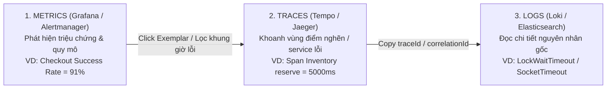
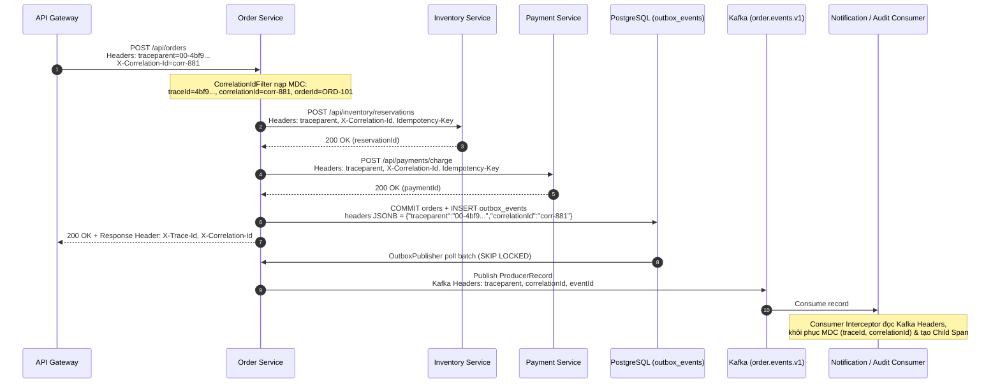

# Thiết Kế Observability Dashboard, Metrics (Technical + Business) & Distributed Tracing

> Tài liệu này thiết kế hệ thống quan sát toàn diện cho `order-service` trong bối cảnh Flash Sale: phân tách rõ vai trò **Logs – Metrics – Traces**, chuẩn hóa truyền vết **Correlation/Trace ID** xuyên qua cả giao tiếp đồng bộ (HTTP) lẫn bất đồng bộ (Transactional Outbox $\rightarrow$ Kafka), và định nghĩa bộ **6 Bảng Dashboard Grafana + PromQL + Alert Rules**.

---

## 1. Phân Biệt Ba Trụ Cột Observability (Logs, Metrics, Traces)

Khi sự cố Flash Sale nổ ra lúc 20:00 (*Checkout success rate giảm từ 99.8% xuống 91%, khách báo bị trừ tiền nhưng không có order*), chỉ nhìn CPU/Memory và log rời rạc là vô dụng. Ba trụ cột phải phối hợp theo trình tự:

| Thành phần | Trả lời câu hỏi cốt lõi | Đặc điểm dữ liệu & Chi phí | Vai trò trong sự cố Flash Sale 20:00 |
| :--- | :--- | :--- | :--- |
| **Metrics** | *"Hệ thống đang có xu hướng/biểu đồ/cảnh báo gì bất thường? Mức độ ảnh hưởng bao nhiêu %?"* | Số liệu tổng hợp theo chuỗi thời gian (Time-series), dung lượng nhỏ, truy vấn cực nhanh, dùng để **bắn Alert**. | Phát hiện ngay lúc `20:00:30`: Checkout Success Rate tụt xuống `91%`, Inventory p99 vọt lên `5.0s`, Orders stuck ở `PAYMENT_PROCESSING` tăng vọt. |
| **Traces** | *"Một request cụ thể đi qua những service nào, mất bao nhiêu ms ở mỗi chặng, chậm hoặc đứt gãy ở đâu?"* | Chuỗi các `Span` gắn chung `traceId` có cấu trúc cha-con (Waterfall), thường lấy mẫu (Sampling 10% – 100% khi lỗi). | Chỉ đích danh trong 1 request checkout mất `5.2s`: Gateway (`10ms`) $\rightarrow$ Order (`40ms`) $\rightarrow$ **Inventory (`5000ms` timeout)** hoặc **Payment (`2000ms` read timeout sau khi gateway đã thu tiền)**. |
| **Logs** | *"Chi tiết lỗi tại dòng code/hàm đó là gì? Stacktrace, mã lỗi nghiệp vụ, payload/tham số nào gây lỗi?"* | Văn bản có cấu trúc (Structured JSON) gắn `traceId`, `correlationId`, `orderId`. Chi phí lưu trữ cao nhất. | Từ `traceId` trên Trace, lọc đúng log của request đó để thấy: `SocketTimeoutException` khi gọi `POST /payments` với `idempotencyKey=order-ORD-9912-payment`. |



---

## 2. Chiến Lược Correlation ID & Distributed Tracing Xuyên Suốt

### 2.1. Luồng truyền vết từ API Gateway $\rightarrow$ HTTP Services $\rightarrow$ Outbox $\rightarrow$ Kafka Consumer

Để không bị "đứt mạch" trace khi chuyển từ gọi HTTP đồng bộ sang lưu DB Outbox và phát sự kiện Kafka bất đồng bộ, hệ thống thống nhất 3 định danh trong mọi log và header:
- `traceparent`: Chuẩn W3C Trace Context (`00-<traceId 32 hex>-<spanId 16 hex>-01`) do Micrometer Tracing / OpenTelemetry quản lý.
- `X-Correlation-Id`: Mã định danh xuyên suốt phiên giao dịch của người dùng (do API Gateway sinh nếu client chưa gửi, được [`CorrelationIdFilter`](../../order-service/src/main/java/com/example/orderservice/adapter/in/web/CorrelationIdFilter.java) đưa vào `MDC`).
- `orderId`: Định danh nghiệp vụ (`ORD-...`) được gắn vào `MDC.put("orderId", ...)` ngay tại `OrderController` / `CreateOrderService`.



### 2.2. Chuẩn hóa Structured Log (JSON)

Mỗi dòng log từ mọi service đều xuất các trường chuẩn để tìm kiếm tức thì trên Loki / Kibana bằng `{traceId="4bf92f3577b34da6a3ce929d0e0e4736"}` hoặc `{orderId="ORD-101"}`:

```json
{
  "timestamp": "2026-10-25T20:01:14.238+07:00",
  "level": "WARN",
  "service": "order-service",
  "traceId": "4bf92f3577b34da6a3ce929d0e0e4736",
  "spanId": "00f067aa0ba902b7",
  "correlationId": "corr-881-flashsale",
  "orderId": "ORD-101",
  "logger": "c.e.o.a.out.payment.PaymentServiceClient",
  "message": "[PAYMENT] Simulating timeout — orderId=ORD-101"
}
```

---

## 3. Danh Mục Metrics Kỹ Thuật & Nghiệp Vụ (Technical & Business Metrics)

### 3.1. Bảng 10 Metrics Kỹ Thuật (Technical Metrics)

| # | Metric cần giám sát | Tên Metric (Prometheus / Micrometer) | PromQL Chuẩn | Ngưỡng Cảnh Báo (Alert) |
| :--- | :--- | :--- | :--- | :--- |
| **1** | **Request Rate (RPS)** | `http_server_requests_seconds_count` | `sum(rate(http_server_requests_seconds_count{application="order-service"}[1m])) by (uri, method)` | Spike $> 3\times$ baseline hoặc tụt về $0$ |
| **2** | **HTTP 4xx / 5xx Rate** | `http_server_requests_seconds_count{status=~"4..|5.."}` | `sum(rate(http_server_requests_seconds_count{application="order-service",status=~"5.."}[1m])) / sum(rate(http_server_requests_seconds_count{application="order-service"}[1m])) * 100` | Warning: $> 1\%$ trong 2m<br/>Critical (P1): $> 5\%$ trong 1m |
| **3** | **Latency p50 / p95 / p99** | `http_server_requests_seconds_bucket` | `histogram_quantile(0.99, sum(rate(http_server_requests_seconds_bucket{application="order-service",uri="/api/orders"}[1m])) by (le))` | Warning: $\text{p95} > 1.5\text{s}$<br/>Critical: $\text{p99} > 3.0\text{s}$ |
| **4** | **JVM Heap & GC Pause** | `jvm_memory_used_bytes`, `jvm_gc_pause_seconds` | `sum(jvm_memory_used_bytes{area="heap"}) / sum(jvm_memory_max_bytes{area="heap"}) * 100`<br/>`rate(jvm_gc_pause_seconds_sum[1m])` | Heap $> 85\%$ trong 5m<br/>GC pause $> 200\text{ms}$ |
| **5** | **Thread Pool Saturation** | `tomcat_threads_busy_threads`, `tomcat_threads_config_max_threads` | `tomcat_threads_busy_threads / tomcat_threads_config_max_threads * 100` | Warning: $> 75\%$<br/>Critical: $> 90\%$ |
| **6** | **DB Connection Pool (HikariCP)** | `hikaricp_connections_active`, `hikaricp_connections_pending`, `hikaricp_connections_timeout_total` | `hikaricp_connections_active{pool="HikariPool-1"}`<br/>`rate(hikaricp_connections_timeout_total[1m])` | Active $\ge 18/20$ hoặc Pending $> 0$ hoặc Timeout $> 0$ |
| **7** | **Circuit Breaker State** | `resilience4j_circuitbreaker_state`, `resilience4j_circuitbreaker_failure_rate` | `resilience4j_circuitbreaker_state{name=~"inventory|paymentService", state="open"}` | `state="open" == 1` kéo dài $> 30\text{s}$ (P1) |
| **8** | **Kafka Consumer Lag** | `kafka_consumer_fetch_manager_records_lag_max` (hoặc `kafka_consumergroup_lag`) | `max(kafka_consumergroup_lag{group=~"notification.*|audit.*"}) by (group, topic)` | Warning: $> 5,000$ msgs<br/>Critical: $> 20,000$ msgs hoặc tăng liên tục 10m |
| **9** | **DLQ Message Count** | `kafka_topic_partition_current_offset{topic=~".*\\.dlq"}` | `sum(increase(kafka_topic_partition_current_offset{topic=~"order\\.events\\.v1\\..*\\.dlq"}[5m])) by (topic)` | Bất kỳ message mới nào vào DLQ ($> 0$) |
| **10** | **Outbox Unpublished Count** | `outbox_unpublished_count`, `outbox_oldest_pending_age_seconds` | `max(outbox_unpublished_count)`<br/>`max(outbox_oldest_pending_age_seconds)` | Backlog $> 1,000$ hoặc Oldest age $> 60\text{s}$ (P1 nếu $> 120\text{s}$) |

---

### 3.2. Bảng 5 Metrics Nghiệp Vụ (Business Metrics)

> [!IMPORTANT]
> **Tại sao Technical Metrics không thể thay thế Business Metrics?**
> Trong kịch bản `CreateOrderService` gọi `paymentServicePort.charge()` bị rơi vào `chargeWithFallback()`, HTTP endpoint `POST /api/orders` vẫn trả về **`HTTP 200 OK`** kèm trạng thái `PENDING`! Nếu chỉ nhìn `HTTP 5xx rate`, kỹ sư trực sẽ tưởng hệ thống hoàn toàn khỏe mạnh (`5xx = 0%`), trong khi thực tế **Checkout Success Rate thật sự (đơn hàng thanh toán & giữ kho thành công) đã tụt từ 99.8% xuống 91%**!

| # | Metric Nghiệp Vụ | Tên Metric (Micrometer) | Công thức PromQL | Ý nghĩa Vận hành & Ngưỡng Alert |
| :--- | :--- | :--- | :--- | :--- |
| **1** | **Checkout Success Rate** | `order_checkout_total{result="confirmed\|payment_pending\|failed_inventory\|failed_payment"}` | `sum(rate(order_checkout_total{result="confirmed"}[5m])) / sum(rate(order_checkout_total[5m])) * 100` | Tỷ lệ đơn hàng hoàn tất trọn vẹn. **Alert P1 ngay khi $< 95\%$ trong 2 phút** (SLO bình thường $\ge 99.5\%$). |
| **2** | **Payment Success nhưng Order Pending (Mismatch)** | `order_payment_mismatch_total` | `sum(increase(order_payment_mismatch_total[5m]))` | Số ca cổng thanh toán đã trừ tiền (webhook/reconcile báo `PAID`) nhưng đơn hàng ở Order DB đang `PAYMENT_PENDING` hoặc `FAILED`. **Alert P1 nếu $> 0$**. |
| **3** | **Inventory Reservation Failure** | `order_inventory_reservation_total{status="success\|out_of_stock\|timeout\|circuit_open\|bulkhead_full"}` | `sum(rate(order_inventory_reservation_total{status=~"timeout\|circuit_open\|bulkhead_full"}[1m]))` | Tách biệt rõ **hết hàng thật (`out_of_stock`)** với **lỗi kỹ thuật của Inventory (`timeout`, `circuit_open`)**. |
| **4** | **Duplicate Payment Prevented Count** | `payment_idempotency_deduped_total` | `sum(increase(payment_idempotency_deduped_total[5m]))` | Số lần `Idempotency-Key` chặn đứng việc trừ tiền 2 lần khi client/Order Service retry. Tăng đột biến báo hiệu mạng/timeout đang bất ổn. |
| **5** | **Order Stuck ở `PAYMENT_PROCESSING`** | `orders_stuck_payment_processing_count` | `max(orders_stuck_payment_processing_count)` | Số đơn hàng nằm ở trạng thái `PAYMENT_PROCESSING` / `PENDING_PAYMENT` quá **60 giây** chưa được chốt. **Alert P1 nếu $> 10$ đơn**. |

---

## 4. Thiết Kế Chi Tiết Dashboard Vận Hành (Grafana Layout 6 Vùng)

Dashboard được tổ chức theo nguyên tắc **Top-Down Triage** (từ triệu chứng kinh doanh ở trên cùng $\rightarrow$ điểm nghẽn dịch vụ đồng bộ ở giữa $\rightarrow$ đường ống bất đồng bộ & hạ tầng JVM/DB ở dưới):

```mermaid
flowchart TD
    subgraph ROW1["ROW 1: CHECKOUT RELIABILITY (Executive & On-call Overview)"]
        P11["Panel 1.1: Checkout Success Rate (%)<br/>Gauge + Time-series (SLO 99.5%)"]
        P12["Panel 1.2: Checkout Outcomes Breakdown<br/>Stacked Bar: CONFIRMED vs PENDING vs FAILED"]
        P13["Panel 1.3: HTTP 2xx / 4xx / 5xx & p95/p99 Latency<br/>POST /api/orders vs GET /api/orders/{id}"]
    end

    subgraph ROW2["ROW 2: PAYMENT MISMATCH & STUCK ORDERS (Financial Integrity)"]
        P21["Panel 2.1: Payment Charged vs Order Confirmed Delta<br/>Phát hiện 'Trừ tiền nhưng không có order'"]
        P22["Panel 2.2: Orders Stuck in PAYMENT_PROCESSING > 60s<br/>Stat Panel (Red when > 0)"]
        P23["Panel 2.3: Duplicate Payments Prevented<br/>Idempotency Key Hits / min"]
    end

    subgraph ROW3["ROW 3: INVENTORY & PAYMENT LATENCY + RESILIENCE4J"]
        P31["Panel 3.1: Downstream Client Latency<br/>Inventory & Payment p50 / p95 / p99"]
        P32["Panel 3.2: Circuit Breaker State Timeline<br/>CLOSED (Green) / HALF_OPEN (Yellow) / OPEN (Red)"]
        P33["Panel 3.3: Retry Attempts & Bulkhead Available Permits<br/>Phát hiện Retry Storm & nghẽn Bulkhead"]
    end

    subgraph ROW4["ROW 4: KAFKA CONSUMER LAG & DLQ"]
        P41["Panel 4.1: Consumer Group Lag by Topic/Partition<br/>notification, audit, analytics"]
        P42["Panel 4.2: Kafka Produce vs Consume Rate (msg/s)"]
        P43["Panel 4.3: DLQ New Messages (5m increase)<br/>order.events.v1.*.dlq"]
    end

    subgraph ROW5["ROW 5: TRANSACTIONAL OUTBOX BACKLOG"]
        P51["Panel 5.1: Outbox Unpublished Count (status=NEW)"]
        P52["Panel 5.2: Oldest Pending Event Age (seconds)"]
        P53["Panel 5.3: Outbox Publisher Throughput & Failed Attempts"]
    end

    subgraph ROW6["ROW 6: JVM & DATABASE SATURATION"]
        P61["Panel 6.1: HikariCP Connections<br/>Active vs Idle vs Pending vs Max (20)"]
        P62["Panel 6.2: Tomcat Busy Threads vs Max (200)"]
        P63["Panel 6.3: JVM Heap Used (%) vs MaxRAMPercentage (75%) & GC Pause"]
    end

    ROW1 --> ROW2 --> ROW3 --> ROW4 --> ROW5 --> ROW6
```



### Chi Tiết Các Panel Trọng Tâm

#### Vùng 1: Checkout Reliability
- **Panel 1.1 – Checkout Success Rate (%)**:
  - **Loại biểu đồ**: Stat + Time Series có đường ngưỡng SLO `99.5%` (vàng ở `98%`, đỏ ở `95%`).
  - **PromQL**:
    ```promql
    sum(rate(order_checkout_total{result="confirmed"}[2m]))
    /
    sum(rate(order_checkout_total{result!="rejected_4xx"}[2m])) * 100
    ```
  - **Lưu ý thiết kế**: Loại trừ lỗi `rejected_4xx` (do khách nhập sai thẻ hoặc hết hàng hợp lệ) ra khỏi mẫu số để đo chính xác độ tin cậy kỹ thuật của luồng Checkout.

#### Vùng 2: Payment Mismatch & Stuck Orders (Bắt trực tiếp lỗi "Đã trừ tiền nhưng không có order")
- **Panel 2.1 – Payment Gateway Charged vs Order Confirmed Discrepancy**:
  - **PromQL**:
    ```promql
    sum(increase(payment_gateway_charge_success_total[5m]))
    -
    sum(increase(order_checkout_total{result="confirmed"}[5m]))
    ```
  - **Cách đọc**: Bình thường độ lệch này dao động quanh $0$. Nếu vọt lên dương (ví dụ $+45$ trong 5 phút), nghĩa là có 45 giao dịch cổng thanh toán đã trừ tiền thành công nhưng `order-service` bị timeout khi chờ đọc kết quả hoặc lỗi khi cập nhật trạng thái đơn hàng!
- **Panel 2.2 – Stuck Orders in `PAYMENT_PROCESSING` (> 60s)**:
  - Được cập nhật mỗi 15 giây bởi job quét nhẹ:
    ```sql
    SELECT count(*) FROM orders
    WHERE status = 'PAYMENT_PROCESSING'
      AND updated_at < now() - interval '60 seconds';
    ```

#### Vùng 3: Inventory Latency & Resilience4j
- **Panel 3.1 – Inventory & Payment Client Latency (p50 / p95 / p99)**:
  - **PromQL**:
    ```promql
    histogram_quantile(0.99, sum(rate(http_client_requests_seconds_bucket{clientName="inventory-service"}[1m])) by (le))
    ```
- **Panel 3.2 – Circuit Breaker State & Slow Call Rate**:
  - **PromQL**:
    ```promql
    resilience4j_circuitbreaker_state{name=~"inventory|paymentService"}
    resilience4j_circuitbreaker_slow_call_rate{name=~"inventory|paymentService"}
    ```
- **Panel 3.3 – Retry Calls & Bulkhead Rejections**:
  - **PromQL**:
    ```promql
    sum(rate(resilience4j_retry_calls_total{kind=~"failed_with_retry|successful_with_retry"}[1m])) by (name, kind)
    sum(rate(resilience4j_bulkhead_Available_concurrent_calls[1m])) by (name)
    ```

#### Vùng 4 & 5: Kafka Consumer Lag & Outbox Backlog
- **Panel 4.1 & 5.1 – Phân biệt lỗi ở Outbox Publisher hay ở Kafka Consumer**:
  - Nếu **`outbox_unpublished_count` tăng vọt** VÀ **`outbox_oldest_pending_age_seconds` tăng**: Lỗi nằm ở chặng `Order DB (outbox_events) -> Kafka Broker` (Outbox Publisher thread bị treo, HikariCP hết connection không poll được, hoặc Kafka Broker không nhận message).
  - Nếu **`outbox_unpublished_count` vẫn thấp ($\approx 0$)** NHƯNG **`kafka_consumergroup_lag` tăng vọt**: Outbox đã đẩy lên Kafka thành công, nhưng các Consumer (`notification-service`, `audit-service`) xử lý chậm hoặc đang retry trước khi đẩy vào DLQ.

#### Vùng 6: JVM & DB Saturation
- **Panel 6.1 – HikariCP Pool Saturation**:
  - **PromQL**:
    ```promql
    hikaricp_connections_active{application="order-service"}
    hikaricp_connections_pending{application="order-service"}
    histogram_quantile(0.99, sum(rate(hikaricp_connections_acquire_seconds_bucket{application="order-service"}[1m])) by (le))
    ```
  - **Cách đọc**: Nếu `hikaricp_connections_active == 20` (chạm `maximum-pool-size`) và `hikaricp_connections_pending > 0` trong khi CPU của DB chỉ `15%`, chắc chắn ứng dụng đang **giữ DB Transaction trong lúc gọi HTTP sang Inventory/Payment**!

