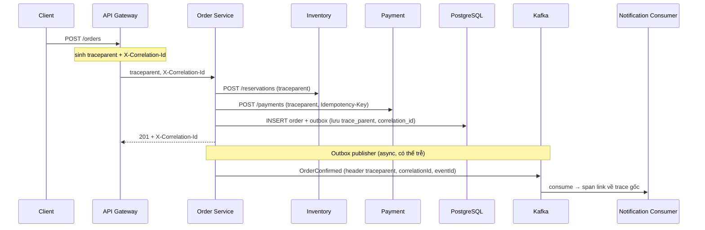

# Observability Design — Order Service

> Phạm vi: `order-service` (Spring Boot 3.2, Java 17, Spring MVC, JPA/PostgreSQL, Kafka + Outbox, Resilience4j).
> Luồng chính: `Client → API Gateway → Order Service → Inventory / Payment / PostgreSQL / Kafka`.

## 0. Logs vs Metrics vs Traces

| Trụ cột | Trả lời câu hỏi | Dùng khi | Ví dụ trong Order Service |
|---|---|---|---|
| **Metrics** | Hệ thống có **bất thường** không? Xu hướng ra sao? | Dashboard, alert, so sánh trước/sau deploy | `p95 POST /orders` 300ms → 1.8s, `checkout_failed_total` tăng |
| **Traces** | Một request **đi qua đâu**, chậm/lỗi ở **bước nào**? | Khoanh vùng service/dependency | Span `inventory.reserve` 3.0s trong trace 1.9s… |
| **Logs** | **Chính xác** chuyện gì đã xảy ra với request này? | Root cause chi tiết, audit | `PAYMENT_STATUS_UNKNOWN orderId=ORD-123 traceId=a8f3…` |

Quy trình điều tra: **Metrics (phát hiện) → Traces (khoanh vùng) → Logs (chi tiết)**. Ba trụ cột được nối với nhau bằng `traceId` (log có `traceId`, metric có *exemplar* trỏ tới `traceId`).

---

## 1. Logs

### Structured log fields

Log ở dạng JSON (production), mỗi dòng là một event:

| Field | Bắt buộc | Nguồn | Ghi chú |
|---|---|---|---|
| `timestamp` | ✅ | Logback | ISO-8601, UTC |
| `level` | ✅ | Logback | |
| `service` | ✅ | `spring.application.name` | `order-service` |
| `environment`, `version` | ✅ | env `APP_ENV`, `APP_VERSION` | So sánh trước/sau deploy |
| `traceId`, `spanId` | ✅ | Micrometer Tracing (MDC) | Nối log ↔ trace |
| `correlationId` | ✅ | `X-Correlation-Id` (CorrelationIdFilter) | ID nghiệp vụ end-to-end, kể cả qua Kafka |
| `orderId` | khi có | MDC | **Chỉ ở log/trace, không bao giờ là metric tag** |
| `tenantId` | khi có | MDC | |
| `event` | ✅ với log nghiệp vụ | code | Mã sự kiện cố định: `ORDER_CREATED`, `PAYMENT_STATUS_UNKNOWN`, `INVENTORY_TIMEOUT`, `OUTBOX_PUBLISH_FAILED` |
| `durationMs`, `errorCode`, `dependency` | khi có | code | |
| `logger`, `thread`, `stack_trace` | ✅ | Logback | |

Ví dụ:

```json
{
  "timestamp": "2026-10-20T20:07:12.123Z",
  "level": "ERROR",
  "service": "order-service",
  "environment": "prod",
  "version": "1.4.2",
  "traceId": "a8f37e9c5b1d4e20",
  "spanId": "1c2d3e4f",
  "correlationId": "c-7f1e9a",
  "orderId": "ORD-123",
  "tenantId": "tenant-01",
  "event": "PAYMENT_STATUS_UNKNOWN",
  "dependency": "payment-service",
  "durationMs": 2003,
  "message": "Payment response timed out after gateway request was accepted"
}
```

Nguyên tắc log level:

- `ERROR`: cần người xem (mất tiền, mất event, state không nhất quán).
- `WARN`: bất thường nhưng đã tự xử lý (retry thành công, fallback).
- `INFO`: event nghiệp vụ quan trọng (order created/confirmed/cancelled) — **không** log body request/response.
- `DEBUG`: tắt ở production, bật tạm theo logger qua `/actuator/loggers` khi điều tra.
- Traffic cao: sampling cho log lặp lại (ví dụ `INVENTORY_TIMEOUT` chỉ log 1/100 kèm counter metric đầy đủ).

### Sensitive data masking

**Không bao giờ log**: password, access token/JWT, `Authorization` header, số thẻ (PAN), CVV, full bank account, OTP, full payload payment.

Biện pháp:

1. **Allow-list thay vì deny-list**: chỉ log các field được chọn (`orderId`, `status`, `amount`), không `log.info("{}", request)`.
2. DTO nhạy cảm override `toString()` (hoặc Lombok `@ToString.Exclude`) để không lộ khi vô tình log.
3. Masking layer trong Logback (regex `MaskingPatternLayout` / `MaskingJsonGeneratorDecorator` của logstash-encoder) cho các pattern: `\b\d{13,19}\b` (PAN) → `****1234`, `Bearer\s+\S+` → `Bearer ***`, email → `a***@example.com`.
4. Gateway không log header `Authorization`, `Cookie`.
5. Review log trong code review + test tự động grep log output tìm pattern PAN/JWT.

### Correlation/trace ID strategy

| ID | Sinh ở đâu | Truyền thế nào | Mục đích |
|---|---|---|---|
| `traceId` / `spanId` | API Gateway (nếu request chưa có) | Header W3C `traceparent` (+ `tracestate`, `baggage`) — Micrometer Tracing + OpenTelemetry tự propagate qua `RestClient`/`WebClient`/`RestTemplate` build từ Spring builder và Kafka (observation enabled) | Trace kỹ thuật |
| `correlationId` | Gateway (`X-Correlation-Id`), nếu client gửi thì validate & giữ | HTTP header `X-Correlation-Id`; Kafka header `correlationId`; lưu vào cột `outbox.correlation_id` | Nối hành trình nghiệp vụ kể cả khi trace bị đứt (async, outbox, retry sau vài phút, sampling bỏ trace) |
| `orderId` | Order Service | Log MDC, span attribute (`order.id`), event payload | Tra cứu theo complaint khách hàng |

Quy tắc:

- Gateway **luôn** trả `X-Correlation-Id` và `traceparent` trong response → Customer Support có ID để báo lỗi.
- **Outbox**: khi ghi outbox lưu `trace_parent` + `correlation_id`; publisher đặt lại vào Kafka header ⇒ consumer tiếp tục trace (span link) dù publish trễ.
- Consumer đưa `correlationId`, `eventId`, `orderId` vào MDC trước khi xử lý, xoá MDC sau khi xong (tránh rò rỉ giữa thread).
- Thread pool / `@Async` dùng `ContextPropagatingTaskDecorator` để không mất context.

---

## 2. Metrics

Tất cả metric có **common tags**: `application`, `environment`, `version` (+ `instance`, `pod` do Prometheus gắn). Chi tiết custom metric: [custom-metrics.md](custom-metrics.md).

### HTTP metrics (RED)

| Metric (Prometheus) | Mục đích |
|---|---|
| `http_server_requests_seconds_count{uri,method,status,outcome}` | Rate, error rate, status distribution |
| `http_server_requests_seconds_bucket` | p50/p95/p99 bằng `histogram_quantile` (bật `percentiles-histogram`) |
| `http_server_requests_active_seconds_active_count` | In-flight requests |
| `http_client_requests_seconds_*{client_name, uri, status}` | Latency/error **gọi ra** Inventory & Payment |
| `tomcat_threads_busy_threads` / `tomcat_threads_config_max_threads` | Saturation thread pool web |

SLO: `POST /orders` p95 < 800ms, p99 < 2s, 5xx < 1%, checkout success > 99%; `GET /orders/{id}` p95 < 300ms.

### JVM metrics

| Metric | Dấu hiệu cần điều tra |
|---|---|
| `jvm_memory_used_bytes{area="heap"}` / `jvm_memory_max_bytes` | Tăng liên tục, không giảm sau GC |
| `jvm_gc_live_data_size_bytes` (heap after GC) | Tăng dần → leak / cache unbounded |
| `jvm_gc_pause_seconds_*` | p99 API tăng cùng thời điểm GC pause |
| `jvm_gc_memory_allocated_bytes_total` | Allocation rate cao → GC pressure |
| `jvm_threads_live_threads`, `jvm_threads_states_threads{state}` | BLOCKED/WAITING tăng → chờ I/O/lock |
| `process_cpu_usage`, `system_cpu_usage` | Saturation CPU |
| `process_uptime_seconds`, `kube_pod_container_status_restarts_total` | Restart/OOMKill |

### Database metrics

| Metric | Nguồn | Dấu hiệu nguy hiểm |
|---|---|---|
| `hikaricp_connections_active` / `hikaricp_connections_max` | Micrometer Hikari | Gần max pool |
| `hikaricp_connections_pending` | Micrometer Hikari | > 0 kéo dài → pool exhaustion |
| `hikaricp_connections_acquire_seconds` | Micrometer Hikari | Thời gian chờ connection tăng |
| `hikaricp_connections_timeout_total` | Micrometer Hikari | Request fail vì không lấy được connection |
| `spring_data_repository_invocations_seconds` | Spring Data | Query/repository chậm |
| DB CPU, I/O wait, slow query, lock wait, deadlock | `postgres_exporter` (`pg_stat_activity`, `pg_locks`, `pg_stat_statements`) | Lock / index / N+1 |

### Kafka/outbox/DLQ metrics

| Metric | Nguồn |
|---|---|
| `kafka_consumergroup_lag{consumergroup,topic,partition}` | kafka-exporter (hoặc `kafka_consumer_fetch_manager_records_lag_max` từ client) |
| `spring_kafka_listener_seconds_count{result}` | Spring Kafka observation — throughput & error rate |
| `spring_kafka_template_seconds_*` | Latency publish |
| `outbox_pending_events` (Gauge) | Custom |
| `outbox_oldest_pending_age_seconds` (Gauge) | Custom |
| `outbox_publish_total{result}` | Custom |
| `event_consumer_retry_total{topic}` | Custom |
| `event_dlq_total{topic, reason}` | Custom (`reason` là enum nhỏ) |
| `event_duplicate_detected_total{topic}` | Custom |

### Circuit breaker metrics

| Metric (Resilience4j Micrometer) | Ý nghĩa |
|---|---|
| `resilience4j_circuitbreaker_state{name,state}` | 1 = đang ở state đó (closed/open/half_open) |
| `resilience4j_circuitbreaker_calls_seconds_count{kind}` | `successful`, `failed`, `ignored` |
| `resilience4j_circuitbreaker_slow_calls` / `slow_call_rate` | Dependency chậm |
| `resilience4j_circuitbreaker_not_permitted_calls_total` | Request bị CB từ chối |
| `resilience4j_retry_calls_total{kind}` | `successful_with_retry`, `failed_with_retry`, … → retry storm |
| `resilience4j_bulkhead_available_concurrent_calls` | Resource còn lại |
| `resilience4j_timelimiter_calls_total{kind="timeout"}` | Timeout count |
| `checkout_fallback_total{dependency}` | Custom — mức degrade |

### Business metrics

| Metric | Loại |
|---|---|
| `checkout_success_total` | Counter |
| `checkout_failed_total{reason}` | Counter (`reason`: `INVENTORY_UNAVAILABLE`, `OUT_OF_STOCK`, `PAYMENT_DECLINED`, `PAYMENT_TIMEOUT`, `VALIDATION`, `INTERNAL`) |
| `checkout_duration_seconds` | Timer |
| `payment_status_unknown_total` | Counter |
| `order_stuck_processing` | Gauge — số order ở `PAYMENT_PROCESSING` quá 5 phút |
| `payment_success_order_pending` | Gauge — đã charge nhưng order chưa CONFIRMED (từ reconciliation job) |
| `payment_duplicate_prevented_total` | Counter (idempotency key hit) |
| `inventory_reservation_failed_total{reason}` | Counter |

**Không** dùng `userId`, `orderId`, `email`, `productId`, `traceId` làm tag.

---

## 3. Traces

### Trace propagation flow



### Sampling policy

| Môi trường | Policy |
|---|---|
| local/dev | 100% (`probability: 1.0`) |
| staging / load test | 100% hoặc 50% |
| production | **Head sampling 10%** ở Gateway (parent-based — service con tôn trọng quyết định của parent) |
| production (nâng cao) | **Tail sampling** ở OpenTelemetry Collector: giữ 100% trace có error, trace > 1s, trace của `POST /orders`/payment; còn lại 5–10% |

Lý do: trace 100% ở flash sale tăng chi phí storage và overhead network; tail sampling giữ lại đúng các trace cần điều tra. Trace bị sample-out vẫn tra được bằng `correlationId` trong log.

### Important spans

| Span | Attributes (low-cardinality ở tên, chi tiết ở attribute) |
|---|---|
| `http POST /orders` (server) | `http.route`, `http.status_code`, `order.id` |
| `checkout` (custom observation) | `checkout.result`, `failure.reason` |
| `inventory.reserve` (http client) | `peer.service=inventory-service`, retry attempt |
| `payment.charge` (http client) | `peer.service=payment-service`, `payment.idempotency_key` |
| `resilience4j` CB/retry events | span event `retry.attempt=2`, `circuitbreaker.state=OPEN` |
| JDBC `INSERT orders` / `INSERT outbox` | `db.system=postgresql` (qua datasource-micrometer nếu cần) |
| `outbox.publish` | `messaging.destination=order-events`, `outbox.age_ms` |
| `kafka send` / `kafka receive` | `messaging.kafka.consumer.group`, `event.id` |

---

## 4. Dashboard

Chi tiết panel + PromQL: [dashboard-design.md](dashboard-design.md).

### Business dashboard
Checkout success rate, payment success rate, payment-success-but-order-pending, inventory reservation failure rate, orders stuck `PAYMENT_PROCESSING`, duplicate payment prevented, order volume/revenue theo phút.

### API dashboard
Request rate theo route, p50/p95/p99, 4xx/5xx, in-flight, rate-limit rejected (Gateway), CB state, retry/fallback, JVM heap/GC/thread, Tomcat busy threads, Hikari active/pending.

### Event-processing dashboard
Consumer lag theo group, throughput, retry, DLQ, outbox pending, oldest outbox age, processing latency, duplicate detected.

### Dependency dashboard
Inventory & Payment latency/error (client-side), DB latency/connections/lock wait, Kafka broker health, cache hit/eviction.

---

## 5. Alerts

Chi tiết + PromQL + runbook: [alert-runbook.md](alert-runbook.md).

| Alert | Alert condition | Severity | First-response runbook | Owner |
|---|---|---|---|---|
| CheckoutReliabilityDegraded | success rate < 99% trong 5 phút (và volume > ngưỡng) | Critical | Xem Business → API dashboard, lọc trace lỗi `POST /orders`, xác định dependency | Order team (on-call) |
| CheckoutLatencyHigh | p95 `POST /orders` > 800ms trong 10 phút | Warning (Critical nếu > 2s) | Xem client latency Inventory/Payment, Hikari pending, CB state | Order team |
| PaymentOrderMismatch | `payment_success_order_pending` > 0 trong 5 phút | Critical | Dừng retry không an toàn, chạy reconciliation, kiểm tra outbox | Order + Payment team |
| OutboxBacklog | oldest pending outbox > 5 phút | Critical | Kiểm tra publisher, Kafka producer error, broker | Order team |
| KafkaConsumerLagGrowing | lag tăng liên tục 10 phút | Warning | So sánh throughput vs produce rate, error/retry, scale consumer | Team sở hữu consumer |
| CriticalEventInDLQ | DLQ payment/order > 0 | Critical | Triage message, **không replay mù quáng** | Team sở hữu consumer |
| DbPoolExhaustion | Hikari pending > 0 trong 5 phút | Warning | Slow query, lock, transaction dài, pool config | Order team + DBA |
| InventoryCircuitOpen | CB inventory OPEN > 2 phút | Warning → Critical nếu checkout fail | Kiểm tra Inventory, đánh giá impact checkout | Order team, notify Inventory team |

---

## 6. Performance risks

### Top 3 likely bottlenecks

| # | Bottleneck | Vì sao có khả năng xảy ra (flash sale) |
|---|---|---|
| 1 | **Inventory dependency chậm + retry khuếch đại** | Hot SKU → lock row trong Inventory DB; Order retry 3 lần → traffic tới Inventory tăng; thread Tomcat bị giữ lâu |
| 2 | **DB connection pool / lock contention ở Order DB** | Pool 20 connection; transaction ôm cả HTTP call ra ngoài (`@Transactional` bọc gọi Payment) giữ connection hàng giây; outbox poll + insert cùng bảng |
| 3 | **Outbox publisher / Kafka consumer không theo kịp** | Publisher đơn luồng, poll batch nhỏ; consumer ít partition/instance; event OrderConfirmed trễ → “đã trừ tiền nhưng Pending” |

### Evidence needed

| Bottleneck | Evidence |
|---|---|
| 1 | `http_client_requests_seconds` p99 theo `client_name=inventory` tăng; `resilience4j_retry_calls_total` tăng; trace có span `inventory.reserve` 3s lặp 2–3 lần; `tomcat_threads_busy` gần max; thread dump nhiều thread WAITING ở socket read |
| 2 | `hikaricp_connections_pending > 0`, `acquire_seconds` p99 tăng; `pg_locks` wait; `pg_stat_statements` top query; trace có khoảng trống giữa span DB và HTTP trong 1 transaction |
| 3 | `outbox_oldest_pending_age_seconds` tăng, `outbox_publish_total{result="failed"}`; `kafka_consumergroup_lag` tăng; `spring_kafka_listener` error |

### Mitigation

| Bottleneck | Ngắn hạn | Dài hạn |
|---|---|---|
| 1 | Giảm timeout Inventory (≤ 1s), giảm retry (tối đa 1 retry có jitter), CB fail fast, rate limit checkout ở Gateway | Bulkhead riêng cho Inventory, retry budget, reservation async/hot-SKU strategy (Redis atomic counter / pre-allocated stock) |
| 2 | Kill query chặn, tạm tăng pool có kiểm soát (không vượt `max_connections` DB / số pod) | Không gọi HTTP trong transaction, index, batch, read replica cho GET |
| 3 | Scale publisher/consumer, tăng batch size | Partition theo `orderId`, nhiều publisher với `SELECT … FOR UPDATE SKIP LOCKED`, CDC (Debezium) |

### Performance anti-patterns & cách phát hiện

| Anti-pattern | Cách phát hiện |
|---|---|
| Retry không giới hạn / không jitter (retry storm) | `retry_calls_total` tăng nhanh hơn request rate; request rate tới downstream > inbound × 1 |
| Không có timeout / timeout dài hơn SLO | Thread WAITING tăng, p99 = đúng bằng giá trị timeout mặc định (30s/60s) |
| HTTP call bên trong `@Transactional` | Hikari active cao trong khi DB CPU thấp; trace thấy connection giữ suốt span HTTP |
| N+1 query | Số span JDBC trên mỗi request tăng theo số item; `pg_stat_statements` calls rất lớn |
| `.block()` trong WebFlux | Thread `reactor-http-nio` BLOCKED trong thread dump; BlockHound fail ở test |
| Log body mọi request | Log volume/GB tăng theo traffic, I/O wait; tìm `Request body:` trong log |
| High-cardinality metric tag | Số time series Prometheus tăng vọt (`prometheus_tsdb_head_series`), scrape chậm |
| Cache unbounded | `jvm_gc_live_data_size_bytes` tăng dần qua ngày, cuối cùng OOMKill |
| Dùng chung thread pool cho read & write path | `GET /orders` p95 tăng cùng lúc `POST /orders` chậm dù GET không gọi downstream |

